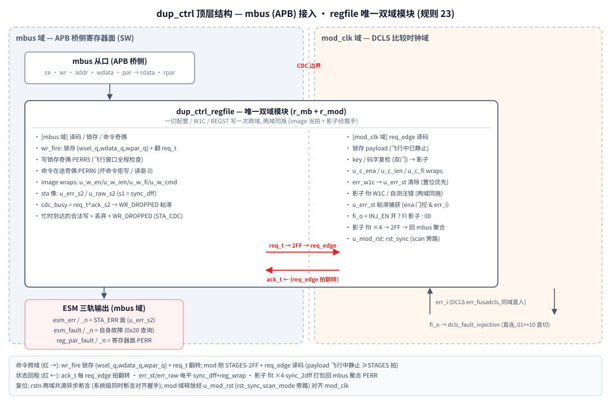

# 10.dup_ctrl — DCLS 控制器设计规格

> 版本: v3.0 (2026-11-08) · 状态: RTL v3 (双域 regfile: 全 CDC 收编 + reg_wrap 两域化 + req_edge 命令握手)
> 上游: `4.fusa_ips[资料]/1.duplication` (dcls_auto.py 生成物)
> 方法模板: `3.ia_bus_timeout/rtl/ia_bus_timeo_regfile.sv` (用户钦定, 同构先例
> `2.parity/rtl/edc_regfile.sv`; 规格全文 = fusa 根 `.claude/skills/rtl-coding-style/SKILL.md` 规则 23)
> 风格: 全仓统一 rtl-coding-style (GRLIB two-process / logic / 例化对齐 / 公共单元单一源)
>
> v3 相对 v2 的架构变更 (用户钦定, 统一跨域寄存器面标准):
> 1. **regfile 双域化**: 全部 CDC / 寄存器 / err 粘滞捕获收编进
>    `dup_ctrl_regfile` (mbus + mod_clk 两域), top 只剩端口壳。
> 2. **mod 域 reg_wrap 化**: 配置影子 (ena/ien/fi) + err 粘滞捕获全部为本域
>    reg_wrap (存储+偶校验+selftest 注错+自有 flt) —— v2 捕获单元 Q/Q_n
>    双副本撤销 (edc_top 同款论证: sticky 在 reg_wrap 内已双副本自愈)。
> 3. **cmd 跨域 = ia 方法**: {wsel, wdata} 锁存 + req_t toggle + req_edge 译码,
>    一切配置/W1C/REGST 写一次跨域、两域同施 (image 当拍 + 影子经握手);
>    v2 的裸准静态同步 (en_on/fi/sta_w1c 三条 sync_2dff) 全部废除。
> 4. **在途保护 + 忙丢显性化**: 写锁存奇偶 PERR5 + 命令奇偶 PERR6;
>    忙时到达的写丢弃 + `STA_CDC` (CFG_BUSY/WR_DROPPED) 可见 (v2 静默丢失)。
> 5. v2 的 FI 00 中转协议不再必须 (握手原子交付 2bit payload)。

---

## 1. 背景与动机

`dcls_auto.py` 对功能 RTL 生成 DCLS 顶层(func/shadow 复制 + 延迟对齐 + 比较器),
demo 实测暴露两个交付缺口:

1. **err 非 sticky**: `err_fusadcls_<mod>` 是比较器 err 的打拍**电平**,
   失配消失后 err 跟着回 0。瞬时失配软件可能永远读不到 —— 必须在 err 的
   **源时钟域**(mod_clk)逐功能拍捕获并粘滞, 由软件 W1C 清除(经命令跨域),
   状态同步到 mbus 寄存器面。
2. **FI 无控制**: `dcls_fault_injection[1:0]` 是裸端口, 在线自检(注错)无法由
   软件发起/禁止 —— 需要寄存器化 + 双保险门控 (4bit 编码使能 + 写 key),
   模式值落 mod 域影子后直连比较器 (v3: 影子本身在 mod 域, 无需再同步)。

v3 在补齐上述两点的同时, 把寄存器面统一到全仓跨域标准 (规则 23):
regfile 是唯一双域模块, 每个寄存器都是所在域的 reg_wrap, 命令经握手跨域。

## 2. 顶层结构

*图 1: 顶层结构 — mbus (APB) 接入, regfile 唯一双域模块 (规则 23)*

- `dup_ctrl_top` — 端口壳: 仅例化 `u_dup_ctrl_regfile`, `scan_mode` 透传
  (规则 19; v2 内部 tie 0 属违规)。
- `dup_ctrl_regfile` — 唯一双域模块: mbus 域 (r_mb + image wraps + sta 像) /
  mod 域 (r_mod.ack_t + 影子 wraps + 粘滞捕获)。参数 `IDX` / `ERR_SYNC_STAGE`
  (2|3, 默认 3, 全部同步链统一)。
- 复位: `rstn` 异步断言两域共源 (系统级约束: 同时断言以对齐握手, 同 ia);
  mod 域释放经 `u_mod_rst`(rst_sync, scan_mode 旁路)对齐 mod_clk。

## 3. 寄存器地图 (mbus, 32bit)

addr[15:8] = IDX(实例号), addr[7:0] = 偏移; `par` = `^{addr,wr,wdata}` 命令在途偶校验。
**一次合法写两域同施**: mbus image 当拍落地, mod 影子经握手 (~2×STAGES+2 拍两域);
忙时到达的合法写被丢弃 (WR_DROPPED 置位, 两域都不动)。

| 偏移 | 名称 | 属性 | 复位 | 说明 |
|---|---|---|---|---|
| 0x00 | CFG_EN | RW | `0xF` | [3:0] 监测使能, 4bit 编码(1111/0000)。非法码整写拒绝(mbus+mod 双门); 1bit 错纠回并**写回 image**(影子不纠正, 下次配置写重载即愈); 2bit 平局默认**开**(fail-visible)。门控在 mod 域影子解码处生效; STA_RAW 读出永不受门控 |
| 0x04 | CFG_INJ_EN | RW+key | `0x0` | [3:0] 注错(FI)使能, 4bit 编码, 平局默认**关**(fail-safe)。写需 [7:4]=`4'b1010`, 否则整写忽略 (两域双门复检) |
| 0x08 | CFG_FI | RW | `0x0` | [1:0] FI 模式(00/01/10)。存储面自由写; **输出** `fi_o = INJ_EN 解码开 ? FI 影子 : 00`(mod 域组合, 影子已在 mod 域无需再同步; 握手原子交付 2bit, **01↔10 直切允许**) |
| 0x0C | STA_CDC | RW1C/RO | `0x0` | **v3 新增** 命令握手状态: [0] CFG_BUSY(RO) 跨域命令在途; [1] WR_DROPPED(W1C) 忙时到达的合法写被丢弃(粘滞)。SW 契约: 依赖性写前 poll [0] 到 0 |
| 0x10 | STA_ERR | W1C/RO | `0x0` | [0] DCLS err 粘滞 = mod 域 `u_err_st` 的同步像(RO)。写 1 = mod 域清除事件(经握手); **置位优先于清除**(源在线清不掉); 撤源后 W1C 经跨域往返生效, 软件 poll 读到 0。**v3: 与 STA_PAR bit5(PERR3 W1C) 不再等价** —— PERR 位只清奇偶粘滞, 状态值由本寄存器清 |
| 0x14 | STA_RAW | RO | `0x0` | [0] err 当前电平同步像(区分"正在报"与"报过已粘滞")。诊断面, **允许漏拍** —— 保证捕获在 u_err_st |
| 0x18 | STA_PAR | RW1C/RO | 静息读 `0x2` | house 标准布局: [0] PAR_FAULT 电平(**寄存器面**各组 flt 或 + 自测锁存; 在途事件 PERR5/PERR6 本体与 WR_DROPPED 不在此电平, 走 esm_fault 轨), 写 1 只清自测锁存; [1] PAR_FAULT_N 反轨(RO); [8:2] PERR6..PERR0(W1C, bit=2+组号, 清对应组两域粘滞) |
| 0x1C | CFG_REGST | W+key | — | [3:0] key=`1010`; [4] REG_SELFTEST 脉冲(对 [11:8] REGSEL 组 0/1/2 注 image+shadow 两域 / 组 3 注 image+sticky / 组 4 注 image / 组 6 注 cmd wrap; 组 5 无目标忽略; >6 忽略); [5] PAR_SELFTEST 脉冲(只置自测锁存); [6] FLT_SELFTEST 脉冲(置 STA_FAULT[31] 自测位, keyed 源级注入)。读回 0 |
| 0x20 | STA_FAULT | RW1C/RO | `0x0` | **2026-11-13 三轨统一新增** 监视器自身故障源查询面(esm_fault 之源): [0] CMD_PAR(RO, PERR6 命令在途奇偶粘滞, W1C 在 STA_PAR[8]) / [1] WLT_PAR(RO, PERR5 在途写锁存 lane, W1C 在 STA_PAR[7]) / [2] WR_DROP(RO, W1C 在 STA_CDC[1]) / [31] FLT_TEST(RW1C, CFG_REGST[6] 自测位) |
| 0xFC | ID | RO | `5AFE_2002\|IDX` | 实例识别 (v3: 双域 regfile 改版标识; v2=2001, v1=2000) |

PERR 组号 ↔ STA_PAR bit = 2+组号 (image+shadow 同组):
**0** CFG_EN / **1** CFG_INJ_EN / **2** CFG_FI / **3** STA_ERR(image+mod 粘滞)/
**4** STA_RAW(仅 image, mod 域无存储)/ **5** 在途写锁存奇偶(Q/Q_n lane,
飞行窗口内 mbus 域检查, 无注错目标, REGSEL=5 忽略)/ **6** 命令在途奇偶
(W=1 wrap, W1C 即重写重算)。**在途事件本体 (PERR5 lane / PERR6 粘滞)
与 WR_DROPPED 为监视器自身故障, 聚合走 esm_fault 轨** (查询面 STA_FAULT
0x20, 2026-11-13 三轨统一)。

## 4. CDC 策略 (v3: 全部收编在 regfile 内)

| 通路 | 方向 | 策略 |
|---|---|---|
| cmd (一切写) | mbus → mod | **ia 握手**: wr_fire 拍锁存 `{wsel_q, wdata_q, wpar_q}`(锁存后飞行窗口内静止 —— busy 门控阻止下一次 wr_fire) + 翻转 req_t; mod 侧 STAGES 2FF + 边沿检出 → req_edge 译码锁存 payload(已静止 ≥STAGES 拍, 无亚稳/无需再打拍); 每个 req_edge 都翻转 ack_t 应答(含无操作译码); ack 回 STAGES 2FF → `cdc_busy = req_t != ack_s2`。**忙时到达的合法写 = 丢弃 + WR_DROPPED**(mbus 零等待不停等) |
| err_i | mod 域 → u_err_st | **同域直入**(生成物已打拍), 捕获与 err 同拍 —— 每个功能拍失配必被粘滞(单拍即捕获, v1 "≥2 拍可观测宽度"约束作废) |
| err_st / err_raw | mod → mbus | 电平, sync_dff 首级(s1) + reg_wrap 第二级(s2 = 寄存器面本身, ia 方法); STA_ERR/esm_err 与 STA_RAW 各一条 |
| 影子 flt ×4 | mod → mbus | 电平, `u_flt_sync`(sync_2dff WIDTH=4)打包回同步 → PERR 组 0/1/2/3 的 mod 侧 |
| mod 复位 | — | rst_sync(异步断言/2FF 释放对齐 mod_clk, scan_mode 旁路透传到 top) |

**SW 契约**: (a) 依赖性配置/W1C 写前 poll `STA_CDC[0]` CFG_BUSY 到 0
(TB 的 mbus_wr 已内建), 或按跨域往返间隔 (~2×STAGES+2 拍两域)隔开写;
(b) mod_clk 停摆期间一切配置/W1C 写被丢弃(busy=1 可见, v2 隐性约束显性化);
(c) W1C 语义: 置位优先, 源在线清不掉, 撤源后写一次即可(poll 读到 0)。

esm_err / esm_fault / reg_par_fault 三对双轨为 mbus 域输出 (2026-11-13 规则 25), 与 int_prot 同按 ESM 侧约定消费。

## 5. 加固规格

1. **4bit 编码使能**(规则11): CFG_EN/CFG_INJ_EN 均 d=4 码(纠1检2), 最近邻纠
   1bit 并**写回 image**(功能自愈; 影子不纠正, 下次配置写经命令重载即愈);
   平局方向: 监测=开(fail-visible)/注错=关(fail-safe); 注错使能写带 key。
   **双门**: mbus image 与 mod 影子各自复检 key/码字 —— 在途被扰的非法值
   进不了影子(PERR5 已在 mbus 报)。
2. **寄存器奇偶**(规则10/14, reg_wrap × 11): image 4(u_w_en/u_w_ien/u_w_fi/
   u_w_cmd) + sta 像 2(u_err_s2/u_raw_s2) + mod 影子 4(u_c_ena/u_c_ien/u_c_fi/
   u_err_st) + 命令 1。存储+偶校验+selftest_key 注错(注错只翻 parity, 数据
   不动; **治愈 = 重写该寄存器**)+flt 粘滞(双副本 SEU 自愈, W1C CPU 优先)。
   W1C/REGST 解码随同一命令跨域 —— 两域 flt 同施同清, 不失同步。
3. **err 粘滞捕获**(规则12 承接): u_err_st 跟随型 wrap,
   `err_nxt = (err_w1c ? 0 : err_st) | (ena 解码开 && err_i)` —— 置位优先、
   单 mod 拍捕获无漏拍。存储被扰: data 位被扰成 1 → 保守粘滞(跟随保持),
   W1C 可清; 被扰成 0 → 已锁事件丢失但 PERR3 已报 —— fail-visible。
   v2 的 Q/Q_n 捕获单元撤销(sticky 在 reg_wrap 内已双副本自愈)。
4. **在途写锁存奇偶**(PERR5): `{wsel_q,wdata_q}` 自锁存起的飞行窗口内全程
   mbus 域检查 `(^wsel_q)^(^wdata_q) != wpar_q` —— 错误 key/码字/掩码被送进
   mod 域之前即报; Q/Q_n 锁存 lane, 无注错目标, W1C。
5. **命令在途奇偶**(PERR6): ce 拍重组比对 par, 失配 = APB→mbus 通路在途
   损坏。fail-safe: 坏命令**写不落任何寄存器**(含不翻 req_t), **读驱 0**,
   W=1 wrap 粘滞可 W1C(W1C 即重写重算)。
6. **ESM 三轨**(规则13+25): `esm_err/_n`(DCLS 检错 = 监控职责错误,
   STA_ERR 寄存器面)、`esm_fault/_n`(监视器自身故障 = 在途命令奇偶
   PERR6 | 在途写锁存奇偶 PERR5 | 忙丢 WR_DROPPED | FLT_TEST 自测位,
   查询面 STA_FAULT 0x20)、`reg_par_fault/_n`(寄存器面奇偶 = 存储
   wrap flt 或 + 自测锁存, **不含在途事件**), 三对互补双轨。
7. **PAR_SELFTEST 锁存**: Q/Q_n 反相副本逐拍比较, 失配自愈回 SET, W1C 走
   STA_PAR bit0。用途: ESM 服务程序自检签名("有 fault 无源" = 锁存通路完好)。
8. **FLT_SELFTEST 锁存**(2026-11-13): keyed CFG_REGST[6] 置 STA_FAULT[31]
   自测位(Q/Q_n 副本自愈同上, W1C 走 STA_FAULT bit31) —— **源级注入**
   出 esm_fault 轨, fault 轨周期连通性自测(err 轨由 FI/DCLS 检错覆盖,
   par 轨由 PAR_SELFTEST 覆盖)。

## 6. 与 dcls_auto 生成物的集成约束

| 本模块端口 | 生成物(test_dcls.v)侧 | 约束 |
|---|---|---|
| mod_clk | 该 wrapper 的比较时钟(DCLS 主时钟) | 单 wrapper 单比较时钟; 捕获/命令生效均需该时钟在跑(停摆 = 写被丢, busy 可见) |
| err_i | `err_fusadcls_<mod>`(1 路) | **单 dup wrapper 专用**; 多 wrapper = 多个 dup_ctrl 实例各接 1 路 |
| rstn | DCLS 复位(异步低) | 两域共源复位, 系统级须同时断言(对齐握手) |
| scan_mode | DFT | 透传 rst_sync 旁路(v3 新增端口, 规则 19) |
| fi_o[1:0] | `dcls_fault_injection[1:0]` | **直连**(v3: 影子在 mod 域, 本模块不再同步, 对端也不必); 01↔10 直切允许 |
| — | `icg_mode` / scan 类 | 不入寄存器, 集成者接 DFT 信号或 tie 0 |
| — | `<mclk>_dcls_gate` 等 | 生成物内部时钟门控, 本模块不触碰 |

注: dcls_auto 生成物为多时钟 DCLS IP 时, err 通道应按"每比较时钟域一组"聚合
(生成物强制单一主比较时钟); 跨域异步 err 的对齐不在本模块职责内。

## 7. 验证计划 (tb_dup_ctrl, T1–T18)

双时钟: mbus #21 (~23.8MHz) + mod_clk #13 (~38.5MHz, 非整数比相位渐变,
功能快于总线 = 漏拍压力场景)。所有写经 mbus_wr(内建 poll CFG_BUSY),
跨域生效经 wait_cmd(往返)等待。

| # | 内容 | 关键点 |
|---|---|---|
| T1 | 复位默认值 + ID(2002) + 双轨全 0 | 含 STA_CDC=0 / STA_PAR=0x2 静息基值 |
| T2 | CFG_EN 编码切换 | 1111→0000→1111, image 读写回即时 |
| T3 | 拒写三连(双门) | 非法 nibble / 无 key / key+非法 —— image 不动, 影子复检同拒 |
| T4 | err 电平→捕获→RAW+STA | mod 域驱动 (negedge+#3) |
| T5 | **sticky 核心** | 源撤销 RAW 回 0, STA/esm 保持; 离线 W1C 经握手往返清 0 |
| T6 | W1C 语义 | 在线清不掉(置位优先); 撤源后清; 空闲重复 W1C 无害 |
| T7 | EN 门控 | 影子经握手生效(写后往返延迟); 关时只 RAW 不粘滞; 重开恢复 |
| T8 | FI 三重门 | INJ_EN 关时 FI 可写读但 fi_o=0; 开后 fi_o 跟随影子; **01→10 直切**(原子交付); 复关 fi_o=0 且存储不变 |
| T9 | ESM 三轨电平 | 全程互补监视(run_check) + 显式电平查 |
| T10 | REGST 逐组 0–6 | 注错(两域)→PERR→治愈(重写/自愈)→W1C; REGSEL=5 无目标忽略, >6 忽略 |
| T11 | PAR_SELFTEST | 锁存("有 fault 无源")→bit0 W1C |
| T12 | 命令在途坏 par | PERR6: 拒写+读 0+W1C (在途事件走 esm_fault 轨, STA_FAULT[0] CMD_PAR 镜像可查; 与 T16(d) PERR5 / T17 WR_DROPPED 同为监视器自身故障源) |
| T13 | 静默类 | 未映射/错实例/写 ID/写 RAW/写 STA_CDC bit0(RO)/写 STA=0 |
| T14 | 复位清除 + scan 旁路 | err 在线+已粘滞时复位全默认; **scan_mode 断言/释放即时透传(P0)**; 释放后握手对齐 |
| T15 | **单功能拍捕获** (头条) | err 单个 mod_clk 拍 → STA_ERR 必粘滞; **PERR3 W1C 不清 STA_ERR**(v3 语义分离), STA bit0 才清 |
| T16 | 存储扰动 (force SEU) | (a) u_err_st par 位翻→PERR3 值不动 (b) data 位扰 0→1→保守粘滞+PERR3 (c) u_c_fi 影子扰→PERR2 持续到重写 (d) wpar_q 扰(PERR5 飞行窗口; STA_FAULT[1] WLT_PAR 镜像 + esm_fault 轨) |
| T17 | **CDC 忙丢** (v3 新增) | 往返内第二写被丢弃: image 不落地 + WR_DROPPED 粘滞(→ esm_fault 轨); poll busy→0 后 W1C 清; 恢复写被接受 |
| T18 | **FLT_SELFTEST** (2026-11-13) | keyed 源级注入: 无 key 忽略 / STA_FAULT[31] + esm_fault 轨(STA_PAR 不含测试位) / W1C bit31 清 |

运行: VM rocky-eda `~/work`, `bash sim/run_vcs.sh`(自检 grep TB PASS/FAIL,
SVA/$display 不进退出码)。当前状态: **T1–T18 全绿, 125 checks**
(2026-11-13 三轨统一改版后复绿; TOGGLE 原始值未做结构常量排除, 排除战役另行)。
