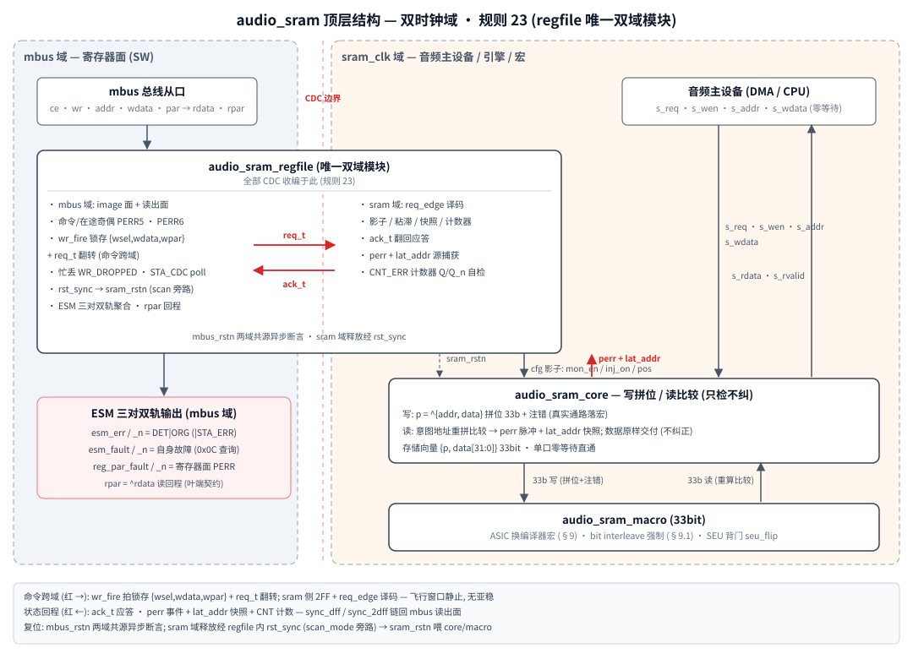

# 11.audio_sram — 32bit 音频 SRAM 奇偶 (parity) 包封设计规格

> 版本: v3.1 (2026-11-10) · 状态: RTL parity 版 (T0–T18 全绿, 157 checks)
> 定位: 音频子系统共享 SRAM 的 FuSa 数据面加固 —— 每次访问都是整 32bit 字
> (无 partial), 在 RAM 接口处做奇偶拼位 (写) 与重算比较 (读)。
> v3 变更 (用户钦定 "简单点, 不做 ECC 只做 parity"): 检错码从 (39,32)
> SECDED 换为 (33,32) 单校验位 —— **只检不纠**, 检出即告警, 数据原样
> 交付; 宏 39b→33b (32+1 标准编译器字宽); 寄存器地图 v3 改版 (单注错
> 通道 / STA_ERR 2bit / 单计数器 / STA_LAT 弃 SYN / ID=5AFE_A002);
> 规则 23 双域 regfile 架构不变。v2 SECDED 版退役 (git 历史)。
> v3.1 变更 (用户钦定 "把地址加进去做计算"): **写地址折入校验位**
> `p = ^{addr, data}` —— 零存储/零周期新增读侧错行检出 (§3/§4)。
> 风格: 全仓统一 rtl-coding-style (GRLIB two-process / logic / 例化对齐 /
> 公共单元单一源)。

---

## 1. 背景与需求

音频 SRAM 32bit 宽, 主设备 (音频 DMA / CPU) 只做整字访问:

- 写侧无需读改写 (RMW), 整字直接 `p = ^data` 拼位落宏;
- 读侧把宏读出的数据**重算奇偶并与存储校验位比较**, 失配即上报
  (perr) —— **不纠正**, 交付数据恒为宏原始读数 (raw delivery,
  标记坏而不再生);
- 上电/复位后未初始化地址不得产生伪事件 (行为宏上电内容为全 0,
  是合法奇偶码字; 真实宏上电随机 → 初始化契约升级为**强制**, §9.1)。

**为何 parity 可行 (v3 论证结论)**:

1. **纠正在 v2 里只是可用性收益** —— SECDED 的纠正交付在安全面与
   parity 的 "检出+原始交付" 等价 (都 fail-visible), 差别仅在送出的
   数据是否再生。音频数据短生命周期 (缓冲整块刷新), 可用性损失由
   重写自愈兜底;
2. 检出面: 单比特 (数据位/校验位) 100% 检出, 与 SECDED 同覆盖;
   唯一实质损失是**同字双比特静默** (DC=0) —— 强制 bit interleave
   (§9.1, 从 v2 硬性推荐升级为不可妥协项) 把物理 MBU 摊到多字,
   每字至多 1bit → 均可检出;
3. 面积: 33 = 32+1 是存储器编译器标准字宽; v2 的 39 需取 40bit 宏,
   ~15% 阵列面积代价。

## 2. 顶层结构 (双时钟域)



*图 1: 顶层结构 — mbus / sram_clk 双时钟域, 全部 CDC 收编于 regfile (规则 23)*

CDC 全部收编在 regfile 内 (规则 23):

- **命令跨域 = ia 握手**: `wr_fire` 拍锁存 `{wsel_q, wdata_q, wpar_q}` +
  翻转 `req_t`; sram 域 STAGES-2FF + 边沿检出 `req_edge` 译码 (payload
  飞行窗口内静止, 无亚稳), 影子/sticky/快照/计数写同拍载入, `ack_t` 翻回;
  `cdc_busy = req_t != ack_s2`。一次 SW 写两域同施 (mbus image 当拍 +
  sram 影子经握手)。
- **状态回程** = sram 域源捕获 (跟随型 wrap, 无漏拍) → sync_dff 首级 +
  reg_wrap 第二级 (寄存器面即同步链末级); 计数器读出面为 sync_2dff 诊断
  副本 (本体 Q/Q_n 在源域保护)。
- **在途保护**: 写锁存奇偶 lane (PERR6, 飞行窗口 mbus 域全程检查) +
  命令在途奇偶 (PERR5, ce 拍重组比对)。
- **忙丢显性化**: mbus 零等待不停等 —— busy 时到达的合法写丢弃 +
  `WR_DROPPED` 粘滞 (STA_CDC[1] W1C), `CFG_BUSY` (STA_CDC[0]) 可 poll;
  sram_clk 停摆期间写被丢且 busy 挂起可见。
- **复位**: `mbus_rstn` 异步断言两域共源; sram 域释放经 regfile 内
  rst_sync 对齐 sram_clk, 输出 `sram_rstn` 喂 core/macro (sram 域单一
  复位源); `scan_mode` 拉到 top (DFT 旁路)。

## 3. 编码 (33,32) 单校验位偶奇偶 (v3.1 地址折入)

- 存储向量布局 `{p, data[31:0]}`: data[i]→bit i, p→bit 32;
- 编码: **`p = ^{addr, data}`** —— 写地址一并折进校验位 (XOR 树
  32→32+AW 输入, 存储仍 33bit, 零存储/零周期代价)。v2 SECDED 下地址
  入码字需加宽宏故弃; parity 下免费 —— 厂商 vdsp 参考方案 "写地址编进
  校验读时重拼" 的 parity 特例;
- 一行合法字判据: `p == ^(本行地址, 本行数据)` —— 写侧天然满足,
  读侧用**意图地址** (core 的 rd_addr_q) 重拼比较 (§4);
- 33 = 32+1 为编译器标准字宽 (无拼宏/取宽损失)。

## 4. 读侧比较与交付 (只检不纠)

```
perr_raw = (^{rd_addr_q, mem_data}) != mem_p     意图地址重拼 vs 存储校验位

单比特 (数据位)        → 检出, 原始读数交付 (翻位可见)
单比特 (校验位)        → 检出, 数据原样交付
读侧错行 (请求 A 实回 B 行内容, 宏行译码/读地址通路错误)
                       → 失配 ⇔ A,B 地址差奇数个 bit:
                         单 bit 地址错 (主导失效) 100% 检出;
                         随机错行 50% (潜伏故障+缓冲反复读 → 快速暴露);
                         偶差静默 (与数据双翻同类盲区)
写侧错行 (写错位置, 读回旧行有效数据) → 静默 (旧行对自己合法, §9.2)
同字双比特 / 偶数多比特 → 校验平衡 → 静默 (盲区, §9.1 interleave 缓解)
奇数多比特             → 检出 (与单比特不可区分, 无 syndrome)
干净                    → 无事件
```

与 v2 SECDED 的语义差异 (安全论证, §1):

- **无 syndrome**: parity 不定位错误, STA_LAT 弃 SYN 字段只留 ADDR
  (错行检出时报**意图地址** —— 诊断上正是 "你请求了哪、回了不是那的货");
- **无纠正交付**: 交付数据恒为原始读数 —— v2 的纠正交付仅可用性收益;
- **CERR/DERR 之分消失**: 只有 "检出" 一种事件 → STA_ERR 2bit /
  单计数器 CNT_ERR;
- 2bit 同字从 "DERR 检出" 退化为 "静默" —— v3 唯一实质检出面损失,
  interleave 强制 + 短数据生命周期 + 音频非安全关键数据路径三重缓解,
  入残余清单 (§9.2)。

时序: 读命令拍 P1 → 宏 P2 边沿出数据 → [P2,P3) 内 s_rvalid=1,
s_rdata 组合直通, perr 同拍脉冲 (1 拍)。

## 5. 无硬件洗刷写回 (v3 下更自然)

parity 无纠正值可回写, "洗刷" 语义自然消失:

- 检出后交付原始读数 + 告警; 上报 (perr→粘滞/计数/快照) 受 mon_en
  门控, 交付不受门控 (数据通路无开关);
- 单口宏插写回周期必须反压前端, 破坏音频主设备零等待直通假设;
- 无 partial 访问下**任何整字重写即自愈** —— 软件协议: 处理事件后
  重写该地址 (音频缓冲本来就整块刷新);
- 重复读同一坏字会重复检出 + 计数 (按事件计数, 与 TI/RM ECC 计数
  器语义一致, 潜伏故障计数只增不减直到重写)。

## 6. 寄存器地图 (mbus, addr[15:8]=IDX, [7:0] 偏移)

| 偏移 | 名称 | 类型 | 位域 |
| --- | --- | --- | --- |
| 0x00 | CFG_EN | RW | [3:0] 监控使能 4bit 码 (复位 1111, 非法默认开); mbus image + sram 影子 |
| 0x04 | CFG_INJ | RW | [7:4] 写 key=1010; [3:0] 注错使能 4bit 码 (复位 0000, 非法默认关); [14:8] pos |
| 0x08 | STA_ERR | RW1C | [0] PERR_DET (含注错) [1] PERR_ORG 有机检出 (注错期间屏蔽; 2026-11-13 三轨统一自 fault 面迁入 —— 有机数据错 = 监控职责错误) (sram 域粘滞捕获) |
| 0x0C | STA_FAULT | RW1C/R | 监视器自身故障源查询面 (esm_fault 之源): [0] CNT_DUP 计数器 Q/Q_n 失配 (W1C) / [1] CMD_PAR (RO, PERR5 在途命令奇偶, W1C 在 STA_PAR[7]) / [2] WLT_PAR (RO, PERR6 写锁存 lane, W1C 在 STA_PAR[8]) / [3] WR_DROP (RO, W1C 在 STA_CDC[1]) / [31] FLT_TEST (RW1C, CFG_REGST[6] 自测位) |
| 0x10 | STA_PAR | RW1C/R | [0] PAR_FAULT (**寄存器面**各组 flt 或 + 自测锁存; 在途事件不在此电平) [1] 反轨 [8:2] PERR6..0 (W1C 两域同清) |
| 0x14 | CFG_REGST | W(key) | key=1010; [4] REG_SELFTEST+[11:8] REGSEL(0..5, 组6 lane 无目标); [5] PAR_SELFTEST; [6] FLT_SELFTEST (置 STA_FAULT[31], keyed 源级注入) |
| 0x18 | STA_LAT | RO | [7:0] 保留 0 (v2 SYN 退役) [8+AW-1:8] ADDR (AW≤24; 跟随型 wrap) |
| 0x1C | CNT_ERR | RW | [15:0] 检出事件计数 (饱和; sram 域 Q/Q_n, 读出面=诊断副本) |
| 0x20 | STA_CDC | RW1C/R | [0] CFG_BUSY (RO, 写前 poll) [1] WR_DROPPED (W1C) |
| 0xFC | ID | RO | 32'h5AFE_A002 \| IDX (v3 parity 改版标识) |

注错位置编码: **存储位号+1** —— pos 1..32 = 数据位 0..31,
pos 33 = 校验位, pos 0/>33 = 不翻 (v2 汉明位置语义随 SECDED 退役)。

**SW 时序契约 (同 v2)**: 依赖生效的配置/W1C/计数写 → 先 poll STA_CDC[0]
CFG_BUSY 到 0 再写 (忙时写被丢 + WR_DROPPED 置位); sram 域事件到
mbus 读出面 ~2 拍同步延迟。

## 7. FuSa 机制清单

1. **4bit 编码使能** (规则 11): CFG_EN 1111/0000 最近邻纠 1bit + 写回
   (image 侧), 平局默认**开** (fail-visible); INJ 使能平局默认**关**
   (fail-safe); 注错寄存器写带 key 双保险 (mbus image + sram 影子
   两域双门复检)。
2. **计数器 Q/Q_n** (规则 12): CNT_ERR 带反相副本逐拍比较, 失配 →
   **STA_FAULT[0] (CNT_DUP) → esm_fault 轨** (监视器自身故障,
   2026-11-13 三轨统一) + 清 0 自愈 + 副本回贴。事件优先于 SW 写
   (写仅在无事件拍生效, 经握手跨域)。
3. **寄存器奇偶保护** (家族标准, 每寄存器所在域 reg_wrap): 7 组 PERR ——
   0 EN / 1 INJ / 2 STA_ERR / 3 STA_FAULT / 4 STA_LAT (各 = mbus
   image | sram 影子/粘滞 同组聚合) + 5 命令在途奇偶 (坏命令拒写/
   读驱 0) + 6 写锁存奇偶 lane (飞行窗口全程检查, Q/Q_n, 无注错
   目标); REGST 逐组注错 (image+shadow 两域同施) + PAR_SELFTEST
   自测锁存 + rpar=^rdata 读回程校验。
4. **CDC 加固** (规则 23): ia 握手两域同施 / 在途奇偶双件 / 忙丢显性化
   (WR_DROPPED + CFG_BUSY poll) / 影子双门复检 / rst_sync 域复位单一源
   / scan_mode 旁路拉到 top。
5. **ESM 三对双轨** (规则 13+25): esm_err (监控职责错误: |STA_ERR =
   PERR_DET | PERR_ORG 有机检出), esm_fault (监视器自身故障: CNT_DUP |
   在途命令奇偶 PERR5 | 写锁存 lane PERR6 | 忙丢 | FLT_TEST 自测位,
   查询面 STA_FAULT 0x0C), reg_par_fault (寄存器面奇偶, 不含在途)。
6. **有机位注错屏蔽**: 注错使能期间 (inj_on) 的事件视为测试场景,
   不置 PERR_ORG (err 面有机位) —— 代价: 期间有机检出亦被屏蔽
   (edc 同款语义, 测试窗口换取, 关注错后重读可补报)。
7. **注错走真实通路**: 写侧把拼位后的 33b 字按 pos 翻位后落宏, 坏码字
   真实存储、经真实读出比较检出, 覆盖 enc→宏→dec 全链路; 宏行为模型
   另带 SEU 背门 (seu_flip) 验证"写后存储翻转"的有机错误。

## 8. 验证 (tb_audio_sram, T0–T18, 双时钟 #21/#33 非整数比)

T0 复位极性 + rst_sync scan 旁路 / T1 复位默认值 (+ID 5AFE_A002,
STA_CDC) / T2 CFG_EN 编码 / T3 前端基础读写 / T4 注错三重门 (单通道) /
T5 数据位注入 (检出+原始交付+计数+快照+无写回重复计数+重写自愈) /
T6 校验位注入 (pos=33, 数据原样) / **T7 同字双比特盲区负向确认**
(背门双翻 → 校验平衡 → 无事件/无计数/无 fault, v3 残余显性化) /
**T7b 地址折入错行读** (v3.1 译码错误模型: force m_addr 取错行 →
奇差检出+fault+LAT=意图地址 / 偶差静默 50% 负向确认; 行存储完好复读
干净 —— 错误只在学习读通路) /
T8 有机单比特背门 (STA_ERR[0]+[1] DET+ORG → esm_err, 2026-11-13 归
err 面; STA_FAULT 静默) / T9 屏蔽语义 (关注错后重读补报 ORG) /
T10 监控关 (上报门控/交付不门控) / T11 REGST 逐组自检 (0..6,
image+shadow 两域, 各组治愈 idiom) / T12 PAR_SELFTEST 签名 /
T13 命令在途奇偶 (PERR5; 在途事件走 esm_fault 轨, STA_FAULT[1]
CMD_PAR 镜像可查) / T14 静默用例 / T15 4bit SEC force 注入
(image 1bit 纠正写回+影子隔离 / 影子 2bit 平局默认关+release 不回存
+SW 重写恢复) / T16 计数器 Q/Q_n force 自检 (**STA_FAULT[0] CNT_DUP
→ esm_fault 轨**) + SW 写 / T17 CDC (忙窗口第二写丢弃+WR_DROPPED
W1C (忙丢 → esm_fault 轨) / sram_clk 停摆 busy 挂起可见+停摆写丢弃+
恢复命令落地且丢弃值永不落地) / T17b FLT_SELFTEST keyed 源级注入
(STA_FAULT[31]+esm_fault, 无 key 忽略, W1C bit31 清) / T18 收尾。
全程 rpar 契约 + 三对双轨互补在线监视。**179 checks 全绿**
(2026-11-13 三轨统一改版后复绿, VM VCS 实测)。

## 9. 宏选型要求与未保护残余 (safety case 输入)

### 9.1 存储器编译器 bit-interleave 要求 (硬性, v3 不可妥协)

parity 的检错按**逻辑字**计算, 而物理 MBU 打击的是**物理相邻单元** ——
v2 下 interleave 把同字 2bit MBU 变成 "两个可纠单比特"; **v3 下这是
唯一的盲区缓解手段**, 没有它, 相邻 2bit MBU = 同字双翻 = 静默:

- **必须**: 生成 SRAM 时选 bit/column interleave, 打散范围覆盖同一
  逻辑字全部 33 bit (含校验位); 目标 = 同一字任意两 bit 不物理相邻
  (TI Hercules 同款做法)。效果: 相邻 2bit MBU 落到两个不同逻辑字 =
  两个单比特错 → **双双检出** (v3 下不纠正, 靠重写自愈);
- **禁止**: 32+1 双宏拆分 (校验位无保护伴跑, 且数据位仍同宏相邻);
- RTL 无须也无法适配 (parity 作用在逻辑字, 物理布局是宏属性);
- 若所选工艺库无 interleave 选项: 相邻 2bit MBU 静默 —— 不可依赖,
  必须量化 MBU FIT 入残余清单 (§9.2 首条), 恢复依赖周期性缓冲整块
  刷新的天然自愈 + 概率性检出 (字内其他位再翻转时连带暴露)。
- **上电初始化契约 (v3 从推荐升级为强制)**: 行为宏上电为逐行自洽
  合法字 `{p=^i, 0}` (v3.1 地址折入后判据 = p 匹配本行地址; 全 0 init
  对奇地址不再合法, 已退役) —— 未初始化读零伪事件。真实宏上电内容
  随机 —— 单校验位下随机字有 **50%** 概率校验相干 (v2 SECDED 仅 ~1%),
  未初始化区首读一半概率伪检出/一半静默。**CFG_EN 使能前必须先整块
  初始化音频缓冲** (音频流本就整块重写, 天然满足; 使能协议顺序 =
  初始化 → 使能)。

### 9.2 未保护残余

- **同字偶数比特翻转静默 (parity 原理性盲区, v3 主要残余)**: 2bit 同字
  DC=0 (v2 SECDED 为 100% 检出); ≥4bit 偶数多比特同字同理。缓解 =
  §9.1 强制 interleave (MBU 摊多字) + 音频数据短生命周期 (错误累积
  窗口 = 缓冲刷新周期) + 整块刷新自愈。T7 负向确认该盲区存在;
- 奇数多比特 (≥3bit) 检出但与单比特不可区分 (无 syndrome, 定位靠
  重写), 数据不可信程度同 v2 DERR;
- **宏内行译码错误: 读侧半覆盖 (v3.1 缓解), 写侧仍盲** (与厂商参考
  IP 对比残余, 2026-11-10): v3.1 地址折入后, 读回错行按请求/错行地址
  奇偶差检出 —— 单 bit 地址线错 (主导失效) 100%, 随机错行 50%
  (潜伏故障+缓冲反复读 → 快速暴露); **写侧译码错仍不可检**: 写错
  位置后意图行的旧有效数据对自己合法 → 静默。残余依赖宏的编译器
  BIST/冗余字行机制覆盖 (厂商 vdsp 方案同款技术的 parity 特例已尽
  一个校验位之力, 再往上须加宽存储);
- rd_addr_q/rd_vld_q (core 记录 2 拍对齐寄存器): 单 bit 扰动最坏错拍
  译码 (误报/漏报 1 拍), 下一次访问自愈; STA_LAT 捕获由 reg_wrap 保护;
- 多位状态面 (STA_LAT 32b / 计数器 16b) 回 mbus 为准静态同步: 读时恰逢
  新事件/新计数的同步窗口内可能读到撕裂值 —— 诊断面非安全面 (安全面 =
  sticky 逐位独立恒相干; 每次事件必有 sticky+计数);
- 音频主设备→前端口的信号无端到端校验 (SoC 层职责, 与其他 fusa IP 同);
- sram_clk 停摆期间写丢弃 (WR_DROPPED 可见) + 停摆期间 sram 域事件冻结
  —— 时钟恢复后自动续起, 无额外残余;
- ESM 末段单端适配 (规则 13 修订) 走聚合器周期 PATH_SELFTEST, 本模块
  作为叶子保持双轨输出。
