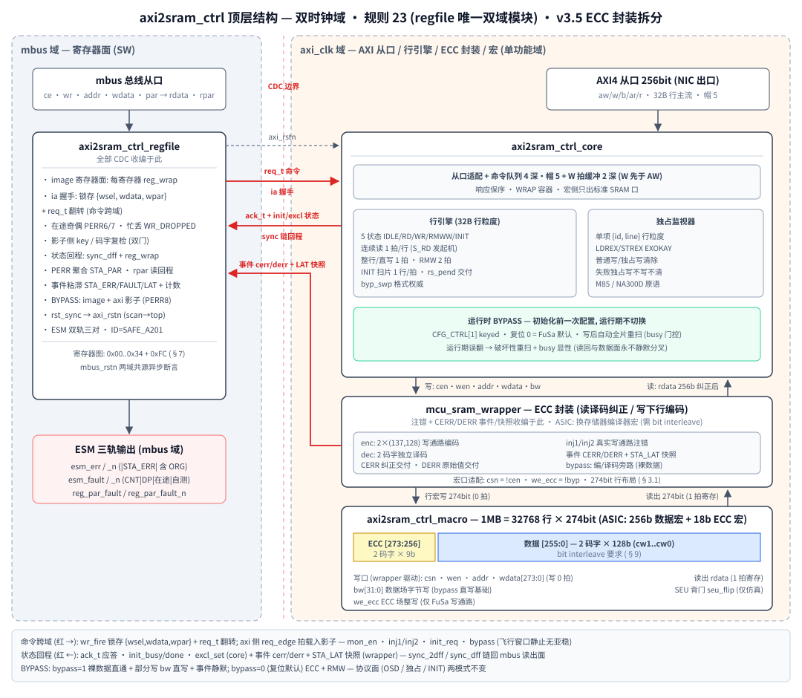
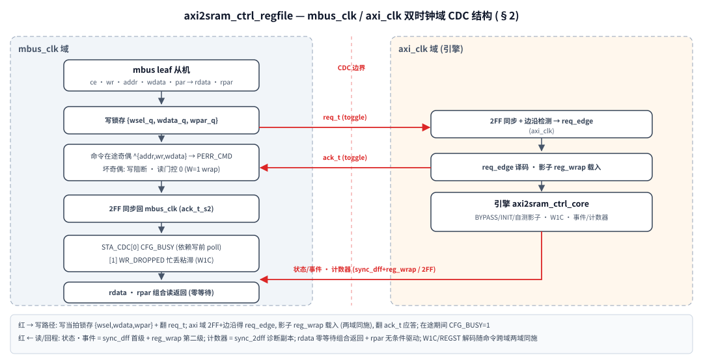
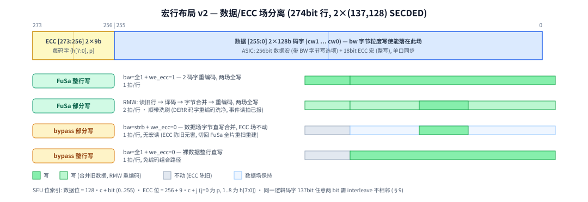
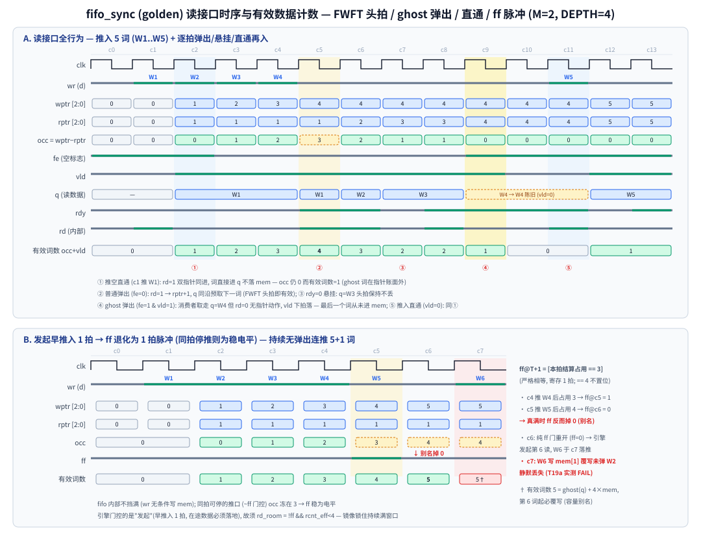
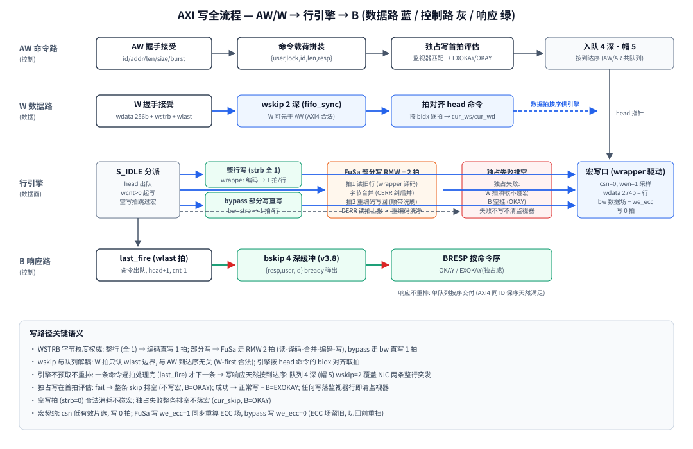
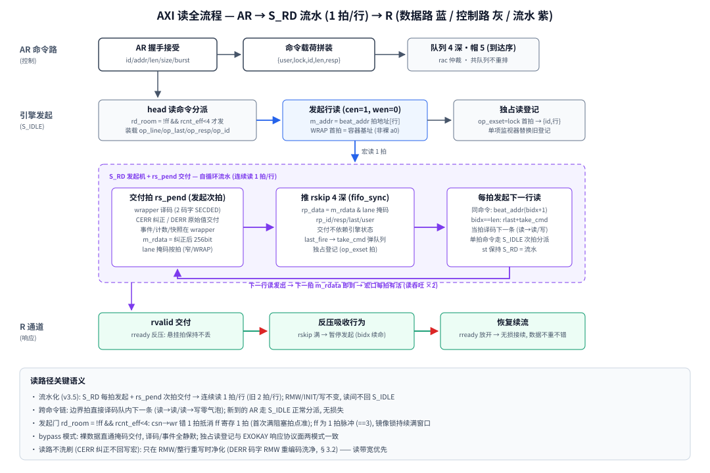
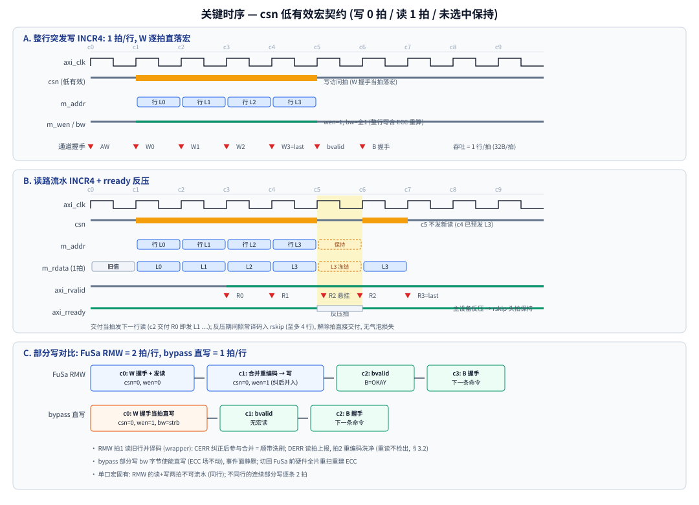

# 12.axi2sram_ctrl — AXI 256bit 从端 SRAM 控制器 (ECC + FuSa) 设计规格

> 版本: v2.1 (2026-11-13) · 状态: RTL v3.9 (**数据面防护**, 用户钦定
> SIL3 诊断覆盖 1~4): FSM one-hot 合法性检查 + **cmdq 命令字/wskip
> W 拍存储奇偶** (奇偶位随载荷推入 fifo, 头词逐拍检查) —— 这两路
> SEU 经 ECC 编码后成合法码字 **ECC 下游不可见 (静默错写)**, 是
> FMEDA 最大 DC 空洞; 检出即**粘滞冻结 fail-safe** (宏口强迫关/
> 命令流停接受/引擎死停, R/B 通道干净词照常排干), 事件 → STA_ERR
> [6:4] DP_FSM/DP_CMDQ/DP_WSKIP + STA_FAULT[1] DP_FSM → esm_fault
> (监视器自身故障轨, SoC 复位级); **keyed CFG_REGST[6] DP_SELFTEST
> 自检非侵入** (三检查点事件面同亮, 不冻结/不进 fault 面, W1C 清,
> T23); **2026-11-13 三轨统一 (规则 25): CNT_DUP 迁 STA_FAULT[0] /
> DERR_ORG 迁 STA_ERR[2], STA_FAULT 扩为源查询面 (+在途/忙丢 RO
> 镜像 + CFG_REGST[7] FLT_SELFTEST), 在途奇偶自 reg_par_fault 剥离
> 入 esm_fault, 3867 checks 全绿**;
> v3.8 (**B 响应缓冲 bskip 4 深**,
> 用户钦定): 写完成响应从 bpend 1 深寄存器改 **fifo_sync M=2 (4 深)**
> —— bready 偶发堵塞 ≤4 写窗口引擎照流 (与 rskip 吸收 rready 堵塞
> 对称; 载荷 {resp, user, id}, 满标志 = 写完成点停等门, 帽 5 = bskip 4
> + 影子 1 恰覆盖在途写极值; q 寄存一拍 = 原 bp_v 时序, AW→B=2 不变,
> T22); 3615 checks 全绿; v3.7 (**AW/AR 换向零气泡**, 用户
> 钦定): rac 从"寄存门控 ready"降级为**同拍竞争偏好** —— 单侧请求组合
> 直授 `awready = cmd_acc && (!rac || !arvalid)` / `arready = cmd_acc
> && (rac || !awvalid)` (互斥; rac 寄存器/复位读侧/公平让渡语义不变,
> 不再付换向死拍 —— len=1 流接受速率=执行速率, cmdq 无积压可垫, 死拍
> 裸露成引擎空泡); 4W+4R len=1 交替流周期 10→**8** 拍, 口利用 80→
> **100%** (15.36→**19.2GB/s** @600MHz, T21); 3592 checks 全绿;
> v3.6b **命令接受重构**: AW/AR 单推入口改**寄存 toggle 仲裁 rac**
> (复位读侧, 当前侧空闲即让, 换向付 1 拍) + 接受门 `!cmdq_ff && !busy_l`
> (推口同拍可停 → occ 冻 3
> 稳电平免镜像, **cmd_cnt 在途镜像退役**), 在途帽 4→**5** (= fifo 4:
> ghost 1+mem 3, + 引擎影子 1); v3.6 **PROT 协议防御
> 退役**: FIXED/size>5 防御译码 / cmd 载荷 skip 位 / PROT 读 SLVERR 直推 /
> prot→STA_ERR[3] 事件面全删, STA_ERR[3] 留位恒 0; **cur_skip 机制保留**
> 仅作独占失败"不落宏"标志; v3.5 ECC 封装拆分承继: 编/译码+注错+事件收编进 mcu_sram_wrapper (ecc_enc/ecc_dec + 行宏), core 对宏侧只出**标准 SRAM 口** (cen/wen/addr/wdata[255:0]/bw/byp/rdata) —— 读回 = wrapper 纠正后 256bit, 写 = 256bit 下行编码; RMW 状态切换留在 core (引擎 5 状态 IDLE/RD/WR/RMWW/INIT, 读交付 rs_pend 解耦, 命令边界拍直接译码下一条); DERR 码字部分覆写后重编码洗净语义 (§3.2); v3.3 fifo_sync 三连化/影子命令/零气泡, v3.1 读路流水/BYPASS/csn 契约承继)
> 定位: 系统 NIC 从端 → 1MB SRAM 宏的 FuSa 控制器: AXI4 256bit 从口 +
> (137,128)×2 SECDED 数据面 (18bit/行 ECC, 面积优化) + 双域寄存器面 (规则 23) + 初始化引擎 +
> 独占访问监视器 + **运行时 BYPASS** (同一颗 IP 双用途: 初始化前一
> 次配置, FuSa 工业 ECC+RMW / 消费电子全旁路, §4.1)。
> 风格: 全仓统一 rtl-coding-style (GRLIB two-process / logic / 例化对齐 /
> 公共单元单一源 / 异步低有效复位)。

---

## 1. 需求与主机侧分析

### 1.1 需求

| 项 | 值 |
| --- | --- |
| 位置 | 系统 NIC 从端 (地址译码后的 SRAM 区) |
| 容量 | 1MB = 32768 行 × 32B/行 (行 = 256bit) |
| 总线 | AXI4 从端, 256bit 数据, 独立 ID, **USER 直通** (axi_awuser/axi_aruser 入队随命令, buser/ruser 原样回传, USERW=4 参数) |
| 出口 | 标准 SRAM 口 (256bit 数据行 + bw, 单口同步) —— 经 **mcu_sram_wrapper** 封装 (ECC 编/译码 + 274bit 码字行宏, §2/§3.1) |
| OSD | **5 笔在途** (v3.6b: fifo 4 = ghost 1+mem 3, + 引擎影子 1; 接受门 = fifo ff, 队列深度参数 OSTD=4) |
| FuSa | ECC + 寄存器加固 + ESM 双轨 (参考 TI R 系列 SRAM 方法) |
| 双用途 | **运行时 BYPASS** (CFG_CTRL[1], keyed): FuSa 工业用 ECC+RMW /
  消费用全旁路直写; 模式**初始化前一次配置**、运行期不切换 (§4.1),
  无编译期参数分叉 |

### 1.2 四个主设备的访问形态与 partial write 可能性 (用户问题 1)

| 主设备 | 区属性 | 访问形态 | partial write 可能性 |
| --- | --- | --- | --- |
| ARM M85 | data 区 (类 DTCM/零等待数据) | 字节/半字/字 store 任意对齐 (C 结构体成员、标志位写) | **必然** — wstrb 字节粒度任意 |
| Nuclei NA300D | CA 区 (cacheable) | 行填充读 (INCR/WRAP burst) + 整行写回为主; 但 write-through/非缓存窗口、描述符尾写可为子字 | **可能** — 不能假设整行 |
| Synopsys GMAC | DMA | 描述符整字写; 帧数据缓冲区: 帧长任意字节 → **最后一字为部分字** (databook 行为) | **可能** — 帧尾部分字 |
| Synopsys USB2 | DMA | bulk/int 包长任意字节 → 缓冲区头尾均出现非对齐部分字 (databook 明示 byte strobe) | **必然** |

**结论**: 必须完整支持字节粒度 WSTRB, 不允许假设对齐/整行。
独占访问: M85 的 LDREX/STREX 与 NA300D 的 LR/SC 都可能落到本区
(RTOS 同步原语) → 需要独占监视器 (§5); GMAC/USB2 DMA 不使用。

### 1.3 与 TI R 系列 (Hercules/RM4x/RM5x) SRAM FuSa 方法的对照

| TI R 系列方法 | 本设计对应 |
| --- | --- |
| 全片 SRAM SECDED ECC (TI 为 39,32 粒度) | 每行 2×(137,128) 扩展汉明 (面积: 18b/行 vs 56b/行; 访问以 32B 行为主, 码字粒度与访问粒度解耦, §3.1), 与 reg_wrap_secded 同一套数学 |
| 复位后硬件自动 ECC 初始化 (未初始化区读出 = 伪 UERR) | **初始化引擎**: 复位释放后自动扫全片写合法零码字; STA_INIT 可见; keyed SW 重扫 |
| ESM 错误分级 (可纠中断 / 不可纠 NMI) | esm_err (监控职责错误, 含 DERR_ORG 有机位) / esm_fault (监视器自身故障) 双轨进 ESM (规则 13+25; 严重级由 ESM 通道映射 G1/G2 承载, DERR_ORG 通道集成侧映射 fatal) |
| ECC 注错自检 (test mode) | CFG_INJ1/2 走真实写通路注错 (keyed + 4bit 码双保险) |
| 可纠错误计数/地址记录 | CNT_CERR/CNT_DERR (Q/Q_n) + STA_LAT 快照 (syn/word/line) |
| 不可纠读出: 数据照常交付 + 错误信号 (不挂总线) | RRESP 保持 OKAY + 原始数据交付 + esm_err 轨 DERR/DERR_ORG 告警 (§6) |

## 2. 顶层结构 (双时钟域, 同构 audio_sram v2)

*图 1: 顶层结构 — 双时钟域; 红色箭头 = CDC 跨域 (全部收编在 regfile, 规则 23)*

CDC 全部收编在 regfile 内 (规则 23, 与 audio_sram v2 逐条同构):
ia 握手命令跨域 / 状态回程 sync_dff+reg_wrap / 在途奇偶双件
(PERR6 命令 + PERR7 写锁存 lane) / 忙丢显性化 (STA_CDC) / 影子双门 /
rst_sync 域复位单一源 / scan_mode 拉到 top。

*图 1b: axi2sram_ctrl_regfile 双域 CDC 详图 — 写锁存+req_t/ack_t toggle
握手 / req_edge 影子 reg_wrap 载入 / sync_dff+reg_wrap 状态回程 /
命令在途奇偶与忙丢显性化*

**时钟假设**: axi_clk = 引擎时钟 = 宏时钟 (单功能域)。若 NIC 输出时钟
与宏时钟不同, 需在 AXI 从口前加异步 FIFO (未包含, 列遗留)。

## 3. 数据面: 行引擎与 ECC

### 3.1 存储

- 1 行 = 256bit = 2 个 128bit 码字, 每码字 (137,128) 扩展汉明 SECDED
  (汉明位 8 + 总偶位 p, 位置 1..137: 2 的幂=汉明位, 137=p, 其余 128
  位=数据), 逻辑码字 `cw[c] = {h[7:0], p, data[127:0]}` (与
  audio_sram/reg_wrap_secded 同一套数学, 码字加宽)。**选型动机**:
  面积 18bit/行 ECC (7.0%) vs 8×(39,32) 的 56bit/行 (21.9%); 本设计
  访问以 32B 整行为绝对主流 (NIC 出口 cacheline fetch), 引擎行粒度
  RMW 使 ECC 粒度与访问粒度天然解耦 —— 128bit 码字不付 RMW 代价;
  代价: 每行并发可纠错误数 8→2, ≥3bit 突发必 DERR (鸽笼), 相邻
  MBU 依赖 interleave 跨两码字打散 (§9);
- **宏行布局 (v2, 数据/ECC 场分离)**: 274bit 行 = `[255:0]` 2×128bit
  码字数据连续 + `[273:256]` 2×9bit ECC (`{h[7:0],p}`) 连续。写口分场
  控制: `bw[31:0]` 数据场字节写使能 (bypass 部分写直写的关键) +
  `we_ecc` ECC 场整写使能。ASIC 对应: 256bit 数据宏 (带 BW 字节写
  选项) + 18bit ECC 宏 (整写), 单口同步契约 (**csn 低有效**片选采样,
  写 0 拍 / 读 1 拍; **csn=1 / 写访问期间输出保持** —— 读路流水停等
  依赖此契约); ECC 阵列 2.25Mb (vs 56b/行 7Mb, −68%);
- bit interleave 要求继承 audio_sram §9.1: 同一逻辑码字的 137bit
  (data 128 + ECC 9) 任意两 bit 不物理相邻 —— 数据/ECC 分属两物理
  阵列天然拉开, 阵列内部仍需码字内位散布 (§9)。

*图 2: 312bit 行布局与四种写通路的场写行为 (绿=写, 灰=不动)*

### 3.2 partial write 的 RMW 分类 (字节粒度 WSTRB)

每写拍按 WSTRB 分类 (wstrb 为权威, 不按 awsize 重算):

| WSTRB | FuSa 模式 (BYPASS=0) | bypass 模式 (BYPASS=1) |
| --- | --- | --- |
| 全 1 (32B 整行) | 2 码字编码整行落宏 (bw 全 1 + we_ecc=1), 1 拍 | 裸数据直写 (bw 全 1 + we_ecc=0), 1 拍 |
| 全 0 | 空写, 消耗拍不访问宏, 1 拍 | 同左 |
| 其他 | **RMW**: 读旧行 → 逐字译码 → 字节合并 → 重编码落宏, 2 拍 | **bw=strb 直写** (字节合并进数据场, ECC 场不动), 1 拍 —— 无宏读, 消费模式窄拍零开销 |

RMW 细节 (v3.5 封装拆分后):

- **数据通路**: core 读旧行 (wrapper 译码: CERR 纠正 / DERR 原始值
  交付) → S_RMWW 按 WSTRB 逐字节合并 (未覆写字节 = 读出值) → 整行
  256bit 下行 → wrapper 重编码双码字落宏 (读、合并、写回的**状态
  切换在 core**, 编/译码在 wrapper);
- 旧数据单比特错按译码纠正后参与合并 → **RMW 顺带洗刷** (CERR 事件
  照报);
- **DERR 码字经 RMW 重编码洗净 (v3.5 语义变化)**: core 对宏侧只有
  标准 SRAM 口 (256bit 数据), 拿不到也写不回裸 274bit 码字 —— 保
  码字需要整行旁路的第二写通路, 与"标准口"钦定冲突, 故废止 v3.4
  的"不可纠不洗白/坏码字字节拒收"语义: RMW 读拍 DERR 事件照报 +
  计数后, 合并结果重编码落宏, **重读不再检出** (未覆写字节数据值
  不变, 仍为译码交付的原始值)。可检性补偿 = 事件/计数已在读拍
  上报 (T8: CNT_DERR=3), 洗净后不再二次报警属预期。

### 3.3 读通路

- **FuSa 模式**: 行读出 → 2 码字独立译码 (同 audio_sram 分类:
  syn_p/syn_h → 干净/CERR/DERR) → 纠正后按 AXI 字节通道掩码交付
  (`rdata = 纠正数据 & lane_mask(size,off)`, 窄传输/WRAP 的 lane 规则
  按拍计算)。CERR/DERR 脉冲 + 计数 + 快照 (最低序出错码字的 syn/
  word + 行地址)。不可纠: 原始数据交付 + fault 轨 (注入期间屏蔽
  语义同 audio_sram);
- **bypass 模式**: 裸数据直通 (`rdata = m_rdata[255:0]` 掩码交付),
  不译码 → **事件全静默** (any_cerr/any_derr=0, 注错寄存器天然无效),
  ECC 场内容被无视 (bypass 期间的写不维护 ECC);
- **读路流水化 (v3.5 引擎重构)**: S_RD = **发起机** —— 每拍判
  rd_room 发起下一行读 (`beat_addr(bidx)`, bidx 在发起拍前进; 窄
  传输同行重读无害, WRAP 跨回卷/跨行窄突发自动跟随); `bidx == len`
  边界拍出 rlast + take_cmd, **当拍译码下一条命令** (读→读/读→写
  零气泡直链; 单拍命令在分派拍完成的走 S_IDLE 次拍分派, 无损);
- **交付解耦 (rs_pend)**: 发起拍捕获 op_* 上下文 (行内偏移/size/
  末拍/响应/id/user), 次拍 rs_pend=1 按上下文把 m_rdata (wrapper
  已译码纠正) 施 lane 掩码推 rskip —— 交付**不依赖引擎状态**
  (S_WR/S_IDLE 期间照推); RMW/INIT 读不置 rs_pend (数据由 S_RMWW
  当拍合并, 单宏操作/拍 → rs_pend 永不与 S_RMWW 同拍);
  宏口每拍有活 → **连续读 1 拍/行**; **交付推 rskip (fifo_sync
  4 深) 而非悬挂寄存器**: NIC rready 反压时引擎最多继续流水 4 行入
  rskip, 满则引擎暂停, 解除后无损续流;
- **发起门 `rd_room = !ff && (rcnt_eff < 4)`**: ff 管首次满阻塞的
  **拍点** —— csn 发起 → rskip wr 推入错 1 拍, 恰好抵消 ff 的 1 拍
  寄存 (bidx=4 时 ff 同拍拉起, 拦住下一发起); 但 fifo_sync 的 ff
  是 **1 拍脉冲** (`==` 占用 3 严格相等, 占用 4 真满时别名掉 0),
  持续 rready=0 下纯 ff 门会重开 → 第 6 推覆盖未弹出槽 (实测 T19a
  静默丢词, §10) —— 镜像 `rcnt_eff = rskip_cnt + rs_pend − pop_now`
  (推入−弹出累计 + 在途预扣) 把门锁到弹出发生, 兼作 ff 的 ≥ 语义;
  RMW/INIT/写路径不变 (RMW 2 拍为单口宏读+写固有, 不可流水)。

### 3.4 命令队列 (4 深, 在途帽 5) 与顺序模型

- **单条命令队列 = golden fifo_sync 命令流** (v3.3, M=$clog2(OSTD) → 4 深):
  AW/AR 共用**单推入口**按到达序入队, 选侧 = **rac 偏好 + 组合直授**
  (v3.7: 单侧请求当拍授予 `awready = cmd_acc && (!rac || !arvalid)` /
  `arready = cmd_acc && (rac || !awvalid)`, 互斥, **换向零气泡** ——
  len=1 流接受速率=执行速率、cmdq 无积压可垫, v3.6b 寄存门控的换向
  死拍会裸露成引擎空泡, 4W+4R len=1 周期 10→8 拍, T21; 两侧同拍
  valid 由 rac 串行化为单推 —— 寄存 toggle 降级为竞争偏好, 复位读侧/
  公平让渡语义不变), 接受门 `!cmdq_ff && !busy_l` (v3.6b:
  推口同拍可停 → occ 冻 3 稳电平, **免在途镜像 (cmd_cnt 退役)**;
  在途帽 5 = fifo 4 (ghost 1+mem 3) + 引擎影子 1); 被选中命令当拍
  `take_cmd` 弹入**引擎影子 cur_*** ——
  bidx 前进 / 独占评估改 resp 置 skip / 完成清空全打在影子上
  (队列退化为纯命令流, 免突变口); 队头 FWFT 组合视图 `nxt_*` 与
  `eff_*` (= 影子有效 ? 影子 : 队头) 供分派/链接当拍直读 —— 引擎逐拍
  串行处理 → 响应自然保序 (同 ID 顺序由 NIC 下游保证, 引擎不重排);
  **命令载荷含 user** (v3.4): `{user, wr, lock, id, len, size,
  burst, a0, resp}`, user 居 MSB (USERW 参数); 读发起拍随 op_* 上下文
  捕获进 rskip 载荷 `{ruser, rlast, rresp, rid, rdata}`, 写经影子到
  bp_user 出 BUSER —— **user 全程随命令/响应流, 无旁路重排面**;
- **引擎 = 单一 one-hot FSM** (S_IDLE/S_RD/S_WR/S_RMWW/S_INIT, 读写合一):
  单口宏一切访问按队列头串行, wskip/rskip 提供 W/R 通道解耦 ——
  分离双引擎并不能并行 (宏口唯一), 反而引入互斥证明负担, 合并是
  可维护性最优解; **写完成不用计数器** —— wlast 经 wskip 镜像
  (cur_wl) 直接判边界, 读边界用 `cur_bidx == cur_len`;
- W 通道 **wskip** (golden `fifo_sync.v`, M=1 → 2 深;
  AXI4 允许 W 先于 AW 到达), FWFT 头拍即 `cur_wd/cur_ws`;
- 读响应 **rskip** (fifo_sync M=2 → **4 深**), 写响应 **bskip**
  (fifo_sync M=2 → **4 深**, v3.8; bready 偶发堵塞 ≤4 写窗口引擎照流);
- 引擎时序 (v3.1 读路流水化后): **整行写 / bypass 直写 / INIT =
  1 拍/行; 连续读 = 1 拍/行 (S_RD 自循环 + 跨命令读链); RMW = 2 拍/行**
  (单口宏同行读+写固有)。吞吐账 @600MHz: 1 拍/行 = 32B×600M =
  19.2GB/s 单向; 11GB/s 读写各半的需求 = 0.286+0.286 行/拍 ≈ 57%
  引擎占用 (读流水化前 86%, 无裕量)。读写换向开销 v3.7 归零 (rac
  直授): 4W+4R len=1 极端交替流实测 **100% 口利用 / 19.2GB/s**
  (v3.6b 寄存门控时 80% / 15.36GB/s, T21); 剩余吞吐折扣只有 RMW
  部分写 (2 拍/行) 与 rskip/bskip 反压窗口 (bready 堵塞 >4 写才损失,
  v3.8)。缓冲尺寸依据:
  - **OSD=4 深 / 在途帽 5** (v3.6b): 深度由主设备并发度定 (NIC 在途
    命令数), 非带宽 —— 带宽上 2 条即可覆盖; 帽 5 = fifo 4 (ghost 1
    + mem 3) + 引擎影子 1, 接受门 = fifo ff (推口同拍可停, occ 冻 3
    稳电平 —— 用户钦定以帽 4→5 换 **cmd_cnt 在途镜像退役**, T19a
    稳态 = 影子 1 + fifo 真词 4, §10); 再深受限于引擎串行节拍只增加
    排队不增加吞吐 (加深 = fifo_sync M 参数加宽, 结构不变);
  - **wskip 2 深**: 覆盖 W-first 窗口与两条突发间的 W 拍堆积, 真正的
    流控是 wready = ~ff (满了自然反压, 主设备侧重发无损失);
  - **rskip 4 深 (v3.2, 用户钦定)**: NIC rready 偶发堵塞 (缓存冲刷/
    仲裁让渡) 时引擎仍可继续流水 4 行, 堵塞窗口 <=4 拍则吞吐零损失;
    发起门 = `!ff && (rcnt_eff < 4)` (§3.3): ff 管首次满阻塞拍点,
    镜像 `rcnt_eff = rskip_cnt + rs_pend − pop_now` 预扣在途推入,
    并锁住 ff 脉冲消失后的持续满窗口 (ff 为 `==`3 严格相等, 占用 4
    真满时别名掉 0 —— 纯 ff 门实测 T19a 静默丢词, §10); 满则引擎
    暂停, 影子 bidx 保留命令上下文, 解除后无缝续流);
  - **bskip 4 深 (v3.8, 用户钦定)**: 与 rskip 对称吸收 **bready 偶发
    堵塞** (NIC 侧 B 通道仲裁让渡) —— 堵塞窗口 ≤4 写则引擎照流零损失
    (T22a: bready=0 期间 3 写后读照回); 载荷 `{resp, user, id}`, 推入 =
    写完成拍 (`last_fire && eff_wr`), 弹出 = bready; **写完成点门 =
    `!ff`** (推口同拍可停 → occ 冻 3 稳电平, 与 wready/命令接受门同款
    免镜像); 在途写帽 5 = bskip 4 (ghost 1+mem 3) + 引擎影子 1 **恰好
    覆盖** —— 第 5 笔写末拍停等在影子, 宏静默只停等不丢 (T22b),
    bready 释放后 5 B 按序 drain (T22c)。

*图: golden fifo_sync 读接口语义 (M=2, DEPTH=4 示意) — A: FWFT 头拍词
在指针账面外 (**有效词数 = occ + vld**, ghost 词不占 mem, 真容量
DEPTH+1), vld 即可取 q (ghost 弹出 fe&vld 无指针动作); B: `ff_d =
(occ==3)` **等值比较** — 同拍可停的推口 (ready = ~ff)
下 occ 冻在 3, ff 是稳电平 (本设计 wready 与 v3.6b 命令接受门即此
用法); **发起早推入
1 拍**的口在途推入必穿过 → occ 到 4 别名掉 0 → 门重开, 第 6 推
静默覆写 —— 须镜像 `rcnt_eff` (§3.3, T19a, §10)*

### 3.5 AXI 写全流程 (req→rsp, 数据/控制分离)

**控制路** (AW 命令): AW 握手 (rac 仲裁选侧, §3.4) → 按到达序入队 (AW/AR 共队) → 分派弹入
影子时独占写首拍评估 (监视器 {id,行} 全匹配 = pass, 失败整条排空)。
**数据路** (W 拍): W 握手 → wskip 2 深 (fifo_sync, W 可先于 AW) →
引擎按影子命令 cur_bidx 逐拍对齐取 FWFT 头拍 `cur_wd/cur_ws`。
**引擎数据面分四类**: 整行写 (strb 全 1) 256bit 下行 wrapper 编码
直写 1 拍/行; FuSa 部分写 RMW 2 拍 (wrapper 读译码 → core 字节合并
→ wrapper 重编码写回, 顺带洗刷); bypass 部分写 bw 直写 1 拍; 独占失败
skip 排空 (W 拍照收不碰宏)。**响应路**:
wlast 拍 last_fire 出队 → bskip 4 深 (v3.8) → BRESP 按到达序 (OKAY /
EXOKAY 独占成), **BUSER = 命令载荷 user 原样**。

### 3.6 AXI 读全流程 (req→rsp) 与读路流水

**控制路**: AR 握手 → 按到达序入队 (AW/AR 共队); 分派弹入影子时装载 op_*
上下文 (行号/行内偏移/size/末拍/响应/id —— off/size 在发起拍
捕获, 译码拍 lane 掩码不依赖头部视图), **独占读在发起拍登记
监视器** (v3.2 修正: 登记提前到发起拍, 次拍即对零气泡跟随的
exw 可见)。**数据路**: 发起行读 (cen=1, wen=0, 行号 = beat_addr
逐拍计算 —— WRAP 首拍 = 容器基址非裸 a0) → 宏 1 拍出数, **wrapper
译码** (2 码字 SECDED: CERR 纠正 / DERR 原始值 + 事件快照, §3.3)
→ 次拍 rs_pend 交付拍 lane 掩码按拍 (窄传输/WRAP) → rskip → R 通道
(**ruser 随 rskip 载荷原样回传**, rid/ruser/rlast 与数据同拍)。
**流水化**: S_RD 发起机逐拍发起 (同命令下一拍 / 边界拍译码下一条
直链) → 连续读 1 拍/行; rready 反压由 rskip 4 深吸收,
满则引擎暂停 (ff+镜像门控, §3.3), 解除后无损续流 (T18 三项时序断言:
首末拍间隔 = 拍数-1 / 跨命令链间隔恒 1 / 停等悬挂拍数据保持)。

### 3.7 关键时序图

- **A 整行突发写**: W 握手当拍落宏 (csn 低有效写脉冲), 1 行/拍,
  wlast 拍出队挂 B;
- **B 读路流水 + 反压吸收**: 交付当拍预发下一行读; rready=0 期间
  已发起的行照常译码入 rskip (最多 4 行), 引擎随后暂停 (占用满),
  rvalid 头拍保持, 解除拍直接交付 —— 无气泡损失、数据不重不错;
- **C 部分写对比**: FuSa RMW 读+写两拍 (单口宏固有, 同行不可流水),
  bypass 直写一拍。

### 3.8 数据面防护 (v3.9, SIL3 诊断覆盖)

**三个检查点** (core, axi 域, 逐拍):

| 检查点 | 机制 | 覆盖对象 | 为什么必须 |
| --- | --- | --- | --- |
| FSM 合法性 | `st_bad = ~(^r.st)` one-hot 归一 (~1 LUT) | 引擎状态寄存器 SEU | 非法态下 case 全落空 → 引擎静默挂死, 原来只有主设备 timeout 兜底 |
| cmdq 载荷奇偶 | 推入算 `^payload` 随词入 fifo (N=CMDW+1), 头词 `vld && ^q≠q[MSB]` | 命令字 (addr/len/size/id) 存储 | **地址翻错 → 写错行, 经 ECC 编码后是合法码字, ECC 下游不可见 = 静默错写** |
| wskip 载荷奇偶 | 同上 (N=290, {wlast,wstrb,wdata}) | W 拍数据存储 | 同理: 编码前的数据翻转 = 静默错数据 |

**检出反应 = 粘滞冻结 fail-safe** (不是自愈): `dp_fault` 置位后
宏口强迫关 (`m_cen` 输出门控)、命令流停接受 (cmd_acc=0)、引擎
死停 (S_IDLE + 影子清) —— **不再执行被 corrupt 的命令/W 拍**;
rskip/bskip 内是已验证干净词照常排干; 只复位解 (SW 在 NMI 语境
处置)。冻结块置于 comb 末段覆盖本拍全部动作 (毒词当拍即拦截,
检测前至多 1 拍窗口 — FMEDA 按 FTTI 论证)。

**不设防残差** (safety case 输入): 弹出后的影子寄存器 (cur_*,
驻留 1~2 行周期)、rskip (ECC 纠正后数据, 驻留短)、bskip (响应
元数据, 主设备可查)、fifo 指针 (灰码/奇偶可再加, 当前以
"错读槽位 → 命令字段非法/奇偶仍核"论证)。

**自检 = 4 号项** (检查器自身 stuck = 潜伏): keyed
`CFG_REGST[6] DP_SELFTEST` (key=1010 复检, 1 拍脉冲) 注入三检查
点的**事件输出** → STA_ERR[6:4] 三位同亮 + esm_err, **非侵入**:
不冻结、不置 STA_FAULT[1]/esm_fault (regfile 侧门 `!dp_test`,
同 ECC 注错 DERR 的 `!inj_active` 先例), W1C 清后可反复跑 ——
运行期周期自检不中断功能。冻结动作 (dp_fault→fail-safe) 由
仿真 force 证 (T23a/b/c), 硅上按破坏性验收测试处置 (safety
manual 件)。TB 侧 T23d 证: 自检后功能访问照跑 + fault 面静默。

## 4. 初始化引擎 (TI 式 ECC 初始化)

- **复位释放后自动扫全片** (0..2^LAW-1 行写零码字, 1 行/拍),
  期间 init_busy=1, awready/arready 拉低 (NIC 缓冲, 无死锁);
- 完成后 init_done 粘滞 1 (复位清), 行为宏上电为随机内容的场景
  由本引擎净化 (audio_sram 依赖"音频缓冲整块刷新"的契约在此不成立
  —— CPU data 区没有整块重写保证);
- **keyed SW 重扫**: CFG_CTRL[7:4]=1010 + [0]=1 → 重新扫全片
  (数据全部清零, SW 诊断动作用); 注错使能期间的重扫同样受注错
  影响 (覆盖全链路, SW 保证注入期与初始化期不同时)。

### 4.1 运行时 BYPASS 模式位 (寄存器实现, 初始化前一次配置)

**动机**: 同一颗 IP 集成后可能用于 FuSa 工业 (ECC+RMW 全开) 也可能
用于消费产品 (性能优先) —— SKU 用途不由 RTL 参数决定, 由 SW **在初始
化之前配置一次**, 运行期不切换使用场景。

- **控制位**: CFG_CTRL[1] BYPASS, 随 [7:4]=1010 key 写入 (keyless 写整
  寄存器拒收); 双域实现 = mbus image + axi 影子 (u_c_byp reg_wrap, 同
  一命令两域同施, PERR8 组); **复位 0 = FuSa 默认** (fail-visible);
  读回 {30'h0, BYPASS, 1'b0};
- **模式语义**: 引擎数据面以扫片时捕获的 `byp_swp` 为权威 (byp_swp
  = 阵列格式状态, 不是动态切换开关):
  - FuSa (byp_swp=0): 全 ECC 编解码 + RMW 部分写 + 事件上报 (§3);
  - bypass (byp_swp=1): 读裸数据直通 + 部分写 bw 直写 1 拍 (无宏读)
    + 事件全静默 + 注错天然无效; 协议面不变 (OSD/独占/INIT);
- **生效流程 (开机配置, 硬件自动承接)**: SW bring-up 写 BYPASS → core
  检测 `init_req || (bypass != byp_swp)` 自动全片重扫: 队列排空后起扫,
  **起扫拍捕获新模式** (`byp_swp ← bypass`), busy 门控 awready/arready,
  SW poll STA_INIT[0] 后再放流量;
  - 复位自动首扫 (FuSa) 进行中写入: 首扫 (32K 行 ≈ 0.33ms@100MHz)
    大概率还没扫完 SW 已在写 —— 末行重臂捕获, 新模式新一轮起扫,
    SW 无需关心首扫状态;
  - 0→1 (配 bypass): 扫片写裸零 (we_ecc=0, 旧 ECC 场作废);
  - 1→0 (配回 FuSa): 扫片写零码字 (we_ecc=1) —— bypass 期间未维护的
    ECC 被整体重建, **不存在裸数据被当码字译码的窗口**;
- **运行期误翻守卫 (fail-visible, 非支持场景)**: 运行中写 BYPASS
  (契约之外的误操作/扰动) → 同样触发破坏性全片重扫 (阵列清零 + busy
  显性), **寄存器读回与数据面行为永不静默分叉** —— 不存在"读回已翻
  而数据面仍旧模式"的静默状态; 代价是误翻即清片, 故配置只应在初始
  化前一次完成 (部署契约入 safety case);
- **性能账 (SKU 间对比)**: 消费 SKU 全程 bypass: 部分写 1 拍直写 vs
  FuSa RMW 2 拍 (宏读+译码合并+编码写) —— 窄拍占比高的负载 (M85 字节
  store / USB2 包尾 / GMAC 帧尾) 直接受益; 整行拍两者同为 1 拍, bypass
  免编码组合路径; NIC 常态 32B 对齐整行流量两模式开销相当;
- **安全论证**: bypass 模式 = **无数据保护** (消费预期, ECC 场内容
  任意); 部署契约 = 模式初始化前一次确定、运行期不动; 硬件三重保证
  配置可审计: 模式位 keyed 写保护 + 复位默认 FuSa + 任何翻转必经
  可见的破坏性重扫 (STA_INIT busy/done 轨迹 + bypass 读回位)。

## 5. 独占访问监视器 (M85 LDREX/STREX, NA300D LR/SC)

- 单项全局监视器: {有效, AxID, 行地址}, 粒度 = 32B 行 (粗于字节粒度,
  同行内别名竞争表现为额外 STREX 失败重试, 无活锁 — 持锁者总有进展);
- 独占读 (arlock): 处理首拍登记/替换监视器, RRESP=EXOKAY;
  (若不支持, M85 单线程 LDREX/STREX 循环将永远失败 = 挂死, 故必须支持);
- 独占写 (awlock): **首拍处理时**评估 pass = 监视器{id,行}全匹配 →
  写入 + BRESP=EXOKAY; fail → **不写** + BRESP=OKAY (AXI 语义);
- 任何普通写/独占写/RMW 落到监视器行 → 清监视器; 初始化扫片清监视器;
- 失败的独占写不改监视器 (ARM 全局监视器语义)。

## 6. 错误处理策略 (fail-visible)

| 事件 | 数据面行为 | 上报 |
| --- | --- | --- |
| CERR (单比特) | 纠正交付; RMW 顺带洗刷 | STA_ERR[0], CNT_CERR, STA_LAT, esm_err |
| DERR (双比特) | 原始数据交付 (不可信), RRESP 仍 OKAY (TI 语义: 不挂总线, 系统级经 ESM 反应) | STA_ERR[1], CNT_DERR, STA_LAT, esm_err |
| 有机 DERR | 同上 | STA_ERR[2] DERR_ORG + esm_err (注入期间屏蔽; **有机数据错 = 监控职责错误, 2026-11-13 三轨统一自 fault 面迁入**, fatal 级反应由 ESM 通道映射承载) |
| 数据面防护 (FSM 非法 / cmdq / wskip 奇偶, v3.9) | **粘滞冻结**: 宏口关/停接受/引擎死停, R/B 干净词排干, 只复位解 (§3.8) | STA_ERR[4..6] 事件面 + STA_FAULT[1] DP_FSM + esm_fault (监视器自身故障) |
| bypass 模式一切数据事件 | 不译码不报 (裸数据语义) | 无 (CERR/DERR/FAULT 全静默, 模式本身可见可审计) |

### 6.1 STA_ERR 与 STA_FAULT 的分工及触发条件

**2026-11-13 三轨统一 (规则 25)**: 分工按**故障来源类别** —— STA_ERR =
被监控数据/协议的错误 (监控职责), STA_FAULT = 监视器自身完整性故障;
严重级 (中断/fatal) 由 ESM 通道映射 G1/G2 承载, 不由轨名承载。

| | **STA_ERR (0x0C, RW1C)** | **STA_FAULT (0x10, RW1C/R)** |
| --- | --- | --- |
| 定位 | **监控职责错误面**: 一切被检出的数据/协议错误事件, **含注错窗口内的注入事件** | **监视器自身故障面**: 计数器自检失配 + 数据面防护 critical 冻结 (+ 在途/忙丢 RO 镜像 + 自测位) |
| bit0 | CERR: 任一码字译码出单比特可纠 (注入翻转被纠也置位) | CNT_DUP: CNT_CERR/CNT_DERR 计数器 Q/Q_n 副本失配 (2026-11-13 自 STA_ERR[2] 迁入) |
| bit1 | DERR: 任一码字译码不可纠 (含注入) | DP_FSM: 引擎失 one-hot critical 冻结 (v3.9, §3.8) |
| bit2 | DERR_ORG = `derr && !inj_active` 有机不可纠 (2026-11-13 自 STA_FAULT[0] 迁入) | — |
| bit3 | 保留 0 (原 PROT 防御位, v3.6 退役) | — |
| bit4 | DP_FSM: 引擎失 one-hot (v3.9, §3.8) | — |
| bit5 | DP_CMDQ: 命令字奇偶失配 (v3.9) | — |
| bit6 | DP_WSKIP: W 拍奇偶失配 (v3.9) | RO 镜像: [2] CMD_PAR (PERR6) / [3] WLT_PAR (PERR7) / [4] WR_DROP, [31] FLT_TEST (CFG_REGST[7] keyed 自测位) |
| ESM 轨 | esm_err (规则 13+25 双轨, 经 mon_en 门控; DERR_ORG 通道集成侧映射 fatal 级) | esm_fault (双轨; 在途奇偶 PERR6/PERR7、忙丢、自测位同驱, 见 regfile 聚合) |
| W1C | 按 [8:0] 写 1 清; 置位源在线则清不掉 | [1:0] 写 1 清; [31] W1C; [4:2] RO (清在 STA_PAR/STA_CDC) |

**触发条件逐条**:

- **CERR**: wrapper 译码拍 (= 交付拍 rs_pend / RMW 读拍, v3.5 收编
  wrapper), 2 个码字任一 syn 落在单比特
  可纠集合 → 纠正交付 + STA_ERR[0] + CNT_CERR + STA_LAT 快照;
- **DERR**: 同上场景 syn 不可纠 (双比特及以上) → 原始数据交付 +
  STA_ERR[1] + CNT_DERR + 快照;
- **CNT_DUP**: 计数器正本与反相副本逐拍比较失配 (规则 12) →
  STA_FAULT[0] (esm_fault 轨, 监视器自身故障) + 计数器清 0 自愈 +
  副本回贴;
- **DERR_ORG**: DERR 事件发生且注错未使能 (inj_active=0)。注入窗内
  的 DERR **不置** ORG 位 (屏蔽, 测试窗口语义); 注错释放后坏行
  再被读到 → 按 organic 补报 (T8 验证) —— 保证"真实硬件不可纠"与
  "故意注入"可区分; fatal/NMI 级反应改由 ESM 通道映射承载 (轨内
  只留来源类别, 2026-11-13)。
- **DP_FSM → STA_FAULT[1]** (v3.9, §3.8): 检测即冻结, 事件为检出
  首拍 1 脉冲 (粘滞冻结期间不重复发); 进 FAULT 轨因为控制面损坏 =
  事务上下文不可信且唯一解是复位 (监视器自身故障, esm_fault → SoC
  整体复位不变)。**自检注入不置位** (门 `!dp_test`, 与 DERR_ORG 的
  `!inj_active` 同语义): esm_fault 判定不被测试窗口污染, 自检非侵
  入免复位; DP_CMDQ/DP_WSKIP/DP_RSKIP/DP_BSKIP 为 fifo 词毒化完成
  (只进事件面, 不冻结)。

**为什么分两面**: STA_ERR 回答"被监控的数据/协议错在哪" (注错自检
的观测点也在这里), esm_err 报监控职责错误; STA_FAULT 回答"监视器
自己坏没坏" (计数器自检 / 引擎 FSM / 在途命令通路), esm_fault 报
监视器自身完整性故障。DERR_ORG 的 fatal 级反应由集成侧把该 ESM
通道映射到 G2 承载 —— 轨名只表达来源类别, 不再表达严重级。

## 7. 寄存器地图 (mbus, addr[15:8]=IDX, [7:0] 偏移)

| 偏移 | 名称 | 类型 | 位域 |
| --- | --- | --- | --- |
| 0x00 | CFG_EN | RW | [3:0] 监控使能 4bit 码 (复位 1111 非法默认开) |
| 0x04 | CFG_INJ1 | RW | [7:4] key=1010; [3:0] 注错使能 4bit 码 (复位 0000); [10:9] 码字选择 0..1; [8] 保留 0; [18:11] 汉明位置 1..136, 137=p |
| 0x08 | CFG_INJ2 | RW | 同构第二通道 (同码字两位 = 双比特) |
| 0x0C | STA_ERR | RW1C | [0] CERR [1] DERR [2] DERR_ORG 有机不可纠 (注错期间屏蔽; 2026-11-13 自 STA_FAULT[0] 迁入) [3] 保留 0 [4] DP_FSM [5] DP_CMDQ [6] DP_WSKIP (v3.9) [7] DP_RSKIP [8] DP_BSKIP (v4.0) |
| 0x10 | STA_FAULT | RW1C/R | 监视器自身故障源查询面 (2026-11-13 三轨统一): [0] CNT_DUP 计数器 Q/Q_n 失配 (W1C, 自 STA_ERR[2] 迁入) / [1] DP_FSM 数据面防护冻结 (v3.9, W1C) / [2] CMD_PAR [3] WLT_PAR [4] WR_DROP (RO 镜像, 清在 STA_PAR[8]/[9]/STA_CDC[1]) / [31] FLT_TEST (RW1C, CFG_REGST[7] keyed 自测位) |
| 0x14 | STA_PAR | RW1C/R | [0] PAR_FAULT (**寄存器面**各组 flt 或 + 自测锁存; 在途事件不在此电平) [1] 反轨 [11:2] PERR9..0 |
| 0x18 | CFG_REGST | W(key) | key=1010; [4] REG_SELFTEST+[11:8] REGSEL(0..9, 8=BYPASS 影子); [5] PAR_SELFTEST; [6] DP_SELFTEST (v3.9, §3.8 非侵入自检脉冲); [7] FLT_SELFTEST (置 STA_FAULT[31], keyed 源级注入出 esm_fault 轨) |
| 0x1C | STA_LAT | RO | [8:0] SYN ([8]=0) [10:9] WORD [25:11] LINE |
| 0x20 | CNT_CERR | RW | [15:0] 可纠事件计数 (饱和, Q/Q_n) |
| 0x24 | CNT_DERR | RW | [15:0] 不可纠事件计数 |
| 0x28 | STA_CDC | RW1C/R | [0] CFG_BUSY (RO) [1] WR_DROPPED (W1C) |
| 0x2C | STA_INIT | RO | [0] INIT_BUSY [1] INIT_DONE |
| 0x30 | CFG_CTRL | RW(key) | [7:4] key=1010; [1] **BYPASS** 模式位 (粘滞, 读回); [0] INIT_REQ 重扫脉冲 (WO 读 0) |
| 0x34 | STA_EXC | RO | [0] EXCL_SET 独占监视器有效 |
| 0xFC | ID | RO | 32'h5AFE_A001 → **5AFE_A201** \| IDX |

PERR 组号 (STA_PAR bit = 2+组号): 0 EN / 1 INJ1 / 2 INJ2 / 3 STA_ERR /
4 STA_FAULT / 5 STA_LAT / 6 命令在途奇偶 / 7 写锁存 lane (无注错目标) /
8 CFG_CTRL image + **BYPASS 影子** (同组) / 9 STA_INIT+STA_EXC 读出面。
**在途事件本体 (组 6 粘滞 / 组 7 lane) 与 WR_DROPPED 为监视器自身
故障, 聚合走 esm_fault 轨** (查询面 STA_FAULT 0x10, 2026-11-13
三轨统一; STA_PAR 位保留诊断)。

## 8. FuSa 机制清单

1. 4bit 编码使能 (规则 11) + 注错 key 双保险 (两域双门复检);
2. 计数器 Q/Q_n (规则 12, 失配清 0 自愈 + 副本回贴);
3. 寄存器奇偶保护 (每寄存器所在域 reg_wrap, 10 组 PERR) + REGST 逐组
   自检 + PAR_SELFTEST 签名 + rpar 读回程;
4. CDC 加固 (规则 23 全要素);
5. ESM 三对双轨 (规则 13+25): esm_err = 监控职责错误 (|STA_ERR, 含
   DERR_ORG) / esm_fault = 监视器自身故障 (CNT_DUP, DP_FSM, 在途
   PERR6/PERR7, WR_DROPPED, FLT_TEST) / reg_par_fault = 寄存器面奇偶
   (不含在途); 三轨 keyed 源级注入全可测 (err=INJ1/2+DP_SELFTEST,
   fault=FLT_SELFTEST [7], par=REG/PAR_SELFTEST);
6. 数据面 2×(137,128) SECDED (mcu_sram_wrapper 封装) + RMW 洗刷 +
   DERR 事件读拍上报 (部分覆写重编码洗净, §3.2);
7. 初始化引擎 (TI 式上电 ECC 净化) + keyed 重扫;
8. 独占监视器 (协议正确性亦是安全性: 同步原语挂死 = 失效);
9. 有机位注错屏蔽 (DERR_ORG/DP_FSM 门 !inj_active/!dp_test, 测试
   窗口语义, 同 audio_sram);
10. 运行时 BYPASS (§4.1): 复位默认 FuSa + keyed 模式位 + 初始化前一
    次配置 (重扫生效, 格式不混存) + 运行期误翻必经破坏性重扫显性可见
    + 模式可读回可审计 —— 消费分叉不削弱 FuSa 默认态;
11. **数据面防护 (v3.9, §3.8)**: FSM one-hot 合法性 + cmdq/wskip
    存储奇偶, 检出粘滞冻结 fail-safe + STA_ERR[6:4]/STA_FAULT[1]/
    esm_fault + keyed DP_SELFTEST **非侵入**自检 (事件面照亮,
    不冻结不进 fault 面, W1C 清) —— 补 SIL3 控制面 DC
    (SFF≥99% 路线 1H 的引擎/fifo 空洞)。

## 9. 宏选型要求与残余 (safety case 输入)

- **硬性 (v2 布局)**: 256bit 数据宏 (须带 BW 逐字节写选项 —— bypass
  部分写直写的物理基础) + 18bit ECC 宏 (整写), 同地址/同时选通
  (csn 低有效) 由本控制器单点驱动, 逻辑上是一行; 两宏各自内部 bit interleave: 同一
  逻辑码字 data 128bit 与 ECC 9bit 任意两位不物理相邻 (分属两物理
  阵列天然拉开; 阵列内码字内位散布仍要求, audio_sram §9.1 结论继
  承); 相邻双比特 MBU 需被 interleave 打进不同码字 (2 码字粒度下
  x2 交错即有效), ≥3bit 突发按鸽笼必成 DERR (fail-visible);
- bypass 模式的数据场无任何保护 (消费预期); `we_ecc`/`bw` 写使能
  单点扰动: we_ecc 卡 0 → 后续 FuSa 读必 DERR (响亮可检); bw 卡 0
  → bypass 模式字节丢失静默 (bypass 无保护固有, 入 safety case);
- 行为宏上电随机内容 (RAND_INIT=1) 用于验证初始化引擎的净化能力;
  真实宏上电随机 → 未初始化区首读伪 DERR 由初始化引擎消除
  (bypass 模式下无伪 DERR 概念, 不译码);
- 宏内行译码错误不可检 (ECC 极限, 同 audio_sram §9.2, 依赖宏 BIST);
- 写数据通路 (AXI→编码→宏) 无端到端校验: 编码前的翻转被合法编码
  "洗白" (SoC 层职责, 与其他 fusa IP 同, 列残余; bypass 模式下编码
  不存在, 无此洗白面但亦无检出);
- INCR 突发出界按 1MB 回卷 (NIC 区译码保证不出界, 防御性行为);
- 命令队列 4 深但在途帽 5 (fifo 4+影子 1, §3.4), 数据流由引擎串行节拍
  (预取优化为遗留改进项); 不同 ID 间不重排 (合法但保守);
- 引擎行对齐寄存器/命令影子寄存器 (cur_*) 的单比特扰动: 轻则错行访问, 重则
  协议错 —— 未加冗余, 分析与加固选项见 §9.1;
- axi_clk 与 NIC 时钟同域假设 (不同则需异步 FIFO, 遗留)。

### 9.1 SRAM 口地址完整性: 双轨可行性分析

**问题**: 宏口 m_addr 能否像 ESM 输出那样做双轨 (addr / addr_n),
在 SRAM 口保证地址不出错? 是否有必要?

**结论: 端口双轨无检出力, 不必要。有效手段是寄存器 Q/Q_n (可选
加固) 与地址折入奇偶 (可选改进), 当前按残余归类 (与 audio_sram
rd_addr_q 同级论证)。**

- **端口双轨为什么无效**: 双轨的检出力来自两轨**物理路径分离**后在
  受信端互补比较 (如 ESM 侧比较)。SRAM 宏只有一个地址口, **宏内没有
  比较器**, 双轨信号送不进宏; 若比较器放控制器内, 两条轨同源于同一组
  地址寄存器 (cur_a0 / op_line / m_addr_c) —— 寄存器翻转两轨一致翻,
  比较器恒过。结果 = 一倍引脚/走线成本 + 零检出增益;
- **地址出错的真实来源与可覆盖性**:
  1. **地址寄存器单比特翻转** (SEU, 现实失效大头): 规则 12 Q/Q_n
     互补副本逐拍比较即可覆盖 (cur_* 命令字 + op_line/op_id 操作
     上下文), 成本 = 副本+比较器, 不改宏 (样板 int_prot cnt_par_err);
     当前未加, 列残余, 可钦定后补;
  2. 寄存器→宏引脚组合走线翻转: 与数据走线同级, 无结构性手段,
     SoC 端到端职责 (与写通路端到端校验残余同类);
  3. 宏内行译码错误: ECC 极限之外, 依赖宏 BIST (§9 既有残余);
- **地址折入奇偶 (可选改进, audio_sram v3.1 先例)**: 存储奇偶改为
  `p = ^{行地址, 数据}` → 错行读出 syn_p 必失配 (单比特地址错 100%
  检出, 随机错行 ~50%), 把"读错行"变成可检事件。代价: 编码语义
  变更 (初始化须逐行自洽 `{^i,0}`)、写侧仍盲 (错行写不可检)、
  bypass 模式无奇偶可折。本设计已有扫片引擎, 折入实现顺路, 但属
  语义级变更 —— 未钦定不动, 列改进选项;
- **错行写的原理性盲区**: 任何读侧方案都检不出"写命令地址错"——
  数据落错行且是合法码字 (洗白), 目标行只是保留旧值 (SW 数据校验
  可发现)。此为 ECC 方法边界, 入 safety case, 与写通路端到端校验
  残余合并论证。

## 10. 验证 (tb_axi2sram_ctrl, 双时钟 #21/#13 非整数比)

T0 复位极性 + rst_sync scan 旁路 / T1 复位默认值 + ID 5AFE_A201 +
初始化引擎 (busy→done, 零码字, busy 期间 awready=0) / T2 整行读写 /
T3 partial write (字节/半字/字, 未写字节保留) / T4 burst INCR 整行 +
窄传输 lane / T5 WRAP / T6 独占访问 (pass/fail/清除语义) / T7 单比特
注入 (CERR+纠正交付+快照+RMW 洗刷) / T8 双比特注入 (DERR+屏蔽+
**DERR_ORG 有机补报 (2026-11-13 起 STA_ERR[2]→esm_err, fault 面静默)**+
RMW 重编码洗净 — 坏行写后重读不检出, CNT_DERR=3 = 2 次读
+ 1 次 RMW 读) / T9 SEU 背门 / T10 (PROT 防御, v3.6 退役删除) /
T11 REGST 逐组自检 / T12 PAR_SELFTEST / T13 CDC 忙丢 (WR_DROPPED →
esm_fault 轨 + W1C 清) / T14 计数器 SW
写 + Q/Q_n / T15 keyed 重扫 + 收尾 / **T16 BYPASS 配置流程 + 误翻守
卫**: 配 bypass (busy poll + 读回 [1]) → 裸零读 → 整行/部分写**宏访问
计数断言** (部分写 = 读 0 次/写 1 次, 无 RMW) + 合并语义 + 窄 size 写 →
INJ arm 后事件面静默 (STA_ERR/STA_FAULT/CNT_CERR 全 0, 注错天然无效)
→ 误翻回 FuSa (守卫触发重扫, busy poll + 读回 [1]=0) → RMW 恢复
(读 1/写 1) + CERR 事件回归。
全程 rpar 契约 + 三对双轨在线监视。

**T17 AXI4 协议扫面 (294→1295 checks 扩容; v3.6 删 (f)(g) PROT 两节)**:
(a) WRAP2 len=1 /
(b) WRAP16 len=15 全回卷容器 / (c) 窄 WRAP4 size=2 / (d) 字节传输
size=0 len=3 + 跨行窄突发 size=2 @off28 / (e) INCR256 len=255
全片扫描 / (f) 独占语义细化: 异 id 独占写 OKAY 不写、
监视器单项被新独占读覆盖、exw fail→pass / (g) 混合 AR/AW/AR 不同
id 在途 (rready=0+bready=0 停放再释放, rid 顺序 3→5、bid=4) /
(h) B 通道背压 (bready=0, bvalid 保持 5 拍) + W 迟到 (AW 后 5 拍
才 W)。

**T18 读路流水时序**: (a) len=7 连续流: 首末拍间隔=7 且拍间 gap=0
(**1 拍/行实证**) / (b) 跨命令链: 两笔读背靠背, 链间隔恒 1 (零气泡)
/ (c) rready 停等: 悬挂拍 rvalid+rdata 保持 6 拍, 解除后无损续流 /
(d) 读→写命令边界 (park 双 ready) / (e) 写命令夹在读流中
(write-behind)。

**T19 背压特殊场景 (用户钦定; 至 v3.5 1295→1536, v3.6 删 (c) 后 1470,
v3.6b 接受门/rac 重构后 1492 checks)**: (a) **在途帽 5 满
stall** — rready 预 park, 6 突发预写 + 6 条 AR 快发: AR1 推空旁路
(ghost) + AR2..AR4 占满 mem (occ=3, ff 稳 1 关门); AR1 末行发起拍
**边界弹 AR2** (occ 2→1, ff 掉) → AR5/AR6 补位 (occ 回 3 冻结) →
六条全接受 (帽 5 = fifo 4+影子 1); AR1 四行恰灌满 rskip → 引擎停发
在 AR2 行0, 队面稳态 5 (影子 AR2 + fifo 真词 4: q=AR3 + mem AR4..AR6) →
arready/awready 拉低稳定可观测 (rskip_cnt=4 / rvalid 头拍保持 /
m_cen=0 逐拍断言); 释放后 24 拍按序无损 drain (rid/ruser/数据/last),
追加 AW+B 证 slot 回收 / (b) **rskip 满停发** — len=15 长读 + rready
压低: 4 行灌满 rskip 后引擎**暂停发起 SRAM 读** (m_cen=0 ×4 拍, bidx
在影子续命), 解除后 16 拍无损续流。

**T20 无气泡流延迟 (v3.7)**: AW/W/AR 通道有效恒高, 突发图样 1,4,4,
1,1,4 (15 拍), posedge 打点 —— (a) AW/W 同拍起跑: len=1 突发 AW 与
W **同拍接受** (v3.7 直授; v3.6b 时 W 因 rac 换向早 1 拍), **AW→B=2**
(B 锚定 AW 而非 W —— dispatch+写+bskip 寄存; W 早进 wskip 也压不短),
**Wlast→B=2**; AW 流 6 连拍零气泡, W 流起步 wskip 灌满停 ~5 拍后
1 拍/行到底 (写吞吐 = 1 行/拍, AW 验证侧最多超前 W 6 拍) /
(b) W 先行 8 拍: 数字同 (a), Wlast→B=11 证 B 只等命令不等数据 /
(c) AR 无气泡流: **AR→首 R=3** (空流水; cmdq 寄存 + dispatch 发读 +
宏 1 拍 + rskip 寄存), 后续突发首 R 随前方排队行数线性增长 (按序
交付, 15 拍 R 拍间 gap 全 1)。

**T21 4W+4R 交替流带宽 (v3.7 探针, 用户钦定)**: len=1 读写各 50%,
4 写 (AW/W 同拍, 组内无气泡) 接 4 读循环 100 组 —— v3.7 rac 直授后
稳态 = **8 拍/8 笔** (min=max 严格周期), W→R/R→W 边界 gap 各 1,
**口利用 100% = 19.2GB/s @600MHz** (读 9.6 + 写 9.6; 连续 1s =
6 亿笔 / 19.2GB); v3.6b 寄存门控同场景 10 拍/8 笔 (80% / 15.36
GB/s) —— 每次换向裸露 1 拍引擎空泡: len=1 接受速率=执行速率,
cmdq 无积压可垫; len≥2 突发的换向气泡天然藏进 cmdq 积压 (两版
本皆 100%), 该损失是 len=1 特有。

**T22 bskip B 反压吸收 (v3.8 探针, 用户钦定)**: (a) bready=0 窗口
3 写 + 1 读 —— 读照常回 (**引擎未被 B 反压卡住**, bskip occ=2 未满);
(b) 边界: 第 4 写入队 occ=3 → ff 升, 第 5 写末拍**停等在影子**
(cur_v=1 且宏静默 = 在途帽 5 = bskip 4+影子 1 全占, 只停等不丢);
(c) 释放 bready → 5 B 按序 drain (**buser 0..4 证顺序**); (d) 回读
数据无损。B 通道时序不变: T20 AW→B=2 / Wlast→B=2 复测一致
(q 寄存一拍 = 原 bp_v 时序)。

**T23 数据面防护 (v3.9, force 注错证真检查树 + keyed 非侵入自检)**:
(a) `force r.st=5'b0` (失 one-hot) → STA_ERR[4] + STA_FAULT[1] +
esm_fault + 冻结 (双 ready 关/宏口关); (b) AR len=15 开路 + AW/W
落队 (队头滞留窗口确定) → `force u_cmdq.q[0]` 翻位 → STA_ERR[5] +
冻结不消费毒词; (c) bready=0 + 5 写 park (W5 的 W 拍滞留 wskip 头)
→ `force u_wskip.q[5]` 翻数据位 → STA_ERR[6] + 宏静默; (d) keyed
`CFG_REGST=0x4A` (key|DP_SELFTEST) → 三位同亮 111 + esm_err,
**STA_FAULT/esm_fault 静默 + 双 ready 保持开** (非侵入本体), 自检
后功能写读照跑 + W1C 清事件面; (e) 复位全清 + 双 ready 重开 + 全零
回读 (**force 暂存静态暂存防自引用 no-op; 跨 posedge hold 再
release**)。每子场景间 t23_reset 重扫 (refmem 同步清零)。
**T24f2 FLT_SELFTEST keyed 源级注入 (2026-11-13 三轨统一)**:
`CFG_REGST=0x8A` (key|FLT_SELFTEST) → STA_FAULT[31] + esm_fault 轨
(STA_PAR 不含测试位), 无 key (0x80) 忽略, W1C bit31 清。

TB 时序契约补充 (T16 排障沉淀): 逐次依赖生效的寄存器写之间必须
`cmd_wait()` (CDC 在途窗口约 5 个 mbus 周期, 背靠背第二写落忙窗被
WR_DROPPED 丢弃是**正确行为** —— T13 专测; 曾因 T8/T9/T11 末尾
`RA_STA→RA_FLT` 背靠背对把 W1C 丢掉, st_flt 残留到 T16 才暴露)。

TB 时序契约补充二 (T17/T18 沉淀): rready/bready 常高时 R 拍/B 响应
会被**无感消费** —— 多命令在途收集类用例必须先 park (rready=0, 有
写在途再加 bready=0) 再发命令, 收集前释放; TB 采样约定 = NBA 在 T
拍写入的值 TB 在 T+1 拍才读得到 (保持类断言前先 settle 一拍)。

TB 地址契约补充 (T19 沉淀): **DUT 配置 DEPTH=256 (LAW=8, PAW=13,
refmem [0:255])** —— 用例行基址必须 ≤ 0xFF; 越界行号 (`line<<5` 超
13bit) 会被 AXI 地址口**静默截断别名到区内**, 且 tpat 图样只取
line[15:8] (0x11B 与 0x1B 同图样) 使写读回环"看起来对"而 refmem
越界读出 X —— 排查指纹 = exp 全 X / got 图样正确; 在途帽满观测需
**rready 预 park** (命令 last-issue 即弹不依赖 R 消费, rskip 4 行恰
容纳首命令; 满帽稳态 = 影子 1+fifo 真词 4 (含 ghost), 否则命令流
空转在途帽永不满)。
