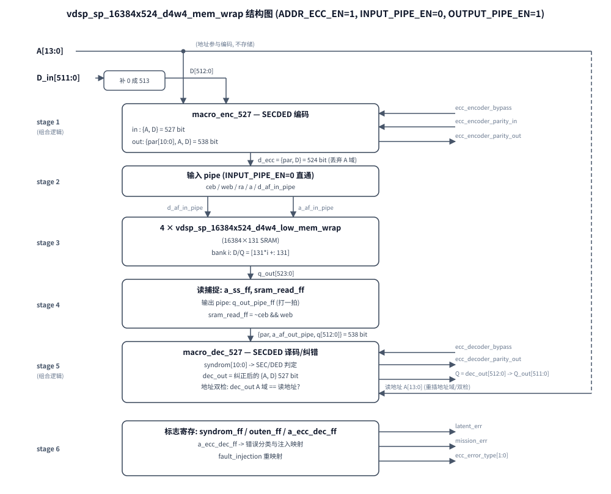
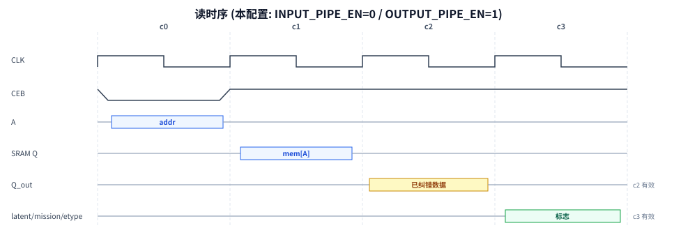

# vdsp_sp_16384x524_d4w4_mem_wrap 功能详解

## 1. 概述

这是一个**带 SECDED ECC 保护的单口 SRAM wrapper**，面向 FuSa（功能安全）应用：

- 存储体：16384 字 × 524 bit，由 **4 片 16384×131 子宏**（`vdsp_sp_16384x524_d4w4_low_mem_wrap`）拼接而成
- 每字 524 bit = **513 bit 数据 + 11 bit ECC 校验**（10 位 Hamming + 1 位总体奇偶，Hsiao 奇数权列方案）
- 用户可见数据宽度 512 bit（`D_in`/`Q_out`），第 513 bit 由 wrapper 内部补 0（`INTBIT=512`）
- **地址 ECC**（`ADDR_ECC_EN=1`）：14 位地址与数据一起参与 ECC 编码（不占用存储位），读回时以读地址重新计算校验子，可发现 SRAM 地址译码/行选故障
- 错误分类输出：`latent_err`（潜伏错，已纠正，需 scrub）、`mission_err`（任务错，不可纠/地址错）、`ecc_error_type[1:0]`
- 输出级**故障注入**（`fault_injection_enable/value`）：不改变存储内容，只重映射错误输出，用于验证上层 FuSa 监控通路

## 2. 主要参数

| 参数 | 值 | 含义 |
|---|---|---|
| `ECCNUMIOBIT` | 524 | SRAM 物理字宽（513 数据 + 11 校验） |
| `BUNIOBIT` | 513 | ECC 保护的数据 bundle 宽度 |
| `INTBIT` | 512 | 用户数据宽度（bundle 高位补 0） |
| `NUMWORD` | 16384 | 字深度，`ADDR_WIDTH=$clog2(16384)=14` |
| `ADDR_ECC_EN` | 1 | 地址参与 ECC |
| `INPUT_PIPE_EN` | 0 | 输入直通（本配置） |
| `OUTPUT_PIPE_EN` | 1 | 输出打一拍（本配置） |

## 3. 端口

| 端口 | 方向 | 位宽 | 说明 |
|---|---|---|---|
| `rstn` | i | 1 | 异步复位（仅复位 pipeline 寄存器，不影响 SRAM 内容） |
| `mem_cfg` | i | 42 | SRAM 工艺配置脚，直连子宏 |
| `A` | i | 14 | 地址 |
| `D_in` | i | 512 | 写数据 |
| `WEB`/`CEB` | i | 1 | 写使能/片选，低有效 |
| `CLK` | i | 1 | 时钟 |
| `Q_out` | o | 512 | 读数据（已纠错） |
| `ecc_encoder_parity_out` / `ecc_decoder_parity_out` | o | 11 | 编码/译码校验位观察口 |
| `ecc_error_type` | o | 2 | 错误类型（见真值表） |
| `latent_err` / `mission_err` | o | 1 | 潜伏错/任务错标志 |
| `ecc_encoder_bypass` / `ecc_decoder_bypass` | i | 1 | 编/译码旁路 |
| `ecc_encoder_parity_in` | i | 11 | 旁路模式下的外部校验位 |
| `fault_injection_enable` / `fault_injection_value` | i | 1/2 | 输出级故障注入 |

## 4. 结构图

*图 1: 数据通路六级结构 — 编码 → 输入 pipe → 4×131bit 子宏阵列 → 读捕捉/输出 pipe → 译码纠错 → 错误分类与注入映射; 地址参与编码不存储, 读时重插地址域双检*

## 5. 逐级说明

1. **Stage 1 编码**：`ADDR_ECC_EN=1` 时用 `macro_enc_527`，输入 `{A, D}` 共 527 bit；编码输出高位 11 bit 为校验位。存入 SRAM 的字为 `{par, D}`（地址域丢弃——地址靠"读地址重算校验子"来保护）。若 `ADDR_ECC_EN=0` 则用 `macro_enc_513` 只对 513 bit 数据编码。
2. **Stage 2 输入 pipe**：本配置直通，仅做信号重命名/隔离。
3. **Stage 3 存储阵列**：4 片子宏各负责 131 bit，`W_NUM=0..3`，切分 `[131*W_NUM +: 131]`。
4. **Stage 4 读捕捉**：`sram_read_ff` 记录"本拍是读"；`OUTPUT_PIPE_EN=1` 时 `q_out_pipe_ff` 把 SRAM 输出打一拍。
5. **Stage 5 译码**：译码输入把**当前读地址**重新插回地址域。`syndrom` 全 0 = 无错；非零奇数权 = 单比特错（已纠正，SEC）；非零偶数权 = 双比特错（不可纠，DED）。另外把译码输出的地址域与寄存的读地址比对，不等则强制按双比特错处理（地址故障）。
6. **Stage 6 错误分类**：`SEC=|syndrom_ff`，`DED=SEC && !(^syndrom_ff)`；`ecc_error_type` 输出映射注意点：**SEC(01) 被映射为 00 输出**，单比特错只通过 `latent_err` 上报（用于触发 scrub 回写），`ecc_error_type=01` 实际表示 DED。故障注入优先级最高：`fault_injection_value` 经 01→11、10→10、11→01 重映射后替代真实错误类型。

## 6. 错误类型真值表

| 情况 | syndrom | type_s {DED,SEC} | latent_err | mission_err | ecc_error_type |
|---|---|---|---|---|---|
| 无错 | =0 | 00 | 0 | 0 | 00 |
| 单比特错(数据/校验位) | 非零奇数权 | 01 | 1 | 0 | **00**(映射) |
| 双比特错 | 非零偶数权 | 11 | 0 | 1 | 01 |
| 地址错(译码A≠读A) | — | 强制 10 | 0 | 1 | 10 |
| 注入 value=11 | — | 强制 01 | 1 | 0 | 00 |
| 注入 value=01 | — | 强制 11 | 0 | 1 | 01 |
| 注入 value=10 | — | 强制 10 | 0 | 1 | 10 |

## 7. 读时序（本配置）

*图 2: 本配置读时序 — CEB 低一拍采样地址, SRAM c1 出数, Q_out c2 有效, latent/mission/etype 标志 c3 有效*

写：CEB=0、WEB=0 的那个上升沿写入，当拍完成。

## 8. 子模块功能（本仓库补写的功能模型）

| 模块 | 文件 | 功能 |
|---|---|---|
| `macro_enc_527/513` | [ecc_secded.v](../ecc_secded.v) | Hsiao 奇数权列 SECDED 编码：系统码，数据原样输出，11 bit 校验附高位；bypass 时校验位取外部 `parity_in` |
| `macro_dec_527/513` | [ecc_secded.v](../ecc_secded.v) | 译码：`syndrom = H·接收码字`；syndrom 等于某数据位列→翻转该位纠正；等于单位向量→校验位错不纠数据；不等于任何列→双比特错不纠；bypass 时 syndrom=0、不纠错 |
| `vdsp_sp_16384x524_d4w4_low_mem_wrap` | [vdsp_sp_16384x524_d4w4_low_mem_wrap.v](../vdsp_sp_16384x524_d4w4_low_mem_wrap.v) | 行为级单口 SRAM：16384×131，CEB/WEB 低有效，同步写同步读 |
| H 矩阵生成 | [ecc_secded_tab.vh](../ecc_secded_tab.vh) | 校验位列=权 1 单位向量；数据列=权 3/5/7/9/11 升序枚举（initial 预计算，仅用于仿真） |

> 说明：原 foundry 宏的具体 H 矩阵未知，本实现采用与之**判定语义完全等价**的 Hsiao 构造（单错=奇数权 syndrom，双错=偶数权非零 syndrom），用于功能仿真/学习；与真实宏的校验位具体取值可能不同。

## 9. 验证

[sim/tb_mem_wrap.v](../sim/tb_mem_wrap.v) 全链路自检（`powershell -File sim\run_sim_wrap.ps1`）：普通写读、数据位/校验位单比特翻转（SEC 纠正+latent）、双比特翻转（DED+mission）、编解码旁路、输出级故障注入——全部通过。比特翻转通过对 `d_af_in_pipe`（编码后、写入前）force 实现。

## 10. 提取勘误

原截图提取稿 stage 3 的两处切片写成 `[131*W_NUM +: W_NUM]`（宽度随循环变量变化，W_NUM=0 时为零宽，非法），已修正为 `[131*W_NUM +: 131]`（[vdsp_sp_16384x524_d4w4_mem_wrap.v:201](../vdsp_sp_16384x524_d4w4_mem_wrap.v#L201) 与 [:205](../vdsp_sp_16384x524_d4w4_mem_wrap.v#L205)）。
