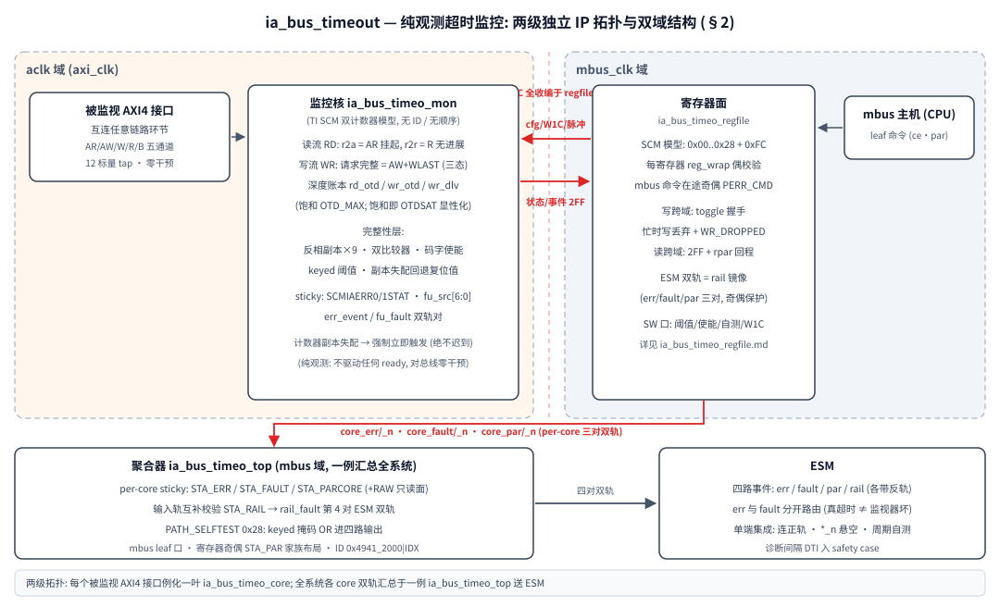
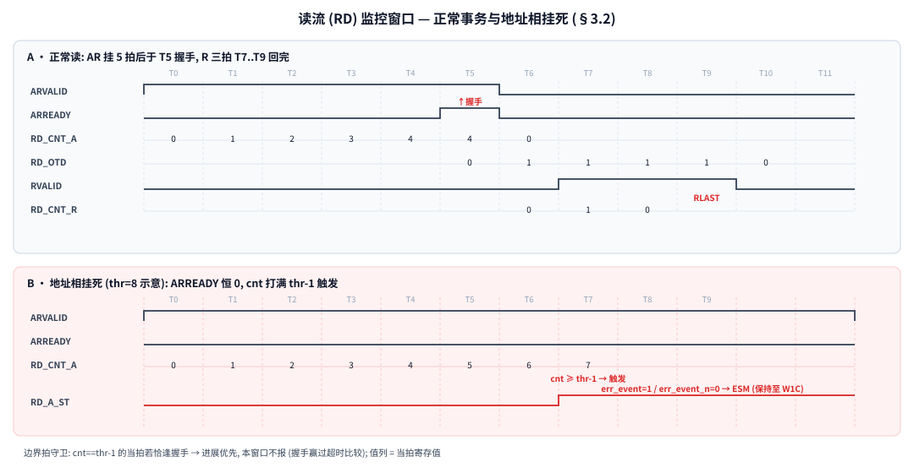
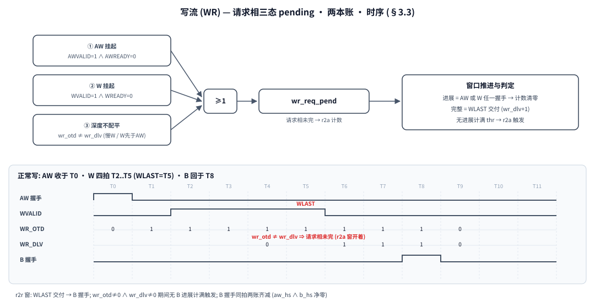
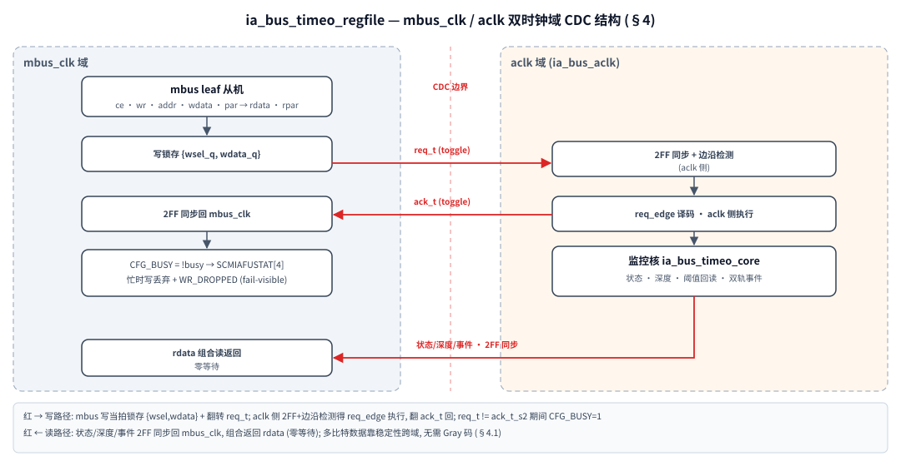

# ia_bus_timeout 总线互连超时监控 — 统一设计文档

**模块族**: `ia_bus_timeo_mon` (监控核, 纯观测 tap) / `ia_bus_timeo_regfile` (SCM 寄存器面, mbus leaf, CDC 内置) / `ia_bus_timeo_core` (前两者打包的单口叶端 IP) / `ia_bus_timeo_top` (全系统 fault 聚合器)
**参考**: TI Hercules RM57Lx TRM SPNU562A ch.3 SCM / ch.4.3.5; Safety Manual SPNU575 5.11.9; ARM AXI4 (AMBA 4); IEC 61508:2010 SIL2
**文档版本**: v1.0 (2026-11-13) —— 首版统一设计文档 (此前仅有寄存器/覆盖率两份分册)
**关联文档**: [ia_bus_timeo_regfile.md](ia_bus_timeo_regfile.md) (寄存器逐条详解 v1.4) / [ia_bus_timeo_cov_sil2.md](ia_bus_timeo_cov_sil2.md) (覆盖率与 SIL2 分析)

---

## 目录

- §1 定位与设计目标
- §2 总体架构: 两级独立 IP + 双域
- §3 监控核设计 (双流模型 / 读流窗口 / 写流三态 / 深度账本)
- §4 FuSa 完整性层
- §5 寄存器面与 CDC (摘要)
- §6 ESM 集成与聚合器
- §7 集成约束
- §8 验证状态
- §9 设计决策表

---

## 1. 定位与设计目标

### 1.1 一句话定位

**纯观测 tap 的总线挂起检测器**: 并线观察一个 AXI4 接口的 12 个握手标量, 用"请求从发出到被接收 / 到有响应进展的**时间上界**"判据检出挂起, 只上报、**不干预** (不驱动任何 ready, 不发 dummy, 无恢复桥)。TI SCM (SPNU562A ch.3) 的直系映射。

与 hang_prot 的分工 (系统级定位):

| | ia_bus_timeout | hang_prot |
|---|---|---|
| 角色 | 检测器 (旁路观察, 零干预) | 检测 + 恢复桥 (inline, 造 dummy 释放 master) |
| OTD_MAX | 账本**量程** (≥ 真实在途) | room 门放行上限 + ID FIFO 记分板深度 |
| 在途事务身份 | 不记 (TI 原话 "no need to save outstanding transactions") | 逐笔记 {id,len} (dummy 需要) |
| 对总线 | 透明 (纯 tap) | 数据面 inline (重映射/skid/背压) |

两者可独立部署: 只需知道"挂没挂"用本 IP; 需要把 master 从挂死里拉出来加 hang_prot。

### 1.2 设计目标

| # | 目标 | 判据 |
|---|---|---|
| G1 | 检测地址相挂起 (AR/AW 发出后长期不被接收) | req2accept 计数 ≥ 阈值 |
| G2 | 检测数据相挂起 (读无 R 进展 / 写 WLAST 后无 B / 写数据停滞) | req2resp 计数 ≥ 阈值; 写数据停滞并入 req2accept |
| G3 | 检测结果 fail-visible (sticky + 双轨 ESM) | SCMIAERR0/1STAT 粘滞; err_event/_n 电平 |
| G4 | 监控器自身失效可检测 | 反相副本/码字/双比较器 + 独立 fu_fault 通道 |
| G5 | 真超时与监视器坏**不可混淆** | err_event 与 fu_fault 分开路由 ESM 组 |
| G6 | 集成零侵入 | 纯 tap + mbus leaf, 被监视双方无需任何改动 |

### 1.3 检测覆盖清单 (bus-level)

1. 地址相挂起 (AR/AW): req2accept 计数 + sticky + ESM;
2. 写数据相挂起: WVALID && !WREADY 并入写请求相监控;
3. 数据相挂起: 读 = AR 已收无 R 进展; 写 = WLAST 已交付无 B;
4. 停滞的写请求 (master-slow-W / W 早于 AW): 深度不配平 → req2accept;
5. 监视器潜伏故障: selftest_key + 完整性层 (§4);
6. 配置损坏: keyed 写 + 阈值回读 (SPNU575 周期 SW 回读);
7. 边界拍守卫: 最后允许拍上的握手赢过超时比较 (不误报);
8. **不在 IP 内覆盖**: 副本共模 —— 启动端到端事务测试 + 周期 selftest 兜底 (系统级)。

---

## 2. 总体架构: 两级独立 IP + 双域



*图 1: 两级独立 IP 拓扑 —— 每个被监视 AXI4 接口例化一叶 `ia_bus_timeo_core`, 全系统各 core 三对双轨汇总于一例 `ia_bus_timeo_top` 送 ESM*

- **两级拓扑** (集成范例 2.parity edc_core/edc_top): `ia_bus_timeo_core` = 监控核 + 自带 regfile 的单口叶端 IP, **一个被监视接口一例** (`addr[15:8]=IDX` 实例号); `ia_bus_timeo_top` 聚合器不接任何 AXI 信号, 只收各 core 的三对双轨 (§6)。
- **双域划分**: mbus_clk 域 = regfile (SCM 寄存器模型, CDC 全部收编于内); axi_clk 域 = 监控核 (超时窗口 + FuSa 完整性层)。两钟无相位/频率关系约束。
- **观察点 = 被监视接口的握手线上**: 12 个标量 tap (AR/AW/W/R/B 五通道 valid/ready/last), 组合采样, 监控核对总线**零干预**。
- **复位**: mbus_rstn 与 axi_rstn 系统级同时断言 (CDC 握手对齐); 监控核内 rst_sync (3 级, 异步断言/同步释放), scan_mode 逐层拉到 top (DFT, 8.reset_checker 惯例)。

---

## 3. 监控核设计 (ia_bus_timeo_mon)

### 3.1 双流模型 (TI Table 4-4 精确映射)

一个 AXI 口 = 两条独立监控流 (IA bit): 读流 RD (bit0) / 写流 WR (bit1), 每条流两个窗口计数器:

| 流 | req2accept 窗口 | req2resp 窗口 |
|---|---|---|
| 读 (IA0) | ARVALID&&!ARREADY 起计, AR 握手清零 | AR 握手起计, **任一 R beat 清零**, RLAST 时 otd 减 |
| 写 (IA1) | **"写请求完整" = AW 握手 + W 全发完 (WLAST 过)**, 三态 pending (§3.3) | WLAST 交付起计, B 握手清零 |

为什么写的 req2accept 不是 "AW 握手": TI 的总线写请求天然带数据, 一笔"请求"含数据; AXI 把 AW 和 W 拆开, 所以"写请求被完整接收"要到 WLAST 才成立。

### 3.2 读流窗口



*图 2: 读流正常事务 (A) 与地址相挂死 (B); 值列 = 当拍寄存值*

- **r2a**: ARVALID&&!ARREADY 逐拍 +1, 握手当拍清零; `cnt ≥ thr-1` 且仍未握手 → 触发 (thr=8 示意时 T7 拍 cnt=7)。
- **r2r**: 窗口开 = rd_otd≠0; 任一 R beat 握手 = 进展清零; RLAST 握手 otd 减一。注意 rbeat 与 rl_hs 同拍时 otd 净零 (加减相消)。
- **边界拍守卫**: fire 是电平比较, cnt==thr-1 的当拍若恰逢握手 → 进展优先, 本窗口不报 —— 最后允许拍上的握手赢过超时比较, 消除 1 拍竞态误报。

### 3.3 写流: 请求相三态 pending



*图 3: wr_req_pend 三条件 OR + 正常写时序 (两本账 wr_otd/wr_dlv)*

```
wr_req_pend = (AWVALID && !AWREADY)    // AW 挂起
            || (WVALID  && !WREADY )   // W 挂起
            || (wr_otd != wr_dlv)      // 深度不配平 (慢W / W先于AW)
进展 (wr_prog) = AW 握手 || 任一 W beat 握手 → wr_cnt_a 清零
```

第三态是关键: "AW 已收但 W 没发完" 也是**请求进行中** —— master 扣着 W 不发 (master 侧故障) 与 slave 不收 AW, 在监控语义里同为 r2a 无进展。B 先于 WLAST 出现的负漂移窗口同样被 `otd≠dlv` 覆盖。

### 3.4 深度账本与饱和 (OTD_MAX = 量程)

```
rd_otd = AR 握手数 − RLAST 握手数        (饱和于 OTD_MAX, 不回卷)
wr_otd = AW 握手数 − B  握手数           (同上)
wr_dlv = WLAST 握手数 − B 握手数         (同上)
```

- **饱和语义**: 账本在 OTD_MAX 顶上又来递增握手 → 该次递增被丢弃 → 真实深度从此超过账本, drain 后欠计 —— 多出的部分若 hang 将对 r2r 不可见。此事件置 `otd_sat` (fu_src 顶位 [6] OTDSAT + fu_fault, sticky), SW 应 quiesce 流量 + TO_CLR 重启账本, **而不是信任饱和深度**。饱和流可由 SCMOTD (读 = OTD_MAX) 定位。
- **OTD_MAX 是量程不是门限**: 本 IP 纯观测、无 room 门, 在途多少由 masters/互连决定; 量程配小则**正常流量打饱和 = 假 FU_FAULT 告警**。集成约束 = **OTD_MAX ≥ 观察点真实最大 outstanding** (§7.1), 成本只是计数器位宽。
- 深度计数**无 ID、无顺序** (TI 原话) —— 身份记分板是 hang_prot 恢复桥的事; 本核只回答"有没有进展"。

### 3.5 触发与状态语义

- fire 条件**双算** (计数器一遍 / 反相副本一遍, OR 进 fire, 分歧 = fu_fault); 计数器/深度副本失配**强制立即触发** —— 被扰坏的计数器绝不让报告迟到 (危险方向)。
- sticky: 触发置位, **W1C 清除优先于置位**; 但源在线 (挂起持续) 时 W1C 后下一拍立即再置位 —— "清不掉 = 故障持续" (TI T6 语义), 软件先修根因再 W1C。
- `to_clear` (keyed): 同步清零全部实时计数器/深度账本 (THR 语义的重启); `selftest_key`: 强制比较器触发, 证明 err_event 上报链 (含双轨); `fu_selftest`: 强制 fu_fault **不锁 fu_src** —— ESM 服务程序以 "有 fault 无源" 签名识别自测图案 (§4.2)。
- 阈值 == 0 = 显式禁用该检查 (keyed, SW 主动动作); 复位值非零。ena 码字关 = 全部 fire 路径静默 (fail-visible 的例外, SW 显式动作)。

---

## 4. FuSa 完整性层

| 机制 | 实现 | 作用 |
|---|---|---|
| 码字使能 | 4'b1111 开 / 4'b0000 关, 汉明距 4, 多数判决 (ones≥3 开 / ≤1 关 / ==2 保持+报) | 使能位 SEU: 1 翻纠 1 并**写回清洁码字自愈**; 2 翻方向不明 → 保持监控开 + 上报 (fail-visible) |
| keyed 配置 | cfg_key == 4'b1010 才有效; 使能写只收合法码字 | 随机写不能破坏阈值/使能 |
| 阈值副本 | thr + 反相副本逐拍比较; 失配 → fu_fault 且**有效值回退复位值** | 阈值损坏不会静默关检查 (绝不禁到 0) |
| 计数器副本 | 每计数器/深度带反相副本 (mon 记录 9 对) | 失配 1 拍检出 + **强制立即触发** (不让报告迟到) |
| 双比较器 | fire 从正/反副本各算一遍 OR | 比较器单点翻转可见 (分歧 = fu_fault) |
| 状态副本 | sticky 位带反相副本; 失配**自愈为置位** | 被 SEU 清掉的错误重新上报 |
| 双轨输出 | err_event/_n, fu_fault/_n 对 | 传输故障 ESM 侧可检 |
| 命令在途奇偶 | mbus `par = ^{addr,wr,wdata}` 每次 ce 检查 | 坏奇偶写阻断 / 读门控 0 + PERR_CMD (regfile 侧) |

**fu_src 7 位定位** (SCMIAFUSRC, 与 fu_fault 同 fu_w1c): [0] ENA 使能码 / [1] THRA / [2] THRR 阈值副本 / [3] CNT 计数器深度副本 / [4] CMP 双比较器分歧 / [5] STAT 状态副本 / [6] OTDSAT 账本饱和。

**err_event 与 fu_fault 刻意分轨**: 坏掉的监视器不能与真实总线超时不可区分 —— 各走各的 ESM 组 (双轨各自成对)。

**残余**: 同一数据的双副本共模损坏 —— 周期 selftest_key / fu_selftest + 启动端到端事务测试兜底 (SPNU575 5.11.1), 文档化残余。

---

## 5. 寄存器面与 CDC (摘要)

完整地图/字段/软件流程见 [ia_bus_timeo_regfile.md](ia_bus_timeo_regfile.md) v1.4; 结构:



*图 4: regfile 双域 CDC —— 写锁存+req_t/ack_t toggle 握手 / req_edge 影子执行 / 2FF 状态回程 (与 axi2sram_ctrl_regfile 规则 23 同构)*

| 偏移 | 名称 | 访问 | 要点 |
|---|---|---|---|
| 0x00/0x04 | SCMIAERR0/1STAT | W1C/R | r2a / r2r 超时 sticky, bit0=RD bit1=WR |
| 0x08 | SCMIASTAT | R | 流活动电平 (pending 指示) |
| 0x0C | SCMOTD | R | 每流深度动态值 (饱和定位) |
| 0x10 | SCMCNTRL | W/R | key[7:4]=A + ENA 码 + TO_CLR/SELFTEST/FU_SELFTEST 脉冲 |
| 0x14/0x18 | SCMTHRESH0/1 | W/R | r2a / r2r 阈值 ([15:0]) |
| 0x1C | SCMIAFUSTAT | W1C/R | FU_FAULT + 双轨回读 + CFG_BUSY + WR_DROPPED |
| 0x20 | SCMIAFUSRC | W1C/R | fu_src 7 位 |
| 0x24/0x28 | STA_PAR / CFG_REGST | — | house standard 寄存器奇偶 (PERR bit=2+组号, 0 组..10 组) |
| 0xFC | ID | R | 0x4941_0002 ("IA" v1.3) |

CDC 要点: 写跨域 = 单笔 toggle 握手 (锁存 {wsel,wdata} + req_t, aclk 侧 2FF+边沿 req_edge 译码, 飞行窗口 payload 静止无亚稳); **忙时写丢弃 + WR_DROPPED 粘滞** (零等待不停总线, 丢弃显性化); 读跨域 = 2FF 回程 + rpar 无条件驱动; 每寄存器 reg_wrap 偶校验 (mbus 镜像 + aclk 影子 + CMD wrap)。

---

## 6. ESM 集成与聚合器 (ia_bus_timeo_top)

聚合器五件事 (mbus 单域, 详图见 regfile doc §9):

1. **per-core sticky**: STA_ERR (真超时) / STA_FAULT (完整性) 一读定位哪个 core, 再进 core 查流级明细;
2. **per-core 寄存器奇偶** STA_PARCORE 独立通道 (不与超时混排), 折入聚合 reg_par_fault;
3. **输入轨互补校验** STA_RAIL: 每 core 三对轨逐拍查真/反轨同值违例 → rail_fault 第 4 对 ESM 双轨 (真值捕获仍用真轨, 违例只上报不改写);
4. **聚合四对双轨送 ESM** (err / fault / par / rail 各带反轨);
5. **PATH_SELFTEST** (0x28 CFG_ESMTEST, key=1010 + [7:4] 掩码): 测试位 OR 进四路输出, 供 ESM 周期验证通路连通; 签名 = "通道报 1 而本模块一切 STA 源读 0"。

**ESM 单端集成契约** (2026-11-09): ESM 单端时连四根正轨、`*_n` 悬空保留; 末段在线双轨检查失效为文档化残余, 潜藏故障覆盖改周期 PATH_SELFTEST (诊断间隔 DTI 入 safety case); **core→top 段六根全接不变**。各 core 自带 ESM 双轨直出仍可用 (独立冗余通道, 集成可选)。

---

## 7. 集成约束

1. **OTD_MAX ≥ 观察点真实最大 outstanding** (§3.4 量程语义): 纯观测无 room 门, 量程不足则正常流量打 OTDSAT = 假完整性告警; 成本仅计数器位宽, 出厂给宽裕常数 (16/32) 即可, 集成方零计算;
2. r2a 阈值 > 最坏合法不被接收时间 (下级仲裁 + 正常背压窗口); r2r 阈值 > slave 最坏合法响应延迟 (含长突发逐拍回数据间隔);
3. 阈值 0 = 禁用该检查 (keyed 显式动作); 复位值非零, 上电即监控;
4. mbus_rstn 与 axi_rstn 系统级同时断言 (CDC 握手对齐); scan_mode 逐层拉到 top;
5. 观察点选在被监视接口的握手线上, tap 采样时钟 = 该接口的 axi_clk;
6. ESM 侧: 双端接四对轨; 单端连正轨 + 周期 PATH_SELFTEST (§6);
7. 被监视双方 (master/slave/互连) **无需任何改动** —— 纯 tap + mbus leaf 是本 IP 的集成卖点;
8. W1C 规程: 先修根因再 W1C (源在线清不掉是 T6 语义, 不是 bug); 想临时静默用 ENA=0x0 (keyed)。

---

## 8. 验证状态

- TB: `sim/tb_ia_timeo_gen_wrap.sv` (core+top 双级), `sim/run_vcs.sh` 自检 (ERR: / failed at / TB PASS 三查, SVA 不进退出码的对策);
- 覆盖率: **TOGGLE 100.00 双域** (2026-11-07 el 重建实测, `sim/tgl_struct_excl.el` + `gen_ia_excl.py`);
- 分支/条件/注错矩阵: 见 [ia_bus_timeo_cov_sil2.md](ia_bus_timeo_cov_sil2.md) §2 (ena 码字三分支 force 注入 / 副本失配 / 双比较器分歧 / 饱和丢增量 / 边界拍 ±1 等定向);
- SIL2 残余清单与 PFH 论证: 同文档 §5-§6。

---

## 9. 设计决策表

| # | 决策 | 备选 | 拒绝理由 |
|---|---|---|---|
| D1 | 纯观测 tap, 零干预 | inline 恢复桥 | 检测与恢复解耦; 恢复是 hang_prot 的职责 (需 ID 记分板/dummy 引擎, 代价一个量级) |
| D2 | 时间上界判据, 不解析下级状态 | 理解下级 outstanding | ready/valid 只述事实不携带原因; 解析下级破坏层级解耦 (TI 同结论) |
| D3 | 深度计数无 ID/无顺序 | per-事务记分板 | 无恢复动作就不需要身份; 记分板是恢复桥的专利 |
| D4 | 写请求完整 = WLAST | AW 握手 | TI 写请求天然含数据; AW 收/W 停也是"请求进行中" |
| D5 | otd≠dlv 并入 r2a pending | 只看 valid 挂起 | master-slow-W / W 先于 AW 都是无进展请求 |
| D6 | 饱和丢递增 + OTDSAT 显性化 | 回卷/信任账本 | 欠计会掩盖真挂死 (危险方向); 量程语义 + 集成约束 ≥ |
| D7 | 计数器副本失配强制立即触发 | 只报 fu_fault | 坏计数器不让报告迟到 |
| D8 | err_event 与 fu_fault 分轨 | 合并上报 | 坏监视器不能与真超时不可区分 |
| D9 | W1C 后源在线立即再置位 | 置位锁存到清除 | "清不掉 = 故障持续" 是诊断信息 (T6 语义) |
| D10 | 观察点两流 (RD/WR) 分开计数 | 单口单流 | 读/写通道独立挂起独立定位 (SCMIAERR0/1STAT bit0/bit1) |
| D11 | 边界拍握手赢过比较 | 严格 ≥ 即报 | 最后允许拍上的进展是真进展, 消 1 拍竞态误报 |
| D12 | 两级独立 IP (core 一口一例 + top 聚合) | 多口聚合核 | 每接口独立例化 (地址即实例号), 聚合只做 sticky/轨校验/自测 —— 与 edc 家族同构 |
