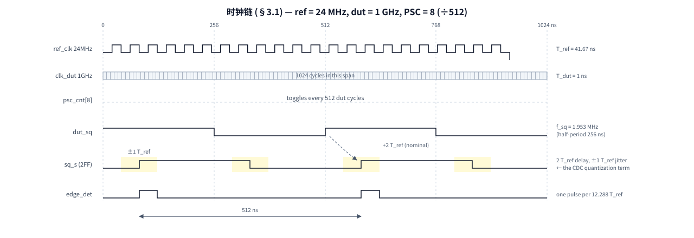
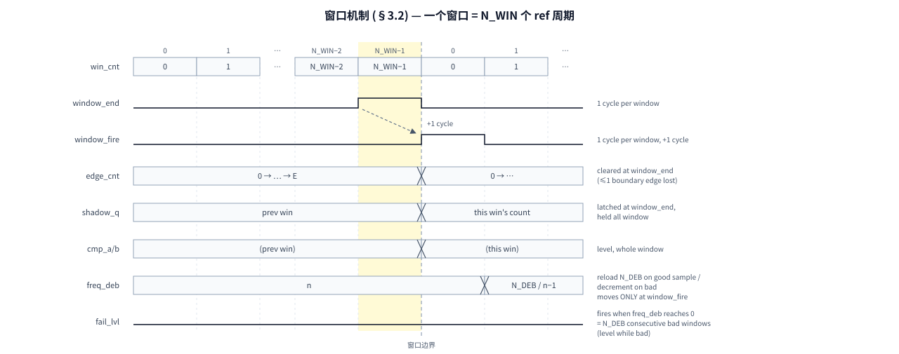
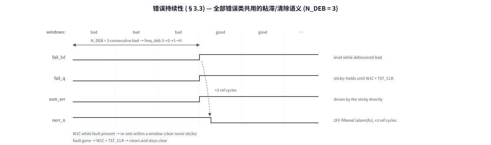

# CMM — Timing Budgets, Error Classes, and Software Guide

Companion to `cmm_sil2_design.md` (architecture) and `fusa_coverage_sil.md`
(safety analysis). This file is the sizing + operations handbook: every
expire value, the timing relationships between the internal signals, a
worked 24 MHz-reference example, the error taxonomy with hold/clear
semantics, and the software flows for initialization and for each error
class (single channel first, then multi-channel).

---

## 1. Parameters (elaboration-time)

All sizing knobs sit on `cmm_top`; the measurement core (`cmm_core`) and
the register file (`cmm_regfile`) receive them by pass-through.
Runtime-programmable values (window bounds, NDEAD, EN, REFSEL, …) live in
registers — see §6.0; the parameters below fix ranges, defaults and
architecture at elaboration.

| Parameter | Module(s) | Default | Unit | Meaning / sizing rule |
|-----------|-----------|---------|------|------------------------|
| `N_DUT` | top, regfile | 16 | — | channels under test (1..16). Drives register packing (FUSRC0/1 nibbles, `DUT_PSC` width) and ID[7:0]. |
| `CNT_W` | top (localparam), regfile, core | 12 | bits | width of edge/shadow/no-edge counters and of the WIN_LO/HI/DEAD register fields. Fixed at 12 to keep the 16ch × 12-bit channel-register packing; constrains E·1.05 < 4096 (§4). |
| `N_WIN` | top | 32768 | ref cycles | reference window length = expire value of `win_cnt`; the detection time quantum. window = N_WIN/f_ref (1.365 ms @ 24 MHz). |
| `WIN_LO_RST` / `WIN_HI_RST` | top, regfile | 1621 / 1792 | edges | reset values of the per-channel band registers (CHi_LO/HI); sized for dut = 20 MHz @ PSC=3 (E = 1706.7, ±5%). Production values programmed per §4. |
| `NDEAD_RST` | top, regfile | 4095 | ref cycles | reset value of CHi_DEAD (no-edge timeout). Deliberately loose (max) — SW programs ≈ 2× the slowest legal edge interval (§4). |
| `N_DEB` | top, core | 3 | windows | FAIL_FREQ debounce: consecutive bad windows before `fail_lvl`. Trades detection time (N_DEB windows) against transient tolerance (N_DEB−1 bad windows absorbed). 2-bit counter → max 3. Also the NEVER_ARMED watchdog debounce (same trade). |
| `DUT_PSC` | top | {N_DUT{4'd3}} | 4 bits/ch | per-channel prescaler tap, packed `[4i+:4]` → PSC of channel i; square wave = clk_dut / 2^(PSC+1). Rule: smallest PSC with f_dut/2^(PSC+1) ≤ f_ref/4, then check E·1.05 < 2^CNT_W (§4). |
| `EN_RST` | top, regfile | {16{4'hF}} | 4 bits/ch | per-channel coded-enable **reset** nibble, packed `[4i+:4]`: `F` = enabled at POR, `0` = **born disarmed** (channel behind a power-on clock gate — stays silent until SW writes EN=1111 after opening the gate, §6.6). Nibbles ≥ N_DUT ignored. |
| `WKEY` | top, regfile | 4'h5 | — | keyed-write key in `wdata[31:28]` for GCTRL/FORCE/CH space (CFG_REGST uses its own 1010 key); wrong key → write rejected + REG_PROT. |
| `HANG_TO` | top, regfile | 1024 | mbus cycles | config CDC req/ack watchdog expire → CFG_HANG. Must be ≫ worst-case handshake latency (~6 ref cycles); 1024 @ 48 MHz ≈ 21 µs. |
| `WIN_ALIVE_MAX` | top, regfile | 131072 | mbus cycles | window-alive watchdog expire → REF_STALE. Must exceed one window in mbus cycles; 131072 @ 48 MHz ≈ 2.7 ms ≈ 2 windows @ 24 MHz ref. |
| `IDX` | top, regfile | 0 | — | mbus instance id; the leaf responds when `addr[15:8] == IDX`. |

Per-channel constants inside `cmm_core` are driven from the top, not
free: `PSC(i) ← DUT_PSC[4i+:4]`, `CNT_W ← 12`, `N_DEB ← N_DEB`.

Elaboration-time review checklist (all must hold):

- `f_dut(i) / 2^(PSC(i)+1) ≤ f_ref/4` for every channel — 2FF + edge-detect Nyquist
- `E(i)·1.05 < 2^CNT_W = 4096` — counter and register-field width
- `NDEAD(i) ≪ N_WIN` and ≈ 2× the slowest legal edge interval
- `WIN_ALIVE_MAX > N_WIN · f_mbus/f_ref` — watchdog outlives one window
- `HANG_TO ≫` CDC handshake latency in mbus cycles

---

## 2. Expire values — the complete list

| # | Name | Where | Unit | Default | Fires when reached |
|---|------|-------|------|---------|--------------------|
| 1 | `N_WIN` | cmm_top param | ref cycles | 32768 | window length; `win_cnt` hits N_WIN−1 → `window_end` (1 cycle) |
| 2 | `2^(PSC+1)` | per-ch `DUT_PSC[4i+:4]` | dut cycles | 3 (÷16) | dut prescaler: dut cycles per counted edge |
| 3 | `WIN_LO` / `WIN_HI` | per-ch CHi_LO/HI regs | edges | 1621 / 1792 | legal count band for one window (nominal ±5%) |
| 4 | `NDEAD` | per-ch CHi_DEAD reg | ref cycles | 4095* | no dut edge for this long → DEAD (*loose default, size per §4) |
| 5 | `N_DEB` | cmm_top param | windows | 3 | consecutive bad windows → FAIL_FREQ; also N_DEB+1 unarmed windows (FSM in RUN, EN on) → NEVER_ARMED |
| 6 | `HANG_TO` | cmm_regfile param | mbus cycles | 1024 | config CDC handshake stuck → CFG_HANG |
| 7 | `WIN_ALIVE_MAX` | cmm_regfile param | mbus cycles | 131072 | no window toggle for this long → REF_STALE |

Sizing formulas (use these in the review, not hand-picked numbers):

```
expected edges per window  E = N_WIN * f_dut / (f_ref * 2^(PSC+1))
PSC rule:  smallest PSC with f_dut / 2^(PSC+1) <= f_ref/4     (2FF + edge-detect Nyquist)
           then check  E * 1.05 < 2^CNT_W (= 4096)            (else PSC + 1)
WIN_LO/HI = E * (1 -+ tol),  tol = 5% production
NDEAD    ~= 2x slowest LEGAL edge interval in ref cycles      (<< N_WIN)
           slowest legal interval = 2^(PSC+1) * f_ref / (f_dut * (1-tol))
```

---

## 3. Timing relationships

### 3.1 Clock chain (example: dut = 1 GHz, PSC = 8)



*图 1: 时钟链 — ref_clk 24 MHz (T_ref = 41.67 ns) · clk_dut 1 GHz (T_dut = 1 ns) · psc_cnt[8] 每 512 dut 周期翻转 · dut_sq = 1.953 MHz (半周期 256 ns) · sq_s 经 2FF 延迟 2 T_ref ±1 T_ref 抖动 (CDC 量化项) · edge_det 每 12.288 T_ref 一个脉冲, 脉冲间距 512 ns*

### 3.2 Window machinery (one window = N_WIN ref cycles)



*图 2: 窗口机制 — win_cnt 计到 N_WIN-1 (高亮列) 出 window_end 脉冲 (每窗口 1 拍), window_fire 迟 1 拍; edge_cnt 在 window_end 清零 (边界沿至多丢 1 个边沿), shadow_q 同拍锁存本窗计数值并整窗保持, cmp_a/b 为全窗电平; freq_deb 只在 window_fire 动作 (好样本 reload N_DEB / 坏样本 decrement); freq_deb 到 0 = N_DEB 连续坏窗口 → fail_lvl 置位*

Key point: `freq_deb` counts **windows**, not ref cycles — the debounce time
constant is N_DEB windows, and one isolated bad window produces exactly one
bad sample (filtered). The 1-cycle `window_end → window_fire` delay is NBA
alignment (sample the shadow of the just-closed window, not the previous
one); it costs 1 ref cycle, not a window.

### 3.3 Error persistence (all classes)



*图 3: 错误持续性 (全部错误类) — N_DEB=3 个连续坏窗口后 fail_lvl 置位 (debounced-bad 期间电平); fail_q 粘滞保持到 W1C + TST_CLR; esm_err 由粘滞直接驱动; nerr_n 经 2FF 滤 (alarm|fu) 迟 +2 ref cycles 拉低; 故障仍在时 W1C 一个窗口内重置 (清不掉), 故障消失后 W1C + TST_CLR 清净保持*

---

## 4. Worked example: ref = 24 MHz, dut ∈ {200 MHz, 1 GHz, 2 GHz}

Window = 32768 / 24 MHz = **1.365 ms**. Method check — the module defaults
are exactly the dut = 20 MHz / PSC = 3 point: E = 32768·20/(24·16) = 1706.7,
±5% → [1621, 1792] = WIN_LO_RST / WIN_HI_RST ✓.

| dut | PSC | f_sq | edge interval | E | WIN_LO / WIN_HI | NDEAD |
|-----|-----|------|---------------|------|------|-------|
| 200 MHz | 6 (÷128) | 1.563 MHz | 640 ns = 15.4 T_ref | 2133.3 | [2027, 2240] | 32 |
| 1 GHz | 8 (÷512) | 1.953 MHz | 512 ns = 12.3 T_ref | 2666.7 | [2533, 2800] | 32 |
| 2 GHz | 9 (÷1024) | 1.953 MHz | 512 ns = 12.3 T_ref | 2666.7 | [2533, 2800] | 32 |

Checks: f_sq ≤ 6 MHz (f_ref/4) ✓ · E·1.05 = 2800 < 4095 (CNT_W = 12, keeps
the 192-bit channel register packing) ✓ · NDEAD = 32 > 15.4/0.95 = 16.2
T_ref slowest legal interval (2× margin) ✓. Non-integer E dithers the count
by ±1 edge; total measurement error (dither + CDC ±1 + boundary ≤1) ≈ ±0.1%
≪ 5% band.

### 4.1 Trip-frequency boundaries — what the LO/HI counts mean in MHz

The register band is in counts; the frequency it gates is counts × the
count quantum. With **Δf = 1 LSB = f_ref·2^(PSC+1)/N_WIN** (the frequency
equivalent of one counted edge per window), the programmed band maps to
three boundary pairs:

```
nominal trip    : f < LO·Δf   or  f > HI·Δf      (HI·Δf = f_dut·(1+tol) exactly
                                                    when E·(1+tol) rounds clean;
                                                    LO·Δf within ½ count of
                                                    f_dut·(1−tol))
guaranteed trip : f ≤ (LO−3)·Δf  or  f ≥ (HI+3)·Δf   (worst −3 count error
                                                       still outside the band)
possible false  : f ≤ (LO+3)·Δf  or  f ≥ (HI−3)·Δf   (a healthy frequency can
                                                       read up to 3 counts off)
```

The ±3Δf uncertainty comes from the three ±1 LSB measurement terms
(non-integer-E dither, CDC 2FF quantization, window-boundary edge loss);
inside the ±3Δf skirt the verdict depends on error direction. N_DEB still
applies on top (three consecutive bad windows — time filtering, it does not
move the frequency boundary).

| dut | Δf (1 LSB) | nominal low / high | guaranteed low / high | possible-false low / high |
|-----|-----------|--------------------|-----------------------|---------------------------|
| 20 MHz (PSC 3) | 11.72 kHz | 18.9961 / 21.0000 MHz | 18.9609 / 21.0352 MHz | 19.0312 / 20.9648 MHz |
| 200 MHz (PSC 6) | 93.75 kHz | 190.0312 / 210.0000 MHz | 189.7500 / 210.2812 MHz | 190.3125 / 209.7188 MHz |
| 1 GHz (PSC 8) | 375 kHz | 949.875 / 1050.000 MHz | 948.750 / 1051.125 MHz | 951.000 / 1048.875 MHz |
| 2 GHz (PSC 9) | 750 kHz | 1899.750 / 2100.000 MHz | 1897.500 / 2102.250 MHz | 1902.000 / 2097.750 MHz |

Read the guaranteed columns as the FAIL_FREQ detection statement (1 GHz
row): a drift beyond −5.13% / +5.11% is certain to alarm within N_DEB
windows; a frequency inside −4.90% / +4.89% is certain not to; between
those skirts (≈ ±3Δf ≈ ±0.11% around each nominal boundary) the verdict
depends on error direction.

Machine-checkable: **`doc/cmm_win_calc.py <f_dut_MHz>`** prints PSC/E/
precision/LO/HI (with actual post-rounding percentages)/all three boundary
pairs/NDEAD/latencies and the keyed register write values (WKEY<<28). Its
output for the four rows above reproduces this table exactly (regression
2026-11-07). Reminder: PSC is an elaboration parameter (`DUT_PSC[4i+:4]`) —
if the computed tap differs from the instantiated one, change the RTL and
resynthesize; LO/HI writes alone cannot retune the divider.

Detection latencies at these settings:

| Event | Latency | Value here |
|-------|---------|-----------|
| DEAD (clock stops) | NDEAD ref cycles | 1.33 µs |
| FAIL_FREQ (persistent drift) | N_DEB windows (+ ≤1 window quantization) | ≈ 4.1 ms |
| FU integrity event → rails | a few ref cycles (+2 for nERR) | < 0.2 µs |
| CFG_HANG | HANG_TO mbus cycles | 21 µs @ 48 MHz mbus |
| REF_STALE | WIN_ALIVE_MAX mbus cycles (≈2 windows) | ≈ 2.7 ms |

Example failure story: 1 GHz channel drops to 900 MHz (−10%) → E = 2400 <
2533 → every window bad → freq_deb 3→2→1→0 → FAIL_FREQ after ≈ 4.1 ms.

---

## 5. Error classes — basis, content, hold/clear semantics

Classification basis: **what is broken — the watched clock, the watcher
itself, or the configuration channel.** Each class has its own output rail
(all three merge into nERR toward the PMIC, but the ESM can tell them apart):

| Class | Rail | Contents | Basis |
|-------|------|----------|-------|
| **safety alarm** | `esm_err/_n` | FAIL_FREQ (out of band), DEAD (clock stopped) | the monitored clock is out of spec → direct safety-goal violation, needs system reaction |
| **integrity fault** | `esm_fault/_n` | FU_CNT (counter/shadow pair incl. armed-flag pair), FU_CMP (comparators disagree), FU_PSC, FU_WIN, HIERR (EN codeword), FSM (illegal state), **NEVER_ARMED** (FUSTAT[10]: enabled channel never saw its first edge), REG_PROT, CFG-shadow parity, **in-flight command parity PERR11/PERR12 (synced in, 2026-11-13 rule 25)** | the monitor itself may be blind (latent fault) → needs service/repair; a counter pair break always reports here, never as FAIL_FREQ (FU pre-empts: the FSM leaves RUN before the debounce accumulates) |
| **config channel** | `cfg_hang/_n`, `reg_par_fault/_n` | CFG_HANG, REF_STALE, WR_DROPPED (FUSTAT[8/9/7]); PERR groups, PAR_SELFTEST (STA_PAR) — register-plane parity only (in-flight events PERR_CMD/inflight moved to esm_fault, 2026-11-13) | configuration is untrustworthy: writes may not have landed, storage may be flipped |

Hold/clear semantics (everything lands in sticky, dual-rail, heal-to-SET
latches; outputs are levels driven straight from the stickies):

| Event | Holds for | Cleared by |
|-------|-----------|------------|
| FAIL_FREQ / DEAD | until W1C + TST_CLR; while the fault persists a W1C re-sets within ~1 window (DEAD re-issues every NDEAD cycles) | ERRSTAT / SRCSTAT W1C |
| FU_CNT/CMP/PSC, FU_WIN, HIERR, FSM, REG_PROT | same, via FUSRC0/1 / FUSTAT stickies; instantaneous re-report while the physical fault persists | FUSRC0/1, FUSTAT W1C |
| NEVER_ARMED (FUSTAT[10]) | scalar sticky; re-fires ≈(N_DEB+1) windows after each TST_CLR/restart while an enabled channel stays unarmed | FUSTAT W1C bit10 (+ TST_CLR) |
| CFG_HANG / REF_STALE / WR_DROPPED | mbus-domain sticky; saturated watchdogs re-fire until the cause is gone | FUSTAT W1C (REF_STALE: wait ~1 window after recovery) |
| REG_PAR_FAULT / PERR_CMD / PAR_SELFTEST | reg_wrap flt sticky; an SEU clear self-heals back to SET | STA_PAR W1C |
| all output rails | level, sticky lifetime | follow the stickies |

---

## 6. Software guide

### 6.0 Register map + universal rules

Instance selected by `mbus_addr[15:8] == IDX`; byte offsets below. Every
register is a parity-protected storage cell (`reg_wrap`): storage + even
parity, a storage parity error raises the STA_PAR PERR group bit (§6.4). Access
tags: **fwd** = write forwarded to `clk_ref` through the CDC handshake
(rule 3) · **W1C** = write-1-to-clear, write 0 has no effect · **keyed** =
`wdata[31:28]` must equal WKEY else the write is rejected + REG_PROT.

| Offset | Name | Acc | Key | Storage | Reset | Content |
|--------|------|-----|-----|---------|-------|---------|
| 0x00 | ID | RO | | — | `0xC44D_01NN` | NN = N_DUT |
| 0x04 | GCTRL | RW fwd | ✓ | mbus → ref | 0 | [0] REFSEL · [1] TST_CLR (one-shot pulse, reads 0) · [3:2] rsvd · [7:4] DBGSEL — every write re-stores REFSEL/DBGSEL (rule 4) |
| 0x08 | GSTAT | RO | | ref synced | `0x0000_0288`¹ | [0] alarm · [1] fu · [2] active · [5:3] fsm (001=ARM 010=RUN 100=ERR) · [6] busy · [7] nerrn · [8] refsel · [9] any_en · [10] reg_par_fault · [11] cfg_hang |
| 0x0C | ENLO | RW fwd | | mbus → ref | `EN_RST[31:0]`² | ch 0..7 coded enables: nibble 0xF = on, 0x0 = off; any other nibble value is rejected + REG_PROT |
| 0x10 | ENHI | RW fwd | | mbus → ref | `EN_RST[63:32]`² | ch 8..15 same layout (masked 0 beyond N_DUT) |
| 0x14 | ERRSTAT | W1C fwd | | ref sticky + mbus image | 0 | [i] = ch i alarm (FAIL_FREQ OR DEAD) |
| 0x18 | SRCSTAT | W1C fwd | | ref sticky + mbus image | 0 | [2i] = fail · [2i+1] = dead |
| 0x1C | FUSTAT | W1C fwd | | mixed (ref classes + mbus liveness) | 0 | [0] cnt_any · [1] cmp_any · [2] win · [3] psc_any · [4] hierr · [5] fsm · [6] reg_prot · [7] wr_dropped · [8] cfg_hang · [9] ref_stale · [10] never_armed (scalar; an enabled channel that never saw its first edge) |
| 0x20 | FUSRC0 | W1C fwd | | ref sticky + mbus image | 0 | ch 0..7, nibble per channel: bit0 cnt · bit1 cmp · bit2 cfgpar · bit3 psc |
| 0x24 | FUSRC1 | W1C fwd | | ref sticky + mbus image | 0 | ch 8..15, same nibble layout |
| 0x28 | FORCE | RW fwd | ✓ | mbus → ref | 0 | test/diagnostic: [N_DUT-1:0] per-ch verdict force · [16] hang · [17] stale · [18] inj_psc · [19] inj_cmp · [20] inj_cnt (inj targets channel DBGSEL); bit16=0 write is the busy-escape path |
| 0x2C | DBG0 | RO | | ref synced | — | [11:0] last window count (shadow) · [27:16] no-edge counter — channel selected by DBGSEL |
| 0x30 | DBG1 | RO | | ref synced | — | [11:0] live edge count · [31:16] win_cnt — channel selected by DBGSEL |
| 0x34 | STA_PAR | W1C local | | mbus | `0x0000_0002` | [0] PAR_FAULT level (W1C clears ONLY the selftest latch) · [1] _n (rail pair, read-only) · [15:2] PERR group 0..13 (bit = 2+group) |
| 0x38 | CFG_REGST | WO fwd | ✓ | — | — | key[3:0]=1010 · [4]=1 + REGSEL[12:8] 0..13 → inject mbus wrap group · REGSEL 16+i → inject ref-domain shadow of ch i · [5]=1 → no-source signature (ESM service test); bad key → REG_PROT |
| 0x3C | ARMED | RO | | ref synced + image | 0 | [N_DUT-1:0] per-channel first-edge armed flags: 0 = channel has not seen its first DUT edge since reset/disarm (silent: no DEAD/FAIL_FREQ; watched by NEVER_ARMED while EN on) |
| 0x40+12i | CHi_LO | RW fwd | ✓ | mbus → ref | `WIN_LO_RST` | [CNT_W-1:0] window count low bound, channel i |
| 0x44+12i | CHi_HI | RW fwd | ✓ | mbus → ref | `WIN_HI_RST` | window count high bound, channel i |
| 0x48+12i | CHi_DEAD | RW fwd | ✓ | mbus → ref | `NDEAD_RST` | no-edge timeout [ref cycles], channel i |

¹ nominal directly after reset (fsm=ARM, nerrn=1, any_en=1 with EN defaults
all-enabled), before the first window fires.
² ENLO/ENHI reset per nibble = the `EN_RST` elaboration parameter of that
channel (`F` default; `0` for channels integrated behind power-on clock
gates — §6.6). With all-F EN_RST this is `0xFFFF_FFFF`.

寄存器地图位置 (house standard): STA_PAR 倒数第 3、CFG_REGST 倒数第 2、
ARMED 倒数第 1 (固定段内; 通道数组区 0x40+ 不参与倒数, ID 留 0x00)。
CFG_REGST 的 key 是 house key `wdata[3:0]=4'b1010`, **不在 WKEY[31:28] 空间**。

STA_PAR PERR group index (bit 2+k): 0 ENLO · 1 ENHI · 2 GCTRL · 3 FORCE ·
4 CLO · 5 CHI · 6 CDEAD · 7 ERRSTAT image · 8 SRCSTAT image · 9 FUSRC image ·
10 FUSTAT image · 11 in-flight payload (latch lane, bit 13, no injection
target) · 12 CMD command in-flight parity (W=1 wrap, bit 14: the W1C write
IS the wrap rewrite) · 13 ARMED image (continuously refreshed, W1C
suffices). Groups 0..6 are config
(rewrite-restore), 7..10 and 13 are continuously refreshed images (W1C
suffices), 11/12 are command-path events.

Universal rules (violations are flagged, not silently ignored):

1. **Command parity**: the master drives `par = ^{addr[15:0], wr, wdata}` on
   every command. Bad parity → write blocked, read returns 0, PERR_CMD sets.
2. **Keyed registers** (GCTRL, FORCE, CH space): `wdata[31:28] = 4'h5`,
   else the whole write is rejected + REG_PROT. CFG_REGST (0x38) uses the
   house key `wdata[3:0] = 4'hA` instead (wrong key = same event).
3. **CDC busy discipline**: config writes cross a one-at-a-time handshake.
   Poll `GSTAT[6] == 0` before each forwarded write; a write while busy is
   dropped + WR_DROPPED.
4. **GCTRL read-modify-write**: every GCTRL write re-stores {DBGSEL, REFSEL}
   — keep a shadow copy and always re-supply both (TST_CLR pulses included).
5. **W1C persistence**: clearing while the fault is still present does not
   stick (levels re-arm). "Won't stay cleared" = fault still present.
6. **TST_CLR** is a one-shot pulse: clears all stickies, FSM → ARM → RUN at
   the next window. Wait ≥ 1 window before trusting status after TST_CLR.

### 6.1 Normal initialization

After POR all channels are enabled (ENLO/ENHI reset to all-0xF) with the
default thresholds — program the real ones before they can false-alarm:

```
1. rd ID          → expect 0xC44D_01NN (NN = N_DUT)         [bus/link alive]
2. rd GSTAT       → expect alarm=0, fu=0; fsm=001(ARM) or 010(RUN)
3. for each channel i in use:                    (poll GSTAT[6]==0 between writes)
       wr CHi_LO   = KEY | win_lo[i]              // offset 0x40 + 12*i
       wr CHi_HI   = KEY | win_hi[i]             //        0x44 + 12*i
       wr CHi_DEAD = KEY | ndead[i]              //        0x48 + 12*i
4. for each unused channel: clear its ENLO/ENHI nibble to 0x0
   (an enabled channel whose clock never arrives reports NEVER_ARMED
   FUSTAT[10]; channels behind power-on gates integrate EN_RST=0 + §6.6)
5. TST_CLR: wr GCTRL = KEY | {dbgsel, 1'b0, refsel} | 0x2    [one-shot]
6. wait ≥ 2 windows
7. rd ERRSTAT / SRCSTAT / FUSTAT / STA_PAR → expect 0x2 (only the _n rail bit)
   rd GSTAT → alarm=0, fu=0, active=1, fsm=010(RUN)
8. Boot self-test (recommended; latent-fault coverage, see TB phases 6/7/10):
   a. threshold self-test ch0: wr CH0_LO = KEY | (E+100) → wait N_DEB+2 windows
      → ERRSTAT[0]=1 proves the full alarm path → restore CH0_LO
      → W1C ERRSTAT bit0 → TST_CLR → wait 2 windows → verify clean
   b. parity self-test: wr CFG_REGST = (group<<8) | 0x1A → STA_PAR[group+2]=1
      → W1C STA_PAR; and the no-source signature: CFG_REGST = 0x2A
      → STA_PAR[0]=1 (fault, no source) → W1C bit0
```

### 6.2 FAIL_FREQ flow — single channel i

Trigger: nerr_n low / ESM event; GSTAT[0]=1.

```
1. rd GSTAT    → alarm=1, note fsm[5:3] (100=ERR expected)
2. rd ERRSTAT  → bit i set
3. rd SRCSTAT  → [2i]=1: FAIL_FREQ  (a [2i+1]=1 would be DEAD — clock gone,
                  different root-cause class: PLL lock, clock gate, supply)
4. diagnose:   wr GCTRL = KEY | (i<<4) | refsel        [DBGSEL=i, RMW rule 4]
               rd DBG0   → [11:0] = last window count; compare vs [WIN_LO, WIN_HI]
               rd DBG1   → [31:16] = win_cnt moving → window machinery alive
               count ≈ 0 (with dead history) → stopped/intermittent clock
               count off by a fixed ratio    → wrong upstream divider/PLL config
5. fix the root cause (restore the clock); wait ≥ 1 window
6. W1C: wr ERRSTAT = (1<<i);  wr SRCSTAT = (1<<(2*i))
   — if the bit re-sets within ~1 window the fault is still present (rule 5)
7. TST_CLR (GCTRL pulse) → FSM ARM→RUN; wait 2 windows
8. verify: ERRSTAT=0; GSTAT alarm=0, fsm=010; nerr_n back high
9. persistent re-fire → escalate per the safety concept (backup clock / safe state)
```

### 6.3 Integrity-fault (FU) flow — single channel i

Trigger: GSTAT[1]=1.

```
1. rd FUSTAT   → class: [0] cnt [1] cmp [3] psc (channel classes)
                  [2] win / [4] hierr / [5] fsm are SHARED classes, see §6.5
2. rd FUSRC0 (ch 0..7) or FUSRC1 (ch 8..15)
               → nibble of ch i: bit0 cnt · bit1 cmp · bit2 cfgpar · bit3 psc
3. meaning: the monitor's integrity for channel i is degraded — its verdicts
   are not trustworthy until cleared (a counter pair break reports HERE,
   never as FAIL_FREQ: the FU event pulls the FSM out of RUN long before the
   N_DEB-window debounce could fire)
4. W1C: wr FUSRCx = (0xF << (4*(i%8)));  TST_CLR;  wait 2 windows
5. rd FUSRCx again:
   - stays 0 → transient SEU; dual-rail pairs have self-healed (the
     heal-to-SET sticky already re-reported it). resume.
   - re-sets → permanent cell fault → escalate: treat the channel as
     unmonitored; system-level reaction (degraded mode or reset)
6. special case FUSTAT[6] REG_PROT: not silicon — a write was REJECTED
   (bad key / RO target / illegal EN nibble). Audit the bus master.
```

### 6.4 Config-channel flow

Trigger: GSTAT[10] (reg_par_fault) and/or GSTAT[11] (cfg_hang).

```
A. reg_par_fault: rd STA_PAR (register-plane parity only, 2026-11-13 rule 25)
   - [17] PAR_SELFTEST : self-test signature, not a fault. W1C bit 17.
   - [15:4] group k    : parity error in register group k:
                         0 ENLO · 1 ENHI · 2 GCTRL · 3 FORCE · 4 CLO · 5 CHI
                         6 CDEAD · 7 ERRSTAT img · 8 SRCSTAT img
                         9 FUSRC img · 10 FUSTAT img · 11 inflight payload
       config groups 0..6 : REWRITE the register — storage and parity reload
                           together, the fault self-restores; then W1C bit 4+k
       image groups 7..11 : self-refresh every cycle; W1C bit 4+k suffices
       re-set after W1C → permanent storage fault → escalate
                         (config for that group is untrustworthy)
   - [14] PERR_CMD / inflight events now ride the esm_fault rail (C-flow):
     still queried at STA_PAR bit 14 / FUSTAT, W1C unchanged.
B. cfg_hang: rd FUSTAT
   - [7] WR_DROPPED : SW wrote while busy — driver bug; enforce rule 3.
                      W1C bit 7.
   - [8] CFG_HANG   : CDC handshake stuck > HANG_TO. If it was the force_hang
                      self-test: escape write FORCE = KEY (bit16=0, accepted
                      even while busy) clears it; the handshake self-heals.
                      Otherwise the CDC path is broken → escalate (reset).
   - [9] REF_STALE  : no window toggle for > WIN_ALIVE_MAX — the reference
                      clock or window machinery stalled. Restore the ref
                      clock, wait ~1 window (watchdog re-arms on the next
                      toggle), then W1C bit 9.
```

### 6.5 Multi-channel scenarios

Triage order whenever several events coexist: **config channel → monitor
integrity (FU) → measurement alarms** — each layer trusts the one before it.

**M1. FAIL_FREQ / DEAD on multiple channels** (several ERRSTAT bits):
```
1. sweep DBGSEL, rd DBG0 per affected channel → compare the count ratios
2. all channels off by the SAME ratio → common cause: the REFERENCE clock
   drifted or the wrong ref was selected — not the duts.
   → REFSEL switch protocol: quiesce config writes → wr GCTRL (flip bit0,
     RMW) → TST_CLR → wait 2 windows → verify all channels clean
   → or escalate the clock-tree fault upstream
3. disjoint subsets, different ratios → independent per-channel faults:
   handle per §6.2, but batch the clears (one ERRSTAT/SRCSTAT W1C write with
   all affected bits set)
```

**M2. FU on multiple channels** (several FUSRC nibbles):
```
1. check the SHARED classes first: FUSTAT[2] win (window generator feeds
   every channel), [5] fsm, [4] hierr (EN codeword) — one shared fault
   explains all channels at once
2. many channels at once → common-cause event (power/EMI/SEU burst):
   prefer a chip-level reset over per-bit cleanup; then re-run §6.1
   including the boot self-tests
3. otherwise: W1C all affected nibbles (one write per FUSRCx register),
   TST_CLR, wait 2 windows, verify FUSRC0/FUSRC1 both 0
```

**M3. Config-channel events** are inherently multi-channel (shared bus):
```
1. repair per §6.4 first
2. then RE-VERIFY every channel's config: read back CHi_LO/HI/DEAD and
   ENLO/ENHI, compare against the golden copy, rewrite any mismatch
3. W1C STA_PAR / FUSTAT, TST_CLR, verify clean for ≥ 2 windows
```

### 6.6 Gated DUT clocks — EN_RST integration, NEVER_ARMED flow

Channels behind SW-controlled (or otherwise late/power-on-gated) clock
switches integrate with elaboration parameter `EN_RST` nibble = `4'h0`:
the channel is **born disarmed** — silent (no DEAD, no FAIL_FREQ, no
NEVER_ARMED) until SW brings it up. The HW has no coupling to the gate
control; ordering is a software contract (TI-DCC-style SW enable):

**Bring-up (gate opening):**
```
1. open the upstream clock gate (DUT clock starts running)
2. wait ≥ 1 DUT clock period (a still-gated clock would immediately arm
   the NEVER_ARMED timer — legal, but avoid the false class)
3. poll GSTAT[6]==0, then set the channel's EN nibble: ENLO/ENHI |= 4'hF << 4i
4. the channel arms on its first edge (ARMED[0x3C] bit i → 1); FAIL_FREQ
   debounce starts from a full fresh N_DEB (no head start)
5. healthy declaration: poll ARMED bit i == 1, then wait N_DEB+2 windows
   and verify ERRSTAT/SRCSTAT/FUSTAT all clean
```

**Tear-down (gate closing) — order matters:**
```
1. clear the EN nibble FIRST (ENLO/ENHI &= ~(4'hF << 4i))  — channel
   disarms: DEAD/FAIL_FREQ/NEVER_ARMED all go silent
2. then close the clock gate
   (closing the gate on a still-armed channel reports DEAD — a real alarm,
   just the wrong class for a planned shutdown)
```

**NEVER_ARMED flow** (FUSTAT[10]=1, esm_fault active, GSTAT fu=1):
```
1. rd ARMED (0x3C) → zero bits = the enabled channels that never saw a
   first edge (gate never opened / upstream clock dead / wrong PSC config
   below the WIN_LO band does NOT apply — unjudged windows cannot fire it)
2. intended gate-open in flight? → wait: the channel arms on the first
   edge and joins judging; W1C FUSTAT bit10 (or TST_CLR) afterwards
3. channel really absent:
   a. retire it: clear its EN nibble (watchdog source gone, no re-fire)
   b. or restart it: open the gate → the channel arms → W1C bit10
      → TST_CLR (RMW rule 4) → wait 2 windows → verify clean
4. note: after any TST_CLR/restart, NEVER_ARMED re-fires ≈(N_DEB+1) windows
   later if the condition persists (never_deb reloads at TST_CLR) — a W1C
   that "won't stay cleared" means the channel is still not arriving
```

**TST_CLR quiesce rule** (ordering, from the TB race that motivated it):
TST_CLR is a *soft* armed-clear — a still-running DUT clock re-arms on its
next edge (by design; this is what makes TST_CLR transparent for live
channels). When using TST_CLR together with a gate stop, quiesce the stop
(≥ 1 DUT clock period + 2FF sync) **before** issuing TST_CLR: an edge
landing after the clear legitimately re-arms the channel, turning the
scenario into DEAD instead of the intended NEVER_ARMED/silence.

---

*Cross-references: architecture and CDC protocol in
`cmm_sil2_design.md` §2–8 (arming semantics §4.2, gate protocol §7.1);
diagnostic coverage of every mechanism above in
`fusa_coverage_sil.md`; executable reference for all flows in
`sim/tb_cmm_top.sv` (358 checks).*
