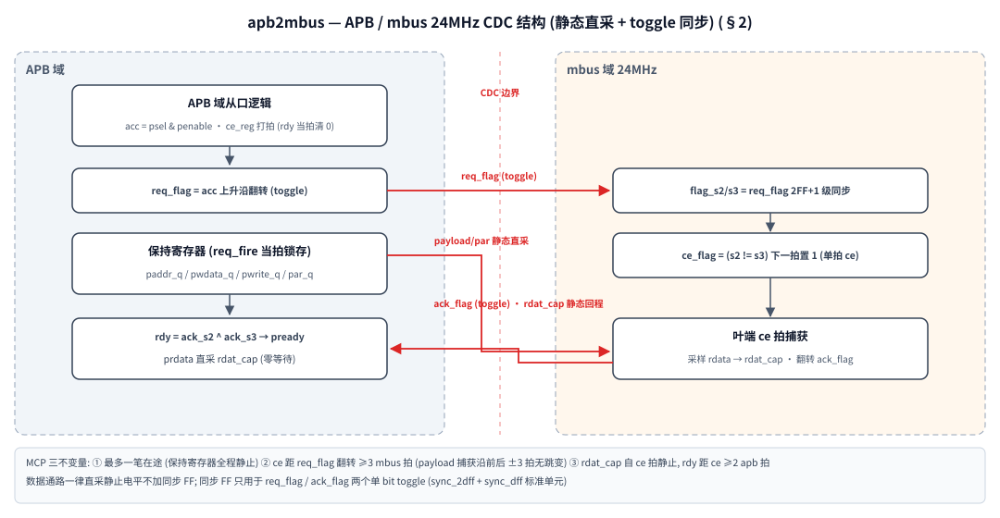

# apb2mbus — APB3 slave → mbus master 桥设计说明

X7A MCU System / TR4 / MCUSys / FuSa。APB3 从端 (apb_clk) 到 mbus 主端
(mbus_clk = 24 MHz) 的 CDC 桥, 面向 FuSa: 命令在途奇偶 + APB 域 hang
看门狗 + 双轨事件输出。CDC 采用 **MCP 直采结构** (静态数据直采 + 单 bit
toggle 同步, 同步一律例化标准 sync 单元)。

## 1. 接口

| 组 | 信号 | 说明 |
|----|------|------|
| APB3 (apb_clk) | paddr[15:0] / psel / penable / pwrite / pwdata → prdata / pready / pslverr | 标准 APB3 从端; 0xFF = 桥本地诊断面 (§3.6) |
| mbus (mbus_clk) | ce / wr / addr[15:0] / wdata[31:0] / par → rdata[31:0] / rpar | 主端, 叶端零等待 (组合读/单拍写); rpar = ^rdata 叶端回程偶校验 |
| 故障 (apb_clk) | hang_flt / hang_flt_n / rpar_flt / rpar_flt_n | hang 超时 / 读回程奇偶错**粘滞电平**双轨, 送 fchm (W1C 清, §3.6) |

越界实例: `NP ≤ paddr[15:8] < 0xFF` 时不发起 mbus 传输, 立即 pready + pslverr;
`paddr[15:8] == 0xFF` 命中桥本地诊断面 (§3.6)。

## 2. CDC 结构 (MCP: 静态数据直采 + toggle 同步)

数据通路一律直采"静止的电平", 不加同步 FF; 同步 FF 只用于两个单 bit
控制 toggle, 例化标准 sync 单元 (`../common_modules/sync_2dff.sv` / `sync_dff.sv`,
FPGA / ASIC 仿真 / ASIC 后端工艺 cell 三分支):



*图 1: APB / mbus CDC 结构 — 数据通路静态直采 (MCP 三不变量), 同步 FF 只用于 req_flag / ack_flag 两个单 bit toggle*

### 2.1 直采安全论证 (MCP 三不变量)

多比特跨域只有"被时钟链逐级采样"才有代际错位; 直采静态电平时, 亚稳态
由**时间**排除 (信号在被采样的时刻前后都不动), 不由 FF 级数排除:

1. **最多一笔在途** (ce_reg 边沿检测 + drain 屏蔽) → 保持寄存器从
   req_fire 到下一笔 req_fire 全程静止;
2. **ce 距 req_flag 翻转 ≥ 3 个 mbus 拍** (flag 同步链传播) → 叶端 ce 拍
   捕获时 payload/par 已静止 ≥ 3 拍; 下一笔 req_fire 必在 rdy (即 ce)
   之后 → ce 拍后也不动。捕获沿前后 ±3 拍无跳变;
3. **rdat_cap 自 ce 拍静止**; rdy (ack 同步链) 距 ce ≥ 2 个 apb 拍 →
   主设备采 prdata 时 rdat_cap 早已静止 (超时/越界/drain 路径输出 0)。

### 2.2 与早期链式版的关系 (演进说明)

早期为与 sysm_msync 同构的链式版 (payload/par 3FF 与 flag 同深度,
rdat 2FF, ack 4FF —— 4FF 是为给 2FF rdat 链让出 1 稳定拍: 两链
aperture 相互独立, ack 早捕 1 拍 + rdat 晚捕 1 拍时 3FF 会让主设备采到
旧 rdat_s2)。引入请求保持寄存器后 payload 与 flag 同沿翻转, 链间存在
**跨代混采的理论窗口** (mbus 采样沿落入两者 clk2q 偏斜窗时, flag 链领先
payload 链一代 → ce 携带旧负载; 且 par 与 payload 同源同深度, 一致落后
时奇偶兜不住)。MCP 直采从结构上消除该窗口 (无链可落后), 并省
~215 FF (payload 3FF + par 3FF + rdat 2FF + ack 1FF)。代价是直采跨域
路径需 SDC 约束 + CDC 工具声明 (§3.5), 窗口极宽, 时序无压力。

ack 回程级数下限说明: rdy 扇出到 pready/ce_reg/wait_ack/drain 四个
消费者, 未解析的 s1 若参与组合 XOR, 同拍采样可能分歧 → 边沿检测必须
"s1 吸收 + s2 解析 + s3 延迟" 三级 (sync_2dff + sync_dff), 不可再少。

## 3. FuSa 机制

### 3.1 命令在途奇偶 (par)

`par_q = ^{paddr, pwrite, pwdata}` 在 req_fire 当拍与 payload **同一沿**
锁存 (APB 域), 与 payload 同为静态直采 → 叶端 ce 拍比对时**必为同一代**
(同一个锁存事件的产物, 无链可落后)。叶端 (edc_regfile / cmm_regfile)
在 ce 拍用收到的负载重组比对, 失配 = 在途 1bit 损坏 → 门掉写 + PERR
(错位写/错实例读来源)。

注意: **par 与 payload 必须同代直达** — 要么都走链要么都直采; 混搭
(一个留链一个直采) 会产生跨代错位 (旧 par 配新 payload), 反而引入
误报/漏报。

保护边界 = req_fire 锁存点之后 (保持寄存器 + 跨域路径 + 广播通路 +
叶端捕获): 保持寄存器在途 SEU = payload 坏 / par_q 好 → 失配检出。
(早期"par 由 paddr_q 在 mbus 采样沿组合生成"的方案对保持寄存器 SEU
漏检 — 同源一致损坏; 已随 par_q 锁存修正。)

### 3.1.1 读回程奇偶 (rpar)

命令 par 保护去程 (APB→叶端), rpar 补齐回程 (叶端→APB) 的对称覆盖:
此前 rdat_cap 直采后 **无任何校验**, 读数据在返回通路上的单 bit 损坏
会静默进入 CPU。

- **叶端契约**: 每个 mbus 叶端 IP 无条件组合驱动 `rpar = ^rdata`
  (不做 wr 门控; 未选中叶端 rdata=0 → rpar=0, 与 rdata 同为 OR 网合
  并, 不需要额外使能)。
- **主端检查**: 本桥 ce 拍与 rdat_cap 同沿采样 `rpar_cap`, 完成拍比对
  `^rdat_cap != rpar_cap` → rpar_bad。**只查读** (`pwrite_q=0`):
  写周期叶端 rdata 无消费语义, 写向在途保护已由命令 par 承担。
- **检出处理 (fail-safe)**: 该笔 APB 读以 pready + pslverr 完成,
  prdata 驱 0 (坏数据不外送); 置 rpar 粘滞寄存器, `rpar_flt` /
  `rpar_flt_n` 电平双轨送 fchm, SW 经 STA_EVT W1C 清 (§3.6, 与 hang
  同模式)。SW 收 bus error 后重读目标寄存器即可恢复 (瞬时翻转重读
  成功; 叶内持久损坏由各叶自己的 STA_PAR 报)。
- **drain / 越界路径不触发**: 那两笔本身已 SLVERR, 语义是"完成状态
  未知", 不与回程奇偶混淆。
- **CDC 安全性**: rpar_cap 与 rdat_cap 同沿锁存、ce 拍后同样静止;
  rpar_bad 是 rdat_cap / rpar_cap / pwrite_q 三个静态寄存器的纯组合
  函数 → 直采安全性与 rdat_cap 完全相同 (§2.1 不变量 3 原文适用),
  无新同步结构。
- **覆盖能力**: 回程任意单 bit 翻转 (rdata 1bit 或 rpar 自身); 双翻转
  (数据+奇偶同时) 为 parity 极限, 文档化残余风险 (与命令 par 同级)。

### 3.2 APB 域 hang 看门狗 (bus-level hang protection)

mbus 叶端全部零等待, mbus 传输本身永不 hang; 唯一 hang 源是 CDC 链路:
mbus_clk 死/停顿、mbus 域复位卡死、广播通路断 → ack toggle 永不返回 →
pready 永久拉低, CPU 总线挂死。该故障只能在 apb_clk 域检测 (看门狗
计数必须依赖一个对端死掉时仍然存活的时钟), 故做在本桥内而不是各叶端:

- **timeout 强制完成**: req 发出后 ack 未在 HANG_TO 个 apb_clk 内返回
  → 当拍完成该笔 APB (pready=1, pslverr=1), CPU 收 bus error 而不是
  挂死; 置 hang 粘滞, hang_flt 电平双轨送 fchm (§3.6)。
- **DRAIN 重对齐**: timeout 后被延误的 ack 可能迟到 (如 mbus_clk 抖
  动); 迟到 toggle 若被误认为下一笔的 ack 会造成 rdata 错位 → 进入
  drain: 屏蔽新 req 发起, 新访问立即 pready+pslverr 快速失败, 直到
  迟到 ack 到达被消化, 链路自动恢复正常 (toggle 重新对齐)。mbus 侧
  永久死亡时 drain 保持, 后续访问全部快速 SLVERR, 不 hang。
- **计数器双轨 + 双比较 OR 触发** (同 ia_bus_timeo_core / cmm_regfile
  的看门狗惯例): 任一单点翻转立即强发事件 (fail-visible, 永不漏报)。
- **边界拍保护**: rdy 同拍优先, ack 恰在 timeout 拍返回时按正常完成,
  不误报。

timeout 后该笔访问实际可能已在 mbus 侧生效 (迟到完成) — SW 恢复流程:
收 SLVERR/hang_evt 后对目标寄存器重新读写确认 (与 PCIe completion
timeout 语义一致: 超时 = 完成状态未知)。

### 3.3 超时笔的执行语义与请求保持寄存器

在途的 req toggle **无法撤回** (cancel 信号自己也过不了死掉的时钟域;
等它能过去时请求可能早已被采样) — 超时后 mbus 恢复, 被延误的请求
**一定会迟到完成**, 这与 PCIe completion timeout 语义一致: 超时 =
完成状态未知。设计能做的保证是"迟到完成时动作正确":

- **请求保持寄存器**: req_fire 当拍把 addr/wdata/wr/par 锁存进 APB 域
  保持寄存器, mbus 侧直采保持值而不是活的 APB 引脚 → 迟到 ce 携带
  **原请求负载** (恰好一次, 地址数据正确), 与当时引脚值无关。消除了
  "迟到写携带当前引脚值误写他址"的窗口 (TB T5: T4 之后引脚是别的
  地址/读, 迟到的写仍以原负载落地)。
- **顺序**: drain 保证迟到笔消化完之前没有新请求上路, 不会乱序。
- **SW 约束**: 超时 = 完成状态未知。对幂等目标 (普通寄存器) 重试即
  可; 对非幂等目标 (FIFO push、W1C、清中断类) 重试前必须先读回确认
  原写是否已生效, 防止双写。

### 3.4 参数

| 参数 | 默认 | 说明 |
|------|------|------|
| NP | 2 | mbus 实例数 (地址译码越界判断; 合法 [1,255], 0xFF 为本地诊断面保留, §3.6) |
| HANG_TO | 64 | hang 看门狗阈值 [apb_clk 拍]。正常往返 ≈ 3 拍 mbus (req 同步链) + 1 拍 ce + 3 拍 apb (ack 同步链); 按最慢 mbus / 最快 apb 折算后留 ≥4× 裕量。默认 64 拍 (mbus 24 MHz / apb_clk ≥ 50 MHz 时约 5×) |

(不设 AW/DW 参数 — mbus 协议定宽 (地址 16b / 数据 32b), 参数化只会
允许破坏译码的非法配置, 徒增审查面。)

### 3.5 后端 signoff 要求 (MCP 直采的配套)

直采跨域路径必须加 datapath max_delay 约束 (否则后端不检查这些路径;
窗口给得很宽, 时序无压力):

```sdc
# 请求方向: 保持寄存器 -> mbus 域叶端捕获 FF (~2.5 个 mbus 拍)
set_max_delay -datapath_only \
  -from [get_cells {paddr_q* pwdata_q* pwrite_q* par_q*}] \
  -to   [mbus 域叶端捕获 FF]  100
# 返回方向: rdat_cap -> apb 域 prdata 消费 FF
set_max_delay -datapath_only \
  -from [get_cells {rdat_cap*}] -to [apb 域 prdata 消费 FF]  15
# 回程奇偶: 叶端 rpar XOR 树 -> mbus 域 rpar_cap 捕获 FF (与 rdata 网同类)
set_max_delay -datapath_only \
  -from [mbus 叶端 rpar 驱动] -to [get_cells {rpar_cap*}]  100
```

CDC 工具 (SpyGlass 等): 上述数据声明为 **MCP / quasi-static data**,
enable = 同步后的 ce / rdy; 否则会报"未同步多比特跨域"。

### 3.6 事件粘滞 + 0xFF 本地寄存器面 (apb_clk 域)

hang/rpar 检出后除当拍 fail-safe 总线行为外, 置粘滞寄存器: 电平双轨
送 fchm + SW 读出/清除/注错面。**粘滞寄存器与本地面全部在 apb_clk 域:
to_fire/rpar_err 本就是 apb 域单拍脉冲, 捕获零 CDC** (寄存器在对域的
dup_ctrl 才需要规则 23 全套跨域握手, 这里结构上不需要)。

寄存器面挂在从越界空间雕出的本地实例 0xFF (NP 因此收紧 ≤255):

| 偏移 | 寄存器 | 位定义 |
|------|--------|--------|
| 0x00 | ID | RO 32'h0000_424D ("BM") |
| 0x04 | STA_EVT | [0]FAULT = HANG\|RPAR (RO); [1]FAULT_N = ~FAULT (RO); [2]HANG / [3]RPAR (W1C); 静息读 0x2 |
| 0x08 | CFG_INJ | [3:0]key = 4'b1010 (错 key 整写忽略); [4]HANG_INJ / [5]RPAR_INJ 写 1 单拍命令; 读回 0 |

要点:

- **本地访问零等待且不受 drain 屏蔽** (mbus 半死诊断期间恰最需要读
  状态); 不进 req_flag/toggle 链、不置 wait_ack (不触发看门狗)。
  未映射本地偏移 pready+pslverr (与越界同 fail-visible 语义)。
- **粘滞 = 双寄存器互补存** (q 与 q_n 独立 FF, 同源同项、次态互补,
  端口直出寄存器 — 端口处组合取反做不到): 存储单翻 (SEU) → 两轨
  失配, fchm 侧轨校验可检。次态 set 优先:
  `q_hang = (to_fire|inj_h) | (q_hang & ~w1c_h)`,
  `q_hang_n = ~(to_fire|inj_h) & (q_hang_n | w1c_h)` (互补恒可证)。
  合法 APB 单事务串行下 set 源 (远端事务) 与 W1C (本地面写) 不同拍
  可达, 优先写法为防御式。
- **注错 OR 在 set 项 (检测源侧)**, 与真实事件共用 寄存器→端口→W1C
  同一通路: 注错会真实抬 fchm 端口电平 (运行期注错窗口协调进 safety
  case); 不进 to_fire/rpar_err 组合项 → 不假完成传输/不进 drain/
  不污染当笔 prdata/pslverr。
- **语义认账**: 粘滞清除前的多笔事件合并, 无 per-event 边沿 (每笔
  hang 本就伴随总线 SLVERR, SW 有逐笔证据; fchm 需计数自行打边沿)。
  W1C 连端口一起清, apb2mbus 侧完全 SW 可控 (fchm 内部若再锁存,
  清除属 fchm 自己的流程)。
- **esm_core 直接输入仍是事件脉冲契约** (≥1 拍); fchm 转发 ESM 时
  level→pulse 转换在 fchm 侧做。


| define | 分支 | 说明 |
|--------|------|------|
| `FPGA` | FPGA | 行为 RTL + ASYNC_REG 属性, Vivado/Quartus 识别为同步器链 |
| `ASIC_SYNCELL` | ASIC 后端 | 例化工艺库 hardened cell; 须同时 `SYNC_2DFF_TECH_CELL=<cell名>` / `SYNC_DFF_TECH_CELL=<cell名>` 注入单元名, 端口映射按工艺库手册调整 |
| (都不定义) | ASIC 仿真 (默认) | 行为模型; GLS 时由网表替代 |

## 4. 验证

`sim/tb_apb2mbus.sv` (VCS 与 iverilog 双过), hang 看门狗专项 +
常时检查, 98 checks 全过 (VCS 2026-11-10 实测; LINE / BRANCH 100%,
TOGGLE 排除结构性死位后 100%, 见 `sim/tgl_struct_excl.el`) (TB 对
CDC 实现透明, MCP 直采化后原样全过):

| 组 | 内容 |
|----|------|
| T1 | 正常写/读往返 (inst0/inst1), 无误响应, 无 hang 事件 |
| T2 | 越界实例: 立即 pready+pslverr, 不发起 mbus 传输 |
| T3 | mbus_clk 停 (时钟死亡): 当笔 ~HANG_TO 拍后 SLVERR 完成 + 置 hang 粘滞 (hang_flt 电平), mbus 侧无 ce |
| T4 | drain 期新访问: 1 拍快速 SLVERR, 不发起 mbus 传输, 无二次事件 |
| T5 | mbus_clk 恢复: 迟到 ack 消化 (drain 自清), 被延误的写迟到生效, 链路恢复正常写读 |
| T6 | hang_flt/hang_flt_n 双轨互补常时检查 (粘滞电平) |
| T7 | ce 拍命令奇偶 par == ^{addr,wr,wdata} 常时检查 |
| T8 | slave 恢复瞬间立即访问: drain 未释放窗内立即 SLVERR (不挂死); 迟到 ack 消化 (drain 自清) 后访问恢复正常 |
| T11 | 读回程奇偶 rpar (§3.1.1): 好读通过 / 坏 rpar 读 → pready+pslverr+prdata 驱 0 + 置 rpar 粘滞 (rpar_flt 电平, W1C 清) / 坏 rpar 写不触发 (只查读) / drain 窗迟到 ack 坏 rpar 不触发 / 坏读后重读恢复 / rpar_flt_n 互补常时检查 |
| T12 | 0xFF 本地面 (§3.6): ID 读 "BM" / STA_EVT 静息读 0x2 (FAULT_N=1) / W1C 清对应粘滞且 FAULT/FAULT_N 同拍翻转 / CFG_INJ 读回 0 / 未映射本地偏移 pready+pslverr / 本地访问不产生 mbus ce |
| T13 | 注错 (§3.6): key=1010 写 HANG_INJ/RPAR_INJ → 对应粘滞置位, fchm 端口电平真实抬升 (STA=0x5/0x9/0xD), W1C 可清; 错 key (…B) 整写忽略; 注错双置后复位全清 |
| T14 | 本地/远端交错: 本地访问零等待 (不占握手拍数), 远端访问照常 ce; mbus ce 计数只统计远端事务 |
| T15 | drain 期本地读: 不被 drain 屏蔽, 读出 hang 粘滞 STA=0x5, W1C 治愈; 同窗远端访问仍快速 SLVERR |

**drain 释放时序** (T8 的重点): mbus_clk 恢复后, 被延误的请求要先走
同步链→ce→ack (~5 个 mbus 拍), ack 再经同步链回 apb 域产生 rdy 脉冲才
清 drain — 即恢复后约 ~25 个 apb 拍 (24MHz mbus / 100MHz apb) 内 drain
仍为 1。**此窗口内的 APB 访问立即 SLVERR (快速失败, 不挂死), 这是设
计语义而不是故障**; drain 自清后的第一笔访问即正常。SW 恢复流程:
收到 SLVERR 后重试即可, 无需额外操作。

本仓相对 `2.parity` 原件的差异:

RTL:
1. **请求保持寄存器** (§3.3): req_fire 当拍锁存 payload, mbus 侧采保
   持值 — 修复"迟到写携带当前引脚值误写他址"的窗口。原件仍是活引脚
   采样。
2. **MCP 直采化** (2026-10-29): payload/par/rdat 去除同步链直采静态
   电平 (三不变量见 §2.1); par 改为 req_fire 同沿锁存 par_q (覆盖保持
   寄存器在途 SEU); ack 4FF → sync_2dff+sync_dff; 同步链一律例化
   sync_2dff/sync_dff 标准单元 (FPGA/ASIC 仿真/ASIC 工艺 cell 三分支)。
   省 ~215 FF; 同时消除"保持寄存器与 flag 同沿翻转导致的链间跨代混采"
   理论窗口 (§2.2)。
3. **事件粘滞 + 0xFF 本地诊断面** (2026-11-10, §3.6): hang/rpar 检出
   置 apb_clk 域粘滞寄存器 (q/q_n 双 FF 互补存), 电平双轨送 fchm;
   SW 经 0xFF 面 STA_EVT W1C 清 / CFG_INJ key=1010 注错; NP 收紧
   ≤255。原件无任何本地寄存器面, 事件只有单拍脉冲端口。

TB:
1. **双仿真器兼容**: task 内 `return` → done-flag 退出 (iverilog 不支
   持 task return; VCS 下 `disable task` 不回拷 output 参数)。
2. **HANG_TO 16 → 64**: 16 拍与正常往返 (~17 apb 拍 @ apb 100MHz /
   mbus 24MHz) 零裕量, rdy/timeout 每拍竞争, 各笔随机超时 (T1b/T1c
   即因此失败); 64 = RTL 默认值及 §3.4 的 ≥4× 裕量规则。
3. **T3c 时序对齐**: to_fire 后等 4 拍再查 hang_evt_seen (事件寄存
   1 拍 + seen 锁存 1 拍)。
4. **新增 T8**: drain 释放窗内访问快速失败 + 自清后恢复正常。
5. **事件粘滞化 + T12-T15** (2026-11-10, §3.6): 原双轨脉冲端口常时检查
   改查粘滞电平; 新增本地面/W1C/注错/本地远端交错/drain 期诊断五组
   (T12-T15 + T10c 注错后复位清), checks 62 → 98。写后检查粘滞端口
   需 `repeat (2) @(posedge apb_clk)` 让 NBA 落地 (TB task 在 active
   region 返回)。
